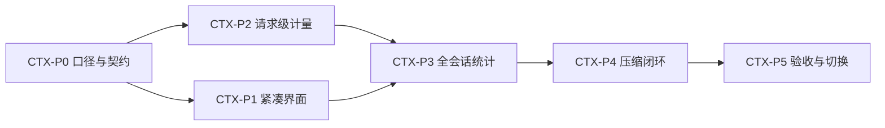

# AI 助手上下文与用量设计草案

> 状态：已批准的设计与实施输入；2026-11-11 用户授权 CTX-P0～P5 全阶段分批实施，批次完成后集中检验。公开语义以[D148](../06-决策记录/V7-冻结决策.md#d148-ai-助手上下文用量与显式压缩)、[FR-006 AC45～AC47](../03-功能规格/V1/02-应用模块/06-AI工作台.md#ac45-紧凑上下文与有效快照)和[技术设计](../03-功能规格/V1/02-应用模块/06-AI工作台-技术设计.md#d148-上下文用量与压缩增量)为准。下文现状为设计时快照，不代表当前实现状态；实际进度和证据仅见[V1实现状态](当前版本/V1-实现状态.md)。不改变既有宿主预算、凭据、权限和额外计费确认边界。
>
> 目标：采用用户指定的 CLI Agent 用量样例的信息层级，把当前说明书式面板改为紧凑、可扫描、可操作的用量卡片；同时补齐真实统计能力，而不是只换皮肤。

## 1. 结论

界面只回答三个问题：**下次请求还能装多少内容、这个会话已用了多少、何时需要压缩。**

推荐采用“环形入口 → 紧凑用量弹层 → 按需详情”三级结构。一级弹层保留一个上下文卡片、一组会话统计和一个详情入口；正常状态不放解释段落、不放原始字节与拒绝码、不展示摘要正文、不要求滚动。

保持 AI 助手与 CLI Agent 的运行时边界。可以借鉴视觉和纯展示组件，不复用 CLI 原生压缩命令或把 CLI 回执当成助手用量。AI 助手的“压缩”明确指生成较早对话摘要用于后续请求，不是删除消息、无损压缩或压缩草稿附件。

## 2. 设计依据与现状快照

### 2.1 已检查的参考

- 用户提供的当前界面截图：说明段落、发送条件、估算方法、字节上限、用量范围、整理说明同时常驻，信息过载且出现长滚动。
- 用户指定的 [4186 交互样例](http://127.0.0.1:4186/)：实际打开用量弹层、点击压缩、按 Escape 关闭并重新打开。默认浏览器视口 1365×768 下，弹层实测宽 350px、高 450px，内有上下文卡片和六行统计。
- 样例明确显示“演示数据 · 无 CLI 调用”；压缩仅演示占用率从 53% 变为 16%。这不是实际模型调用或压缩成功证据。
- 样例的“输入”数值不包含缓存读取，三项相加才得到总计；其缓存命中率按缓存读取占全部输入计算。正式界面不能保留歧义标签。

### 2.2 当前代码提供了什么

| 领域 | 观察到的事实 | 设计影响 |
| --- | --- | --- |
| 上下文估算 | `contextUsage()` 使用预估输入加输出预留；窗口未知不算百分比 | 保留预算口径并始终标注“预估”，不冒充服务商精确占用 |
| 主机限制 | `inspect_context()` 返回独立主机文本上限，图片预留已包含在输入中 | 主机超限可能发生在模型百分比很低时；不能只看模型进度条 |
| 刷新 | 当前面板随草稿、附件、材料、技能、工具、模型等变更，350ms 防抖检查 | 复用检查链路与旧响应隔离，不通过调用模型来刷新估算 |
| 当前统计 | `reportedUsage()` 只累计已加载的结束态助手消息 `total_tokens` | 不能把它直接改名成“会话总计” |
| Provider 用量 | `TokenUsage` 有输入、输出、总计；`UsageLog` 有延迟、请求关联和是否回报标志 | 可以扩展链路，但这些字段尚不等于完整会话统计 |
| 缓存 | 公共 `TokenUsage` 未单独保留缓存读取、缓存写入和推理 token | 完整参考功能需要适配器解析、规范化和持久化，不可由总数反推 |
| 摘要 | `summarize_context()` 已有显式确认、运行排他、幂等、成功安装摘要与保留原消息机制 | 沿用现有流程，新增产品化反馈；不重新创建压缩执行器 |

证据入口：[现有面板](../../src/components/chat/ContextPanel.tsx)、[统计计算](../../src/components/chat/contextUsage.ts)、[当前样式](../../src/components/chat/contextUsage.css)、[宿主检查与摘要](../../crates/dgos-workbench/src/chat/continuous.rs)、[Provider 用量类型](../../crates/dgos-types/src/provider.rs)、[聊天 store](../../src/stores/chatStore.ts)。

约束依据：[AI 助手主规格](../03-功能规格/V1/02-应用模块/06-AI工作台.md) §3.5、[V1 冻结决策](../06-决策记录/V1-冻结决策.md) 中 D018、D074、D081，以及 [D141 运行时命名边界](../06-决策记录/V7-冻结决策.md)。现状为本轮读取的工作区快照，不替代[唯一实现状态](当前版本/V1-实现状态.md)。

## 3. 界面设计

### 3.1 输入区入口

- 位置不变：模型、推理强度之后，发送或停止按钮之前。
- 以小环形占用指示替代常驻“上下文 —”文字；正常状态只有环，不额外显示百分比文字。
- Hover 和键盘聚焦显示“上下文预估 53% · 查看 Token 用量”等简短提示；点击、Enter、Space 打开，不能依赖悬停操作。
- 无窗口数据时用中性空环表示未知，不画成 0% 已用；可访问名称明确“上下文容量未知”。
- 接近上限使用警示色；实际阻断使用错误色和可识别状态标记，不能只靠颜色。
- 弹层打开时有明确选中底色。缩小图形而不缩小命中区：桌面命中区至少 32px，触屏至少 44px，保持周围间距。

### 3.2 一级用量弹层

从入口向上展开，右侧对齐，预留 8px 间距。视觉对齐参考页，不引入新主题。

| 部分 | 内容 | 规则 |
| --- | --- | --- |
| 标题 | 仪表图标 + Token 用量 | 标题不夹带“可发送”“等待输入”等常驻状态句 |
| 上下文卡片 | “上下文窗口”、小号“预估”标记、突出百分比 | 只表达下一次请求预算，不是累计消耗 |
| 卡片进度 | 单一进度条 | 不用多段色块暗示目前没有的精确组成占比 |
| 卡片底行 | 预估占用 / 模型容量 Token；“压缩”按钮 | 简写为 k/M；精确整数和输出预留移到详情 |
| 统计范围 | 本会话 | 必须独立于已加载消息分页；部分记录缺失时显示“部分已回报” |
| 统计列表 | 总计、输入、输出、缓存读取、缓存命中率、生成耗时 | 左标签右数值，单位与口径一致；无数据不补零 |
| 底部 | 查看详情 | 在同一弹层切换到详情页，有返回；不叠开第二个 Popover |

“缓存读取”用缩进与“其中”关系体现它是输入的子集。缓存写入、推理 token、最近一次请求、按模型明细等只在数据存在时出现在详情，不把每种字段都堆到首页。

尺寸基线：350px 宽，视口不足时限制为可用宽度减两侧 16px；中文常规字号下正常态目标约 430–470px 高。外层内边距 20–24px、圆角使用现有浮层 token；内卡间距约 16px；统计行约 30px 高。标题 14–15px/600，指标标签 13px，容量辅助行 12px，百分比约 20px/600。正文使用系统现有字体，数字启用等宽数字，不引入额外字体。

颜色使用 `--surface-popover`、`--surface-card`、`--border-subtle`、`--text-primary`、`--text-secondary`、`--accent-default` 及现有警示/错误 token。正常进度使用主题强调色，缓存状态可用成功色；不硬编码参考页的浅色背景。只有上下文区域有内卡，统计列表不用逐行卡片。

浮层必须避让视口边缘及输入区关键操作；低高度或放大字体时可以内部滚动，这是响应式例外，不以裁切内容维持固定高度。Escape/点击外部关闭，关闭后焦点回入口；打开后不抢走输入区草稿，不自动展开技术详情。

### 3.3 二级详情

按阅读任务分组，默认不暴露底层诊断：

1. **下一次请求**：预估输入、输出预留、模型容量及来源、估算更新时间；说明图片已包含在输入，预估不是账单。
2. **本会话用量**：最近一次/累计，统计范围、已回报与缺失覆盖情况；有来源才展示缓存写入、推理或模型维度。
3. **压缩记录**：最近成功时间、摘要覆盖的对话范围、可展开摘要；原消息仍可在会话中查看。
4. **技术详情（折叠）**：主机文本字节上限及使用量、工具/技能字节、估算方法、脱敏拒绝码。不显示凭据、完整敏感调用内容或无必要的原始回执。

常用解释应可键盘访问，不能只藏在 tooltip。异常直接在相关卡片内给一句影响和一个针对性动作，不要求用户打开详情才知道无法发送。

## 4. 统计口径

### 4.1 上下文：下一次请求预算

- 预估占用 = 宿主预估输入 + 输出预留。输入已经包含图片预留，不能再次相加。
- 已知且语义适用的总窗口：百分比 = 预估占用 / 总窗口。整数百分比用于展示，不用四舍五入结果判断阈值。
- “预估”始终可见；当前算法为保守字节预算，不是模型 tokenizer 的精确计数。不得展示“精确剩余 token”。
- 容量只来自可信模型元数据或用户已保存的明确配置，不凭模型名称推断。服务商若提供的是纯输入上限，适配层必须区别于输入输出合计窗口，不能拿两种口径混除。
- 未知窗口时：保留已知预估量，显示“约 1.5k / 容量未知”，无百分比、无确定填充进度条。“未知”不代表可以无限发送。
- 页面空草稿时可显示当前上下文预算；不显示“发送前请输入”之类表单提示。发送按钮自行处理空输入。
- 模型切换即废弃旧窗口结果；编辑期间保留同一模型的上次有效快照并标记“更新中”，不能把旧快照当成新草稿的已检查结果。跨会话/账户不保留旧值。
- 生成中显示“上次检查”快照，不假装实时 token 进度；终态重新检查。不可读当前快照时显示未知，不沿用其他模型或会话的数据。
- 80% 起显示“接近上限”；更高占用可加强视觉提示，但只有宿主判定拒绝才写“无法发送”。主机字节超限单独说明“本次内容超出发送限制”，不能用模型进度条掩盖。
- 已省略历史时显示“部分较早对话不会带入本次请求”，配“压缩”入口。草稿/附件超限则优先“检查材料”，不要暗示压缩旧对话必然解决所有超限。

### 4.2 用量：本会话已回报消耗

| 指标 | 推荐定义 | 未知与部分数据 |
| --- | --- | --- |
| 总计 | 本会话所有真实模型请求中已回报的规范化总量，含工具循环中的模型调用及压缩请求 | 无任何有效回报为“—”；有缺失显示“部分已回报”，不是账单保证 |
| 输入 | 全部输入 token，包含缓存读取/写入所代表的输入部分 | 不把缓存再次加进总计；不可从总量倒推 |
| 输出 | 服务商回报输出；若推理已经包含其中，不重复相加 | 缺失为“—”；只有原始字段明示才可显示 0 |
| 缓存读取 | 输入中的缓存读取子集 | 不支持为“未提供”；混合覆盖为“部分”，精确覆盖范围进详情 |
| 缓存命中率 | 同一组有完整缓存语义的请求：缓存读取之和 / 对应全部输入之和 | 分母为零或口径不全为“—”；不可平均单次百分比，也不可跨不同覆盖集合相除 |
| 生成耗时 | 会话内模型请求执行时长累计，包含压缩；排除用户思考、工具执行和审批等待 | 不用会话创建至今的时差冒充；有缺失标记部分 |

建议不用原型的“总耗时”标签，因为用户容易理解为完整任务墙钟时间。若将来需要任务总时长，应另行定义，不能混在生成耗时里。

统计范围限定当前账户的当前会话，不跨应用、会话或账户累计。切换模型不清空会话用量，上下文窗口则立即切换到新模型。压缩成功通常降低下一次上下文预算，但会新增一次真实请求消耗，因此会话累计不会随进度条一起下降。

会话统计必须由宿主在持久数据上聚合，不随加载更多消息变化。覆盖成功、失败和中断中实际回报的用量；未知费用不记成零。空会话可显示“尚无用量”；明确没有请求时的 0 与有请求但无回报的“—”是两种状态。

### 4.3 数据链路与迁移建议

1. 在现有 Provider 适配和公共用量模型中保留可空明细、来源及是否回报；核对各协议缓存/推理是否为输入输出子集。不要用一个 `supported` 布尔值代替每个字段的有效性。
2. 在现有持久用量链路关联到宿主派生的账户、会话、运行和真实调用尝试；请求 ID 重放不重复计量，真正再次发出的请求独立计量。工具循环多次请求不能被最终回复总数覆盖。
3. 选定一个权威计量来源，不把 Provider 日志、运行总量和消息总量重复相加。优先核实既有 `UsageLog.request_id`/`caller` 关联能否覆盖普通生成、工具循环、压缩与失败终态；能复用则扩展现有链路，不先造第二套账本。
4. 宿主聚合返回会话汇总及字段覆盖情况；前端只格式化和投影，不扫分页消息伪造全量。
5. 历史关联可证明的才回填；历史只有 `total_tokens` 时可以保留总量，但输入/输出/缓存继续未知。不可按时间接近或模型名称把旧日志猜配到会话。
6. 若需要数据变更，只追加 migration；保留既有历史和审计语义。统计读取失败不能阻断正常聊天，显示“用量暂不可用”；真实预算拒绝仍独立生效。

以上属于 L3 数据一致性增量。开发前应把统计范围、缓存公式、请求去重、历史覆盖和时长定义落实到直接关联的正式决策、契约及技术设计；本稿不把字段草案冒充已经存在的 API。

## 5. 压缩交互

### 5.1 操作流程

- 上下文卡片内唯一主操作为“压缩”。首次点击打开现有确认组件，文案：
  - 标题：压缩较早对话？
  - 说明：将使用当前模型生成摘要，用于后续对话。原消息保留，部分细节可能不再随请求发送；会额外调用模型并可能产生费用。
  - 按钮：取消 / 确认压缩。
- 不默认勾选免确认，不在达到阈值后自动发起收费请求。
- 确认后原位置显示“压缩中…”，禁止重复提交；关闭弹层不取消运行。停止沿用现有运行停止入口。
- 同账户存在互斥运行、尚有未确认执行结果、没有可压缩历史或目标不可用时禁用操作，并给可读原因。窗口未知本身不是禁用压缩的原因。
- 候选历史由宿主判定，不能仅凭当前已加载消息推断“没有历史”。再次发送新的历史后，应重新判断可压缩资格，而非永久锁定“已压缩”。
- 成功以摘要实际安装的宿主终态为准，重新检查当前草稿预算后显示实际变化。刷新失败时显示“压缩完成，用量待更新”，不编造下降百分比。
- 比较前后占用只在同模型、同草稿、同材料等预算输入未变化时进行；否则只显示新的快照。
- 如果占用没有下降，明确显示“压缩完成，预估占用未降低”，不宣称必然节省。容量未知时可以比较同口径 token 估算，不造百分比。
- 失败不安装新摘要，旧上下文保持有效；结果未知不自动重试，先核实已有运行。后续用户主动重试是新的可能计费请求，不悄悄重放。

### 5.2 首屏状态矩阵

| 场景 | 展示与操作 |
| --- | --- |
| 正常 | 预估占用、会话统计、压缩，正常态无说明段落 |
| 窗口未知 | 容量未知、无百分比，保留可用统计与压缩 |
| 接近预算 | 卡片内一句“接近上限”，按问题提供压缩或检查材料 |
| 历史省略 | 一句“部分较早对话不会带入”，不假装完整上下文 |
| 真实阻断 | 指明内容或模型限制及解决动作；用量统计仍可读 |
| 检查中 | 同上下文保留最近快照并标记更新中，首次用稳定占位，不跳高 |
| 生成/压缩中 | 上次上下文快照 + 运行状态；已结算统计不清零 |
| 服务商不回报 | 对应项显示“—”或“未提供”，不显示假的零或命中率 |
| 部分历史数据 | 本会话旁标“部分已回报”；详情解释覆盖范围 |
| 压缩失败/未知 | 一句结果说明 + 查看执行情况，不自动重试 |

## 6. 分阶段实施方案

### 6.1 计划性质与最终交付

2026-11-11 细化。本节取代原 A/B/C 粗分；保留同一份工作稿，不另建平行计划。`CTX-P0`～`CTX-P5` 是本稿稳定任务标识，不是功能、正式 AC、接口或 migration 编号。用户已授权全部实施；阶段完成度以唯一实现状态为准，不由本稿提升证据等级。

最终交付必须同时具备：紧凑用量浮层、可信上下文预估、持久的全会话统计、真实缓存与时长数据的能力适配、显式压缩闭环、旧会话和缺失数据处理。服务商确实不提供某项时显示未知属于正确行为；适配器本应支持但尚未实现，不得用“未提供”掩盖未完成。

所有阶段沿用 §3～§5 的产品设计，不重复定义布局、公式和状态文案。实现进度与验证只在现有 V1 实现状态文档集中维护，本稿只维护任务、依赖和出口。

### 6.2 新核对出的实施约束

| 代码事实 | 风险 | 本计划处理 |
| --- | --- | --- |
| `chat.rs` 中 `ExecutionProvenance.request_id` 使用任务 ID；工具循环共用运行绑定 | 用运行 ID 唯一约束会吞掉同一运行的多次真实模型请求 | 保留运行关联，增加宿主生成的调用尝试身份；同一调用回执幂等，真正再次派发是另一尝试 |
| `UsageLogRepository.create_with_provenance()` 每次插入生成 UUID；`list()` 最多返回 100 条 | 日志行 ID 本身不能防重复；前端拉日志求和会截断长会话 | 数据库唯一约束与定向会话聚合，不复用最近日志列表作为统计 API |
| `ProviderRepository.delete()` 同事务删除该 Provider 的用量日志 | 直接 JOIN Provider 日志会使保留会话的历史累计缩水 | 推荐会话保有运行级、逐调用用量事实，生命周期独立于 Provider 配置；Provider 审计保留原删除语义 |
| 部分 Provider/执行链路以 token 大于 0 判断是否回报 | “明确回报零”与“未回报”在上层已不可区分 | 从协议解析起携带回报存在性；正式语义先对照 D074/D081，不改 UI 来伪装解决 |
| 当前日志存储把输入输出转换为 `i32`，当前统计也有 `i32` 累计路径 | 长会话聚合不能照搬窄整数计算 | 新会话计量与聚合采用检查过的宽整数，传输边界明确安全整数范围；只修改受影响消费者，不顺带重构所有旧报表 |

补充证据：[Provider 日志仓储](../../crates/dgos-db/src/repositories/usage_log_repository.rs)、[Provider 删除](../../crates/dgos-db/src/repositories/provider_repository.rs)、[聊天执行入口](../../crates/dgos-workbench/src/chat.rs)、[共享执行核心](../../crates/dgos-workbench/src/execution.rs)。这些是代码读取结论，不是本轮运行测试结果。

### 6.3 阶段与依赖

| 阶段 | 目标与交付 | 进入条件 | 阶段出口 |
| --- | --- | --- | --- |
| CTX-P0 口径与最小契约 | 统计语义、调用身份、历史与删除策略、数据一致性及下一切片契约 | 本稿及现有规格 | 无阻断下一切片的语义冲突，相关公开变更获准并进入权威文档 |
| CTX-P1 紧凑界面 | 环形入口、上下文卡片、二级详情、简短异常；继续使用真实现有数据 | P0 的展示与快照边界明确 | 用户实际可打开、阅读、操作；旧数据范围明确，无假明细 |
| CTX-P2 请求级计量 | 协议规范化、可空明细、调用尝试、持久化与恢复 | P0 的计量契约与保留策略明确 | 每次真实调用可唯一结算；缓存不重复、未知不计零；升级和故障可验证 |
| CTX-P3 全会话统计 | 宿主聚合、查询契约、store 接入、六项统计及覆盖范围 | P2 的持久事实稳定；UI 接入依赖 P1 | 普通对话与多轮工具、压缩记录均可按会话统计，不受分页和 Provider 删除影响 |
| CTX-P4 压缩闭环 | 宿主资格、确认、真实执行状态、结果核实、前后预算与用量刷新 | P1 的交互、P3 的统计可消费 | 压缩从用户确认到摘要安装、重新估算和累计结算完整贯通 |
| CTX-P5 验收与干净切换 | 旧会话、失败边界、视觉、桌面 IPC、支持矩阵和文档收口 | P1～P4 完成，阶段问题已归并修复 | 在明确支持范围内端到端可用，无旧口径残留、模拟数据或未实现分支 |

P1 与 P2 可在契约确定后并行；P4 的文案与确认界面可提前随 P1 完成，但数据刷新和成功判定必须等 P3 后验收。安全、去重、未知语义随对应阶段实现，不留到 P5 才补。每阶段出口是可验收能力，不是“代码已编译”。

### 6.4 CTX-P0：口径与最小契约

| 工作包 | 具体内容 | 完成判定 |
| --- | --- | --- |
| CTX-P0-01 统一口径 | 落实 §4；列明各已支持协议的 input/output/cache read/cache write/reasoning/total、明确零与缺失、累计或增量流事件、输入窗口与总窗口语义 | 同一个规范化输入可以得出唯一结果，不用模型名或数值差猜字段含义 |
| CTX-P0-02 身份与保留 | 定义账户→会话→运行→调用尝试关系；明确 Provider 删除、会话删除、账户删除和历史回填 | Provider 删除不让保留会话累计缩水；会话/账户删除遵守现有隐私与审计边界，不额外保留统计副本 |
| CTX-P0-03 查询与快照契约 | 明确上下文快照修订、逐字段覆盖、会话统计响应、压缩资格和当前运行关联 | 前端无需猜全量范围、压缩资格、当前/过期快照或缓存分母 |
| CTX-P0-04 正式化下一切片 | 将真实变化写入 FR-006、直接受影响的 Provider 规格、IPC/共享 DTO 与技术设计；只有新的公开语义才追加决策，分支映射沿用仓库规则 | 明确覆盖 D074/D081 的零/未知增量与删除保留政策；规格允许后续实现，不冒充已验证 |

**推荐数据契约（逻辑字段，尚非已注册 API）：**

- 逐调用事实：宿主所属账户/会话/运行/调用尝试身份、调用用途、模型来源、是否已派发、结算状态、规范化 token 明细、各明细回报状态、执行时长、规范化口径版本。数值为非负且可空，显式 0 不等于 null。
- 覆盖情况：每项提供适用调用、已知调用和缺失调用的覆盖；若旧历史无法枚举真实调用次数，则覆盖为历史不完整，不伪造计数。缓存命中率的分子分母固定来自同一可比较集合。
- 会话查询：由宿主验证当前账户与 session 所有权；返回累计值、覆盖状态、统计修订和必要的最近调用信息，不返回敏感提示词、凭据或原始服务商正文。
- 上下文快照：绑定模型、草稿、材料、技能、工具、生成参数和摘要修订；前端本地序号用于拒收过期结果，宿主预算仍是发送依据。快照不持久化敏感草稿作为统计数据。
- 压缩资格：可压缩与原因、可覆盖的历史范围、已有摘要修订；提交时再次验证，不将预检查资格当授权或永久有效凭证。

**持久化推荐取舍：**复用现有 Provider 解析和计量入口，不创建第二个计数器；对聊天增加归属于运行的最小用量事实投影，以同一个调用尝试标识关联 Provider 审计。会话总计只读运行侧这一来源，不再把消息、运行汇总和 Provider 日志相加。与 Provider 审计同库时优先在同一事务结算，避免“审计成功、会话漏记”；清理 Provider 审计后运行侧事实仍在，不能保留密钥或敏感请求正文。

这不是两个可独立写入的账本：规范化只能有一个入口，会话事实唯一约束、提交时点、审计失败传播及清理关系必须在 P0 技术设计中确定。若核对发现能在现有表内同时满足生命周期与归属约束，可采用更小的表结构，但不能改动上述外部语义。

**阶段验收：**Given 同一运行含两次模型调用且一次无用量回报，When 推演会话汇总、重复回执和 Provider 删除，Then 已知值保留、未知覆盖不丢、第二次真实调用不被去重、重复回执不增加总数。必须给出明确定义，而不是留“待实现时决定”。

### 6.5 CTX-P1：紧凑界面与上下文状态

**改动落点：**现有 `ContextPanel.tsx`、`contextUsage.ts`、`contextUsage.css`、`src/i18n/locales/zh-CN/chat.ts` 与英文对应文件。复用已有 `@dgos/ui` Popover/Modal 和主题 token，不改 CLI Agent 数据源，不扩大共享组件契约；仅在组件职责确实过大时局部拆分。

| 工作包 | 实施内容 | 退出场景 |
| --- | --- | --- |
| CTX-P1-01 一级与详情 | 实现环形入口、内卡、统计区和同浮层返回式详情；解释、字节、摘要正文下沉；异常短文案保留 | 常规桌面下无需滚动可读核心项；未知窗口不画 0%；键盘可进入详情并返回 |
| CTX-P1-02 快照状态 | 复用防抖检查；同目标编辑时标记上次快照更新中；模型/账户/会话变化废弃旧值；生成中保留可识别上次检查 | 快速切模型和连续编辑时，旧响应不能覆盖新目标；检查失败不显示新草稿已就绪 |
| CTX-P1-03 现有能力接入 | 使用真实宿主预算及现有摘要确认；保留字段来源，不用样例数字拼满六行 | 未有 P3 时明确“已加载用量”，缺失明细不伪装成支持；现有发送、材料、技能入口不失效 |

本阶段是完整的呈现切片，不是全功能交付。不得在生产代码中留假统计服务、模拟成功压缩或待实现回调；设计场景数据只可放现有预览/测试环境。P3 切换后删除旧的已加载累计展示，不永久保留两套统计模式。

**验证：**现有 `tests/chat-context-usage.test.tsx` 保留图片不重复、未知与零区分等语义测试；补充有风险的过期响应/模型切换交互。实际打开修改后的 AI 助手浮层检查正常、未知、超限、详情、Escape 和焦点返回，不以截图样例或 React 静态渲染替代真实界面验证。

### 6.6 CTX-P2：请求级计量与持久事实

**改动落点：**`crates/dgos-types/src/provider.rs`、现有 Provider 适配器与 `manager.rs`/`stream.rs`、`crates/dgos-workbench/src/execution.rs` 与聊天调用入口、`crates/dgos-db` 实体/仓储/追加 migration。所有共享类型改动先查引用并迁移受影响调用方，包括现有调试台和非聊天消费者；不改变它们的权限或统计范围。

| 工作包 | 实施内容 | 退出场景 |
| --- | --- | --- |
| CTX-P2-01 规范化用量 | 解析输入、输出、缓存读写、推理和总量；完整/缺失/不支持分别表示；流式累计值按协议替换而非逐块相加 | 相同实际 usage 经非流式与流式路径得到相同口径；缓存和推理不重复计量 |
| CTX-P2-02 调用尝试生命周期 | 沿现有模型派发边界生成身份并记录用途；区分未派发、在途、已结算、未知；同运行多次调用独立记录 | 重复终态只结算一次；一次工具循环含多个调用全保留；真正的新调用不被旧运行 ID 吞掉 |
| CTX-P2-03 持久化与恢复 | 追加迁移、唯一约束与索引；落实单一规范化写入口和一致事务；中断/取消/超时保留已回报用量 | 重启能重读已有结算；派发后崩溃无回报显示未知，不自动重发模型请求 |
| CTX-P2-04 历史与生命周期 | 仅精确关联的旧数据回填；其余保留未知或明确历史总量；落实 Provider/会话/账户清理规则 | 升级不丢旧消息；Provider 删除不减少保留会话用量；账户隔离、会话删除不遗留新的统计数据 |

历史总量与逐调用明细不能相加：同一运行选定一个来源；只有完整逐调用来源才整体取代该运行历史总量，否则保留历史总量并单独标识明细覆盖。消息与运行同一结果只能选其一。没有可靠关联时不按时间戳猜配，也不从 total 反推 input/output/cache。

生成耗时从实际模型派发到该调用终态测量，使用单调时钟；聚合不包含本地排队、用户审批、工具执行和落库耗时。重启丢失结束时刻时保留未知，不用会话时间差补算。未派发拒绝不计为模型调用消耗。

不新增重试机制或扩大自动重试范围。若既有调用路径有真正的重试，每次实际派发分别计量；无法证明上游是否执行时保持未知，不承诺外部“恰好一次计费”。

**阶段验收：**普通回复、两次模型调用夹一次工具执行、摘要请求、明确零、无回报、流中断、重复终态、派发后重启、审计写失败分别可重现；同一调用不能重复累计，失败的未知结果不能被清成零。

### 6.7 CTX-P3：全会话统计与前端接入

**改动落点：**聊天仓储与应用服务的公开查询、对应 Tauri command/共享 DTO、`src/stores/chatStore.ts`、现有用量面板。最终命令名及共享类型在 P0 依据仓库命名冻结，不在本稿虚构现成入口。

| 工作包 | 实施内容 | 退出场景 |
| --- | --- | --- |
| CTX-P3-01 宿主聚合 | 按所有权和 session 做数据库定向聚合；使用调用级事实和唯一历史来源规则，输出各字段覆盖和缓存可比较集合 | 超过 100 次调用仍完整；读消息分页前后总计不变；无权 session 不可查询 |
| CTX-P3-02 查询生命周期 | 会话进入、有效调用结算、压缩终态时刷新；在途只显示已结算值及状态，不按每个 token 刷新数据库 | 切账户/会话时取消或拒收旧响应；查询失败只影响用量，不阻断聊天 |
| CTX-P3-03 六项展示 | 切换为“本会话”；接入总计、输入、输出、缓存读取、命中率和生成耗时；覆盖不足有轻量标记 | 同范围可比较时 total/input/output 关系正确；部分缓存只在详情解释部分覆盖，不冒充全会话命中率 |

新会话尚无调用、生成中尚无结算、服务商无回报、历史覆盖不足、明确回报零是不同状态。UI 必须保留这些区别，不以空数组、请求失败或字段缺失统一显示 0。

**阶段验收：**Given 同会话跨模型、跨多页消息且包含一次压缩，When 重启并删除一个 Provider 配置后重新进入，Then 已保留的会话累计不变；模型窗口按当前模型展示；另一账户不能读取；统计请求失败可继续正常发送。

### 6.8 CTX-P4：压缩操作闭环

**改动落点：**现有 `inspect_context()`/`summarize_context()` 及摘要运行查询、`ContextPanel`、chat store。使用原有摘要执行器与显式计费确认，不调用 CLI 原生压缩，不把生成摘要和安装成功视为同一事件。

| 工作包 | 实施内容 | 退出场景 |
| --- | --- | --- |
| CTX-P4-01 宿主资格 | 根据摘要覆盖和可用历史返回资格与原因；提交时复验运行排他、目标、来源及账户；关闭浮层不停止已确认运行 | 无可压缩历史时不发收费请求；有未加载历史仍能正确判断；历史或目标变化不能沿用旧资格 |
| CTX-P4-02 连续状态 | 确认、提交、执行、安装成功、失败/未知均绑定同一运行；保留去重；未知优先读已有运行核实 | 双击不二次派发；关闭重开仍看到当前状态；失败不覆盖旧摘要，不自动收费重试 |
| CTX-P4-03 双刷新 | 摘要安装后分别刷新上下文预算和会话用量；旧快照不可比较时不计算下降幅度 | 预算刷新失败显示待更新；统计刷新失败不抹掉已成功摘要；压缩用量计入会话且不随占用下降而减少 |

对比规则固定非历史输入（模型、草稿、材料、技能、工具、生成参数）一致；摘要版本允许从旧版变为本次安装的新版本，这正是比较对象。两次估算都有效才展示差值，否则只展示当前快照。窗口未知允许比较同口径估算 token，不显示百分比。

**阶段验收：**在成功、取消、模型请求失败、摘要安装失败、结果未知、预算刷新失败、统计刷新失败和压缩期间编辑草稿场景中，均能看到正确结果和下一步；不出现“安装失败却显示已压缩”或“压缩成功就保证下降”。

### 6.9 CTX-P5：集中验收与切换

本阶段合并执行跨层验证，不重新为每处小改动跑全量。每阶段已有证据在受检代码未变化时复用；共享字段、持久化和桌面 IPC 的实际变化必须验证。

| 验证面 | 现有入口或资产 | 应证明什么 |
| --- | --- | --- |
| 统计与交互边界 | `npx vitest run tests/chat-context-usage.test.tsx tests/chat-workbench.test.tsx` | 图片不重复、快照隔离、未知/零、详情和确认行为；按实际场景更新原测试，不固定措辞和 DOM 实现 |
| Provider 规范化 | `cargo test -p dgos-providers` | 已支持协议的缓存、推理、流式累计、字段缺失和明确零；不以固定 fixture 证明真实兼容 |
| 持久化/隔离/升级 | `cargo test -p dgos-db` | 追加迁移、重放幂等、旧来源去重、Provider 清理、会话与账户隔离；本批涉及仓储多边界才使用 crate 级验证 |
| 实际聊天运行路径 | `cargo test -p dgos-workbench --test chat_generation --test chat_tools --test chat_paging` | 普通回复、模型工具循环、摘要请求和分页；复用现有 summary/replay 场景扩展，不另造执行器 |
| 契约与前端构建 | `npm run contracts:check`、`npm run build` | 共享 DTO/command 参数与所有受影响消费者一致；这不是运行成功证据 |
| 桌面真实路径 | 构建成功后 `cargo test -p dgos --features webview-smoke --test webview_smoke_chat -- --nocapture` | 实际 IPC 与改后的用量浮层/压缩入口；需扩展现有 smoke 使它真正覆盖新增查询与状态，不能凭旧命令通过就称覆盖 |
| 可视与键盘 | 实际 AI 助手界面，覆盖浅深色、中英文、窄窗口、放大字体 | 用户能读完核心信息、找到压缩/详情、关闭并返回焦点；无裁切与误导百分比 |
| 真实 Provider 能力 | 沿现有获准 smoke 路径，对本轮宣称支持的协议调用；先确定模型、外发内容与次数/费用界限 | 对照实际回报字段、持久事实与页面值；服务商未产生缓存命中时不能宣称已验证真实命中路径 |

以上命令是后续目标入口，本轮未运行代码测试或桌面 smoke。永久测试只覆盖可观察行为、边界和状态转换；临时脚本用于验证运行路径，完成后移除。迁移需使用可丢弃旧库副本，不能拿用户工作数据库做破坏性试验。

现有 `tests/chat-context-usage.test.tsx` 中“已加载消息合计”测试在 P3 切换后随 obsolete helper 删除或迁移为新会话契约测试；保留图片预算和未知语义，不继续把旧范围重新固定为需求。公共用量模型变更波及的其他消费者测试按引用更新，不把它们留到用户遇到类型或运行错误时再修。

**切换清单：**

1. 生产面板只使用新会话查询；删除旧 `reportedUsage()` 的面板用途、无剩余调用时删除函数及过时文案/测试。不保留隐藏开关或兼容分叉。
2. 运行数据由真实回执驱动，移除开发预览的临时接线；原型仍明确是演示，不成为业务 fallback。
3. 确认已加载范围、会话范围、缓存分母、耗时与压缩语义一致；对每个支持协议记录“本地替身/真实调用/未验证”，不升级证据等级。
4. 持久变更采用追加迁移；回退业务版本前核对旧程序是否兼容新增 schema，不运行破坏性的 down migration、不删除新记录来伪造回退。必要时前滚修复。
5. 只回写受影响规格、契约及唯一实现状态；集中运行文档检查。仅当交付文档浏览器或合并门禁要求时更新派生浏览器。

缺少真实调用授权或桌面环境时，继续完成所有可验证本地切片，单独保留对应证据门槛；不能把整体状态写成“完整验收”。不因某个服务商不支持缓存而阻断其余已支持能力，也不能把未开发的适配器标成服务商不支持。

### 6.10 责任划分、阶段交接与范围控制

- 口径/集成负责人：维护 P0 契约与调用生命周期，拥有共享类型、跨层迁移和最终切换；接口未确定前不让各层自行猜字段。
- 前端工作包：负责 P1 及 P3/P4 的展示接入；不自行计算会话账本，不编辑 Provider 规范化规则。
- 计量工作包：负责 P2 与 P3 的宿主聚合；只读数值事实，不持久化完整提示词、工具参数或凭据。
- 验证由对应工作包随功能完成，P5 统一收口。共享文件同一时点由一个集成负责人修改，界面与后端可以按已定契约并行推进。

每阶段交接只记录：改动入口与契约版本、已执行场景与结果、数据迁移状态、未覆盖范围、下一阶段需要的事实。无可验证结果不推进；不要求为每个工作包新建文档或重复登记同一证据。

第一组可执行任务为 CTX-P0-01～04；契约明确后推进 P1 与 P2，随后按依赖完成 P3～P5。不承诺日历工期或用主观百分比代替阶段出口。

本计划不调整宿主 24 KiB 等预算政策、不启用自动压缩、不新增金额/账单或账户级统计看板、不修改原生 CLI 控制、不建立新的模型执行循环。原型的大窗口数值不是放宽宿主发送限制的依据。

## 7. 拟验收场景（待纳入正式规格）

以下是后续开发验收建议，不是已通过的测试记录。

- 已有可信窗口和预算，打开弹层后，应在正常桌面高度内无需滚动即可看到上下文和六项统计；一级无估算方法长段落和原始字节。
- 模型未提供窗口时，应显示容量未知且无百分比；切换模型后旧窗口不得闪现为新模型结果。
- 图片预算已计入输入时，展示总预算不得再次加图片预留；模型占用低但主机拒绝时必须显示发送限制。
- 加载更多历史、关闭再开会话、重启后，本会话累计不得因消息分页或重复回执增加；账户隔离不得泄露另一账户数据。
- 普通回答、工具循环多次模型调用、压缩、失败后已回报用量，都按实际调用计一次；未回报不得算 0。
- 有缓存读取的请求中，输入包含缓存，缓存不再次加入总计；部分缓存覆盖不能显示为全会话命中率。
- 空会话与有未知回报的旧会话应区分；不支持字段显示未提供，真实回报 0 才显示 0。
- 压缩确认前不发模型请求；重复点击/重放不重复计费；失败、停止和未知结果不伪造成功，不自动重试。
- 压缩成功安装摘要后原消息保留、累计消耗不倒退、预算重新检查；若草稿或模型变更，不展示失真的压缩前后对比。
- 中英文、浅深色、窄窗口和放大字体下不横向溢出或裁切；键盘可打开、进入详情、返回、确认/取消和 Escape 关闭，焦点回到入口。

## 8. 设计证据与实施边界

设计阶段已实际检查参考弹层的打开、压缩演示、Escape 关闭及重新打开，并核对计量、删除和测试入口。原型只提供演示交互，不是生产验证。实施阶段按用户要求集中运行必要测试，实际代码、桌面和外部验证结果只回写唯一实现状态；没有独立外部调用授权时，不擅自使用真实凭据产生费用。

本稿采用用户指定样例和仓库既有设计 token。UI/UX 技能库的渐进披露定向检索未返回适用条目，因此分层建议来自参考页观察、现有代码和通用可访问性原则，不宣称有额外检索证据。
