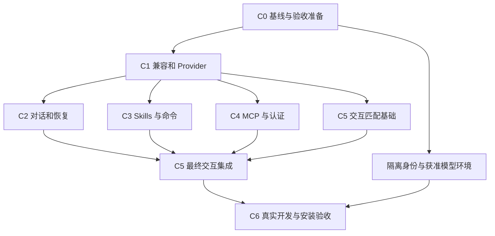

# V7 编程项目工作台方案草案

> 状态：草案，供方案讨论；2026-11-04。用户已明确优先完善基于 Codex 与 Claude Code 的项目管理及编程能力，允许按需要完善 Provider、Skills、MCP；同时保留服务 DG-OS 内部应用与模块的方向。本轮为方案推进，不代表业务实现授权、正式契约冻结或 V7 整体通过开发门禁，不分配功能、IPC、错误码或 migration 编号。

> 2026-11-07 更新：双运行时定位、统一 Skills/MCP 管理及可复用 AI 宿主服务已由用户确认，依据 [D136](../../06-决策记录/V7-冻结决策.md#d136-双运行时分工与统一能力管理)；本轮整体实施计划见 §12。§1～11 保留早期设计与历史切片依据，其中混合能力注入、原生 Provider 来源和模块复用延后等冲突内容由 D136 与 §12 取代，不作为新实现目标。现有代码是否完成切换只见实现状态。

> 2026-11-10 更新：用户要求完成 CLI Agent 的桌面端产品化，覆盖自动准备、项目授权复用、旧会话现场恢复、`/` 技能、多会话生命周期、任务降噪及运行预览 / 终端闭环。完整增量范围、阶段依赖和验收目标统一见 [CLI Agent 桌面端产品化推进计划](V7-CLI-Agent桌面端产品化推进计划.md)。该计划不重编号本页历史阶段、不提升 V7 门禁；涉及授权、恢复与目录并发的行为变化按其阶段 0 先收口权威契约，实际状态仍只写唯一实现状态。

来源：[V7 规划](V7-AI-Agent.md) · [CLI 适配设计](V7-AI-Agent-CLI适配设计.md) · [D127/D132](../../06-决策记录/V7-冻结决策.md) · [实现证据](../当前版本/V1-实现状态.md#2026-11-04-agent-本机分发验证)。本草案是本轮编程工作台方案的单一讨论入口；D132 绘画边界保留，当前不优先推进绘画集成。

> 阶段1增量授权：用户于2026-11-04明确授权“项目管理与任务基础”独立实现，见[D134](../../06-决策记录/V7-冻结决策.md#d134-项目管理与任务基础独立切片)与[阶段1技术契约](V7-项目任务基础技术契约.md)。本草案其余范围继续为讨论稿；实施和验证状态只见V1实现状态，不据此提升V7整体门禁。

> 阶段2增量授权：用户于2026-11-04明确授权“编程执行与代码变更审查”，文件、基线、事件、保留及权限边界见[阶段2增量契约](V7-项目任务基础技术契约.md#7-阶段2增量契约编程执行与代码变更审查)。该授权不包含阶段3；实现与验收证据只在V1实现状态维护。

> 阶段3增量授权：用户于2026-11-04明确授权“直接编辑、运行验证与开发服务”，文件保存、PTY/服务所有权、关闭和验证语义见[阶段3增量契约](V7-项目任务基础技术契约.md#8-阶段3增量契约直接编辑运行验证与开发服务)。不进入阶段4；实现与证据只在V1实现状态维护。

> 阶段5增量授权：用户于2026-11-04明确授权“任务隔离、Git交付与跨引擎继续开发”，目录身份、Git操作、恢复及交接边界见[阶段5增量契约](V7-项目任务基础技术契约.md#10-阶段5增量契约任务隔离git交付与跨引擎继续开发)。不进入阶段6；实现与分级证据只在V1实现状态维护。

## 1. 目标与完整交付范围

让用户在 DG-OS 中导入或建立一个代码项目，选择 Codex 或 Claude Code，持续完成需求讨论、代码修改、调试、测试、运行预览、变更审查、提交及后续维护。用户可以自己编辑和运行，也可以交给 Agent；两种操作共享可见的项目状态。

“完善”按完整开发闭环验收，不能以能聊天、生成单文件或某个切片可用代替整体完成。

| 能力 | 本方案目标 |
| --- | --- |
| 项目管理 | 导入本地目录、创建空项目、克隆仓库、最近项目、重命名显示名称、定位失效目录、归档与解除关联 |
| 仓库与工作目录 | 普通目录及 Git 仓库、分支状态、已有修改识别、任务 worktree、冲突展示；不自动清理工作区 |
| 开发任务 | 目标、验收要求、上下文、执行会话、阻塞与待审查状态、验证证据、任务历史 |
| 编程 | 阅读及搜索代码、多文件修改、基础文本编辑、错误定位、测试与构建、继续修复 |
| 开发运行 | 命令输出、交互终端、可配置开发命令、长驻服务启动/停止、端口和预览入口 |
| 变更交付 | 文件级 diff、用户审查、明确选择提交内容、提交与推送、任务间隔离及安全丢弃 |
| 连续工作 | 应用重启后恢复项目和任务、原生会话恢复、会话不可恢复时保留任务及代码、跨引擎交接 |
| 能力管理 | 项目级模型来源、Skills、MCP、指令和权限配置，以及实际生效来源与版本 |

完整交付包含基础代码编辑与交互终端。可以先实现文件查看和命令输出，再交付编辑/终端；外部编辑器入口是补充，不替代完整目标。代码智能补全、断点调试、多用户协同、远程开发容器与自主多 Agent 编排属于后续扩展，不作为本轮闭环依赖。

## 2. 已核对的实现起点

下表为源码结构核对，运行证据引用实现状态，不产生新的运行通过声明。

| 当前依据 | 可复用部分 | 本方案要补齐的部分 |
| --- | --- | --- |
| `crates/dgos-agents/src/manager.rs` 的 SessionRecord、AgentManager | 用户归属、目录、原生会话索引、两家生命周期 | 独立项目、开发任务、执行尝试及验证关联；现有会话索引不能直接承担这些职责 |
| `src/pages/workbench/AgentWorkbench.tsx` | 配置、消息、原生审批、中断、关闭、工作面关闭协调 | 项目文件与变更、任务组织、运行服务、验证与审查工作面 |
| `src/stores/agentRunnerStore.ts` | 当前会话快照、刷新和账户重置 | 当前仅一个选中会话投影；多个项目/任务切换需要独立状态和明确订阅归属 |
| `crates/dgos-skills/src/content_manager.rs`、PreparedContent | 已校验内容、版本与 hash、用户启用及来源记录 | 原生技能资源加载适配；当前正文准备不等于完整技能包在 CLI 中可执行 |
| `crates/dgos-mcp/src/manager.rs`、`crates/dgos-application/src/module_mcp.rs` | 连接、凭据、工具 schema、审批、调用取消与来源绑定模式 | Agent 专用可信调用上下文和接入端点；不能伪装成现有模块调用者 |
| `crates/dgos-providers/src/credentials.rs`、ProviderManager | Provider 配置、模型管理及宿主凭据访问 | 编程引擎协议兼容验证、按引擎解析运行配置；现有聊天适配器不能视为完整 CLI 协议代理 |

保持 Rust 宿主与现有应用服务分层；前端不直接读数据库、不提交任意身份或原始引擎 RPC。复用两家原生编程循环，不在 DG-OS 再建一套重复的工具推理循环。

## 3. 用户操作闭环

1. **打开项目**：导入目录、创建空目录或克隆到指定的新目录。显示路径、仓库根、分支、已有修改及原生配置来源；读取清单不执行依赖安装、Hooks 或项目脚本。
2. **准备环境**：识别清单中的构建/测试/运行脚本，显示执行目录及命令供用户选择。依赖安装、项目初始化是显式执行操作。单仓多包项目支持命令级子目录，首轮默认一个项目根，不自动扩展到其他目录。
3. **建立任务**：记录目标与完成判定，选择引擎、工作目录模式、上下文及能力配置。直接输入请求也能创建轻量任务，不要求填写冗长表单。
4. **讨论与执行**：同一任务可先分析方案再改代码。展示当前运行、工具请求、审批、问题、命令与错误；用户可编辑需求、补充资料、中断后继续。
5. **运行验证**：选择项目命令或让 Agent 执行必要检查，保留执行目录、命令、退出码、时间及被验证的代码版本标识。启动服务后展示真实就绪状态及预览入口。
6. **审查交付**：展示现存改动与任务期间变化、测试结果及未覆盖项。Agent 可以建议交付，任务进入待审查；用户确认完成与执行 Git 提交是两项独立操作。
7. **继续维护**：项目关联多个历史任务，任务可重新打开；恢复原会话或建立新会话，任务目标、变更和证据仍在。更换引擎建立新的原生会话并交接摘要。

工作面按项目组织，提供任务/会话、文件/编辑、变更、运行/终端、能力配置几个区域。具体布局、快捷键和组件选型在流程确定后单独设计，不把本草案当作已实现 UI。

## 4. 数据归属与存储建议

以下是逻辑对象，字段名不是冻结 API 或数据库物理结构。

| 对象 | 最小信息与归属 | 生命周期 |
| --- | --- | --- |
| Project | owner、显示名称、项目根引用、仓库标识、配置引用 | 归档/解除关联默认不删除磁盘代码；路径丢失时保留记录 |
| Workspace | project、真实目录、原目录/worktree 模式、分支、仓库公共目录标识 | 校验目录身份；分支和磁盘状态每次执行前重读 |
| DevelopmentTask | project、目标、完成判定、工作目录、状态、上下文引用 | 会话退出不删除任务，重开任务保留旧证据 |
| Run | task、engine、原生会话引用、启动配置快照、运行状态 | 一个任务可有多次执行；每次原生会话仅属于一个引擎 |
| CapabilityProfile | 项目选择的 Provider 引用、Skills 版本、MCP 范围、权限选项 | 修改生成新修订；已运行会话保持其实际生效快照 |
| ExecutionRecord | task/run、命令或工具、状态、退出码、日志引用 | 有界保留并脱敏，长驻服务独立记录，不以 PID 单独认领进程 |
| VerificationRecord | 命令、结果、代码快照标识、时间、覆盖范围 | 代码变化后显示过期；模型说“已通过”不能生成通过证据 |
| ChangeReview | 基线、当前变更、审查结论、提交引用 | 当前目录变化重新校验；不声称任意差异都由 Agent 产生 |

建议项目与任务元数据放 SQLite，日志及较大快照放账户隔离的应用数据目录，仓库源文件留在原位置。开发记录不是完整敏感输入输出的常规日志：秘密、令牌不得进入元数据和普通日志，运行输出采用限制访问与脱敏策略，敏感文件不自动加入上下文。

现有 `agent-sessions.json` 迁移建议：升级时幂等导入归属及原生会话引用，无任务信息的历史会话进入待归类列表，不虚构开发任务；事务成功后新存储成为唯一写入源，失败保留旧文件并阻止半迁移准入。迁移格式和退回策略须在正式实现设计中冻结，不能长期维持双写。

## 5. 状态、并发与文件安全

任务状态建议为待开始、进行中、阻塞、待审查、已完成、已取消。运行状态继续区分启动中、等待输入/审批、执行中、空闲、失败、已关闭和结果未知。正常结束一轮不自动完成任务；中断不撤销已发生的修改。

### 5.1 工作目录与 Git

- 默认导入原目录，展示导入前已有修改；用户无需先把仓库清理干净。新任务可选择独立 worktree，但从指定提交创建的 worktree不包含原目录未提交修改，界面必须说明。
- 同一真实工作目录默认只允许一个 DG-OS 写入执行者；用户编辑器不受这把锁控制，保存前用内容版本检查防覆盖，并标记外部变更。只读分析也须依赖引擎实际限制，提示词不是只读保证。
- 并行写任务使用独立 worktree；共享 Git 索引、分支创建、合并等仓库操作另按公共仓库目录串行协调。跨账户同路径不得通过不同项目 ID 绕过宿主冲突检查。
- 非 Git 目录支持阅读、编辑、运行与任务管理，不展示虚假的 Git 回滚/提交能力；可明确选择初始化 Git。
- 默认支持文件级审查。恢复旧内容前核对当前文件版本与任务边界；不能安全归属时要求人工审查，禁止用全仓 reset/clean 实现“丢弃本次任务”。独立 worktree 移除前检查未提交/未合并工作及活动服务。
- 暂存、提交、切分支、合并和推送使用明确操作；不默认 `add all`，用户已有暂存内容须单列。冲突保留现场，不自动强推。提交或推送结果未知先检查实际仓库/远端状态，不盲目重复。
- 文件读取/写入须处理符号链接、目录越界、大小限制、二进制和编码；导航默认尊重忽略规则，明确操作可查看被忽略文件。目录信任不能自动授权所有外部路径。

### 5.2 命令与服务

- 宿主手动运行命令以受控结构保存程序、参数、cwd 和环境引用；需要 Shell 语义时显式标注 Shell，不用隐式字符串拼接。交互终端使用独立 PTY 生命周期，与 Agent 原生工具执行分别标明来源。
- 项目建议的安装/构建脚本是待执行内容，识别成功不构成执行授权。预检检查 Git/运行时/CLI 可用性，不自动更改全局环境。
- 长驻服务记录所属项目和启动实例，检测端口冲突及明确就绪信号；进程仍活着不等于服务就绪。不对不属于 DG-OS 的进程发送停止信号。
- 页面关闭、任务中断、项目关闭和应用退出分别定义动作。建议关闭页面可保留服务；关闭项目时展示活动执行供选择；应用退出默认停止 DG-OS 所属服务。不得只凭旧 PID 在重启后杀进程。
- 外部预览以浏览器打开本地服务为初始路径；若嵌入，则使用无宿主特权的独立页面，不能让项目网页取得主应用 IPC。

## 6. Provider、Skills、MCP 同步完善范围

### 6.1 Provider：复用管理，分别验证引擎兼容性

原生配置路径继续可用。项目选择 DG-OS Provider 时，由宿主按引擎支持的方式解析模型、端点与认证，不把普通聊天协议包装成“兼容所有编程智能体”。兼容状态按引擎版本、服务协议和模型组合记录。

最低验证包括真实多轮、流式返回、工具调用与工具结果回送、错误终态及恢复。没有验证的组合明确标记未验证，不以模型列表可读取或聊天成功冒充兼容。

凭据不写入仓库、前端 DTO 或常规日志。若原生引擎必须获得凭据，应明确它进入受信任 CLI 进程内存/环境的边界，不能声称永远不离开宿主。是否使用兼容转发端点须依据真实协议验证决定，本轮不预先承诺建设通用代理。

### 6.2 Skills：显式项目选择与版本固定

复用安装来源、用户启用、版本与内容 hash。项目明确选择哪些 Skills 提供给本次引擎；区分正文指令、附带资源、可执行脚本与 Hooks，安装/启用技能不等于授权执行脚本。

优先采用引擎支持的会话/项目作用域加载方式。具体加载方式需要按两家实测；不支持隔离加载时不得偷偷写全局配置。涉及写项目原生配置时先展示变更，保护已有同名技能、用户修改和相对资源路径。

需要展示：来源、固定版本、支持的引擎、已配置/加载失败/加载已证实状态。能力配置优先级不能覆盖两家真实原生规则；不能确定最终值时标记来源未解析，不宣称已知有效配置。现有 PreparedContent 的正文不能替代整个资源包兼容验证。

### 6.3 MCP：两种连接所有权，避免重复启动

- **原生 MCP**：沿用引擎已有配置，由 CLI 负责连接和权限；界面标记原生来源，不能声称经过 DG-OS 调用审计。
- **DG-OS 管理的 MCP**：建议由宿主持有连接，向指定 Agent 运行暴露受限 MCP 入口，复用现有 schema、凭据、审批和取消语义。只暴露项目选择的 Server/工具，不直接导出长期凭据。

受限入口需要新增真正的 Agent 可信调用上下文，绑定账户、项目、任务、运行及短期授权。模型不能自填调用者身份；工具清单过滤不替代调用时授权。优先验证会话绑定 stdio 通道；若使用 loopback HTTP，须设计短期凭证、来源隔离、过期和撤销，不能暴露无认证本地端口。

同一运行不能同时以两种模式隐式连接同一 Server。工具 schema 变化使旧确认失效；取消只保证停止等待或后续调度，已产生外部副作用不能伪装回滚。原生引擎审批和宿主业务授权都必须满足，界面应说明各自范围。

此处是对现有“不自动同步”边界的显式接入提案；不是已经修改 D127。正式实现前记录新增决策及可验证的加载/连接契约。

## 7. 应用与模块复用边界

编程工作台首先消费引擎、运行、能力配置、身份授权和执行记录这些公共能力。项目、Git、diff 和开发服务属于编程领域，不强塞进所有应用任务。

未来模块通过公开宿主入口提供任务需求、允许的上下文引用和工具集合，获得受限运行与结果引用；模块身份由宿主派生。业务资产仍由应用自己的领域服务保存。开发 DG-OS 模块的代码属于编程项目；运行中的模块使用 Agent 属于应用调用，两者权限不继承。

不向模块开放任意 Shell、目录、环境或原始 CLI RPC。原生工具无法被可靠限制时，只能用于明确授权的本地编程场景，不能把提示词限制包装成应用沙箱。完整的应用工具桥接后续实现；本轮通过编程场景及一个应用用例做设计走查，避免提前制造无调用者的通用抽象。

## 8. 事务、恢复与验证可靠性

| 场景 | 建议处理 |
| --- | --- |
| 项目创建/克隆中断 | operation 先持久化意图，再在事务外操作文件；只清理本次创建且确认无用户修改的目录，其他残留展示恢复选项 |
| 新任务启动 | 校验账户/目录/配置并获取工作目录租约，记录启动意图；事务外启动 CLI，确认后绑定 native ID；启动结果未知保留核实状态 |
| 消息提交超时 | 稳定请求 ID 及输入摘要防止重复点击；无法确定原生结果时不自动重发，不承诺跨崩溃恰好一次 |
| CLI 崩溃/原生历史缺失 | 保留任务和文件，运行标失败或未知；允许用户在同任务新建会话并显式交接，不伪造原生历史 |
| 文件保存与元数据记录不一致 | 记录待核实操作，通过当前内容核实，不把数据库回滚当作文件回滚 |
| 配置变化 | 新修订仅对新运行生效；撤销权限立即阻止新调用，已发外部调用状态单列；正在运行的原生进程权限如何收紧须由引擎能力决定 |
| 验证后代码变化 | 将证据标为过期，保留原记录。HEAD 相同不代表代码相同，标识必须考虑相关未提交文件及运行期间变化 |
| 账户切换/退出 | 延续 lease 撤销和进程监督，拒绝旧账户后续响应；新增终端/服务也纳入所有权清理 |

数据库事务不跨模型网络调用、Git 克隆或进程等待。外部执行失败不得用自动重试掩盖未知结果。超时、取消宽限和日志保留限额应在各正式接口确定后给出可测值，不直接沿用不相干调用的时限。

## 9. 实施切片与验收场景

以下是建议顺序；每个切片都有可运行交付物，但全部切片及关联边界满足前不能宣称完整项目编程能力完成。

| 切片 | 交付内容 | 验收场景 |
| --- | --- | --- |
| A 项目基础 | 导入/创建/克隆、项目索引、目录身份、任务与会话归属、旧会话归类 | 打开已有脏仓库和非 Git 目录；重启后找回；目录移动可重新定位；跨账户不可访问元数据 |
| B 编程闭环 | 文件搜索/查看、Agent 多文件修改、diff、审批/中断/恢复、运行记录 | 两家分别修复真实多文件问题；保留用户已有修改；失败命令能定位并继续修复 |
| C 直接开发与验证 | 基础编辑、交互终端、项目命令、长驻服务和预览、验证证据 | 用户与 Agent 交替修改；外部编辑冲突不覆盖；启动真实应用验证；端口冲突和服务退出明确显示 |
| D 能力接入 | 项目能力配置、兼容 Provider、固定 Skills、DG-OS MCP 受限入口 | 两家均加载指定技能与资源、调用获准工具；拒绝未选择工具；撤销配置不串项目/账户 |
| E 任务隔离与交付 | worktree、提交/推送、冲突与安全丢弃、跨引擎交接 | 两个任务在独立目录工作；用户暂存内容不混入提交；冲突保留；换引擎继续任务而不伪装恢复 |
| F 集成收口 | 故障恢复、数据迁移、实际安装版、辅助技术与日志边界 | 应用重启/CLI 崩溃/索引失败后不丢代码；安装版完成项目开发全链路；敏感数据不进入普通记录 |

验收使用两个可回退的真实小项目：一个有前后端或开发服务器的项目，一个有编译与测试的项目；两家分别完成新增功能、修复问题、运行验证、审查和继续开发。依赖可用性按项目单独记录。真实 CLI/服务与确定性故障 fixture 分级报告，不用 fixture 提升模型兼容结论。

受控新增回归仅覆盖边界行为：外部编辑冲突、任务串写、审批撤销、未知结果重复提交、旧配置恢复、用户暂存区保护和验证过期。最终命令按实际实现入口确定，本草案不虚构尚不存在的测试脚本。

## 10. 推荐取舍与正式实现前的裁决点

用户已确定：编程项目能力优先；两个 Agent 均为目标；Provider/Skills/MCP 可同步完善；应用/模块方向保留。以下为助手推荐方案，尚未逐项冻结：

| 事项 | 推荐 | 理由与边界 |
| --- | --- | --- |
| 项目工作方式 | 原目录默认，隔离并行任务使用 worktree | 支持现有开发习惯，避免强制迁移；不能保证外部程序遵守宿主锁 |
| 编辑能力 | 完整目标包含基础编辑与交互终端 | 项目开发不依赖另一个编辑器才可完成；不承诺完整 IDE 功能 |
| 任务完成 | Agent 建议、证据可查、用户确认 | 模型完成回复不等于测试或需求验收成功 |
| 引擎切换 | 新会话＋明确任务交接 | 不混用原生历史和审批；上下文摘要可由用户检查 |
| 配置治理 | 原生与 DG-OS 管理来源并存且明确标识 | 不破坏已有工作流，新增接入显式授权 |
| MCP 管理连接 | 优先宿主受限入口，先双引擎技术验证 | 复用凭据与审批，避免另一套连接生命周期；具体传输尚需验证 |
| 代码与项目删除 | 解除关联不删代码；删除文件/任务 worktree独立确认 | 保护本地已有工作，不把项目列表操作变成文件清理 |

进入正式实现前须裁决：新项目任务能力是否作为独立技术任务获准、正式规格范围；原生配置优先级及显式发布方式；Agent MCP 可信身份与通道；旧索引迁移和文件恢复规则。对编程独立任务的批准不能冒充 V7 整体门禁通过；项目本地开发不应被未使用的画布/云服务技术依赖阻塞，但全局版本依赖的调整需另行记录。

已知 CLI 问题纳入编程验收：Codex 重复用户消息显示；Claude 首轮回复偏离需按原生 CLI/SDK/服务分层定位。对关键操作依赖实际授权和工具结果，不以首轮正确回复作为权限边界。发布签名、公证及跨平台缺口继续见实现状态。

## 11. 本轮交付与后续讨论

本轮仅新增方案草案并在 V7 规划中指向此优先方向；没有创建产品表、改写 CLI 配置、调用模型或执行开发任务。草案依据当前源码和既有运行证据，新增接口、状态及切片均为拟议设计。

下一轮先细化“项目导入→建立任务→修改→验证→审查”的操作流程和数据状态，再按相同闭环验证两家能力映射及 Provider/Skills/MCP 的项目接入；由此形成正式实现所需的契约与授权裁决，不继续优先展开绘画业务设计。

## 12. 双运行时与统一能力管理实施计划

日期：2026-11-07。产品边界已按 D136 确认；以下为本次实施任务与验收目标，不是实现完成声明。复用既有项目、任务、文件、Git、进程及关闭协调能力；不重新建设已有闭环，不提升 V7 整体门禁。各阶段可独立验证，但本节全部范围未满足前不能宣称本次整体完成。

### 12.1 已确认范围与实现起点

| 范围 | 本次交付责任 |
| --- | --- |
| DG-OS AI 服务 | 不依赖 CLI 或聊天页面，供 AI 会话和其他模块通过公开宿主接口消费；复用现有管理器，补齐缺口并证明一个真实模块调用闭环 |
| CLI Agent | Codex、Claude 两套原生运行时；Provider 来自 DG-OS，其他 Skills、MCP、工具审批、指令及 Hooks 遵循 CLI 原生规则，不宣称提示词或目录信任构成沙箱 |
| Provider | 唯一配置与凭据来源，按引擎/版本/协议/模型筛选兼容项；无静默原生账号回退，无通用代理承诺 |
| Skills 管理 | 现有页面扩展使用方与范围；分别适配发现、安装、更新、移除及真实支持的启用/禁用，区分资源实例、依赖与当前会话加载状态 |
| MCP 管理 | 现有页面扩展使用方与范围；分别适配配置增删改、认证、检测和原生支持的连接操作；连接所有者、状态观测者、调用与审批来源明确 |
| 环境、配置与生命周期 | 缺失依赖诊断、系统用户/项目作用域、外部写入冲突、生效条件、撤权、退出、未知结果核实及恢复 |
| 工作台体验与 Git | 保留先前讨论的中央对话、输入区能力入口、文件/Git/检查/运行按需展开，以及文件联动、Git 历史和显式 pull；布局与新 Git 行为各自验收 |

源码结构依据：`crates/dgos-workbench/src/chat.rs` 的 ChatManager、`lib.rs` 的 WorkbenchManager 已有模型、Skills 和工具编排；`crates/dgos-application/src/lib.rs` 已有传输无关服务及宿主能力授权。需要核对并迁移消费者、补齐模块可调用路径，不能据这些类型存在就宣称完整复用已实现。既有 `dgos-agents` 能力修订及项目契约 §9 属于 D135 混合接入，需显式切换。此处仅静态依据，无新增运行验证结论。

### 12.2 分阶段任务与依赖

阶段名 P0～P7 仅为本计划任务标记，不分配正式功能编号，也不重编号既有阶段1～6或产品化轮次。

| 阶段 | 任务与交付物 | 依赖 | 退出条件 |
| --- | --- | --- | --- |
| P0 契约与迁移设计 | 盘点所有能力消费者与旧会话；补齐公共 AI 服务输入/事件/取消/错误、可信调用上下文、原生配置写入事务与恢复分支；明确新旧数据、停止与恢复路径。记录具体 CLI 版本支持表及未支持原因 | D136 | 所有旧调用、存量修订和会话有去向；无隐式原生账号回退、混合注入或无主配置；技术设计分支可追踪到验证资产 |
| P1 平台 AI 服务复用 | 在既有应用/领域服务上补齐 Provider、Skills、MCP 编排入口；迁移 AI 会话消费者；选择已有具备真实需求的模块接入，业务资产仍归模块。覆盖流式事件、逐次审批、取消、终态及调用者隔离 | P0 | 无 CLI 安装且聊天页面未挂载时，AI 会话与一个真实模块均完成模型/所选技能/获准 MCP 路径；越权、撤权和取消无串用；不以仅有接口或 mock 模块代替闭环 |
| P2 共享 Provider 与 CLI 切换 | 复用系统目录、兼容筛选、修订及凭据解析；调整 CLI 创建/恢复和项目配置；停止注入 DG-OS Skills/MCP，移除过时生产路径及专属契约测试；完成旧数据迁移 | P0 | 两家真实多轮/流式/工具/错误路径；禁用、凭据变更和不兼容明确处理；旧会话不静默改变运行语义，无 fallback；无凭据进入普通记录 |
| P3 统一 Skills 管理 | 共用浏览/详情/搜索，使用方和范围独立；发现本机已有技能；适配两家原生安装、更新、移除及实际支持操作；保留插件所有权，预览跨目标安装与冲突；检测资源和工具依赖 | P0、P2 | 三类目标分别安装/读取/更新/移除正确资源；两家真实加载技能及资源；未知字段、外部修改和同名实例受保护；安装成功不冒充加载成功，不自动运行脚本 |
| P4 统一 MCP 管理 | 共用管理入口，分开 DG-OS Manager 与两家原生配置适配；支持原生认证方式、显式检测及生效指引；区分用户/项目与检测/会话状态，凭据不自动跨目标复制 | P0、P2 | 三类目标分别完成配置、认证、发现及获准调用；CLI 路径不额外启动宿主副本；取消、失联、认证过期、schema 变化和 unknown 有真实归属；原生审批不记作 DG-OS MCP 执行 |
| P5 工作台交互整合 | 中央对话，项目/任务/会话导航；输入区按运行时提供 Provider、Skills、MCP、权限入口；文件/Git/检查/运行按需展开；管理往返保留草稿与原对象 | P1～P4；呈现骨架可在 P0 后先做 | 两类会话能力来源和生效条件清晰；窄窗、大字、键盘与焦点可用；展开/折叠不重建进程、丢输入或重放请求；文件/结构化事件/diff 联动成立 |
| P6 Git 工作流补齐 | 复用已有暂存、提交、推送、分支与冲突操作；新增只读提交历史和显式 pull。先定义远端/分支、脏目录、冲突、网络信任与 unknown 语义 | P0、P5；Git 设计可独立先行 | 本地临时远端完成历史与拉取实证；默认 fast-forward-only，发生分叉保留现场并引导已有显式合并，不自动 rebase、stash 或覆盖；unknown 核实原操作 |
| P7 集成与生命周期验收 | 全路径运行、旧数据升级、共享配置冲突、账户结束、应用退出、进程崩溃、恢复、依赖缺失和安装版验证；删除过时路径与临时验证设施，集中回写证据 | P1～P6 | 下表验收场景全部具备相应等级证据；真实外部服务/平台未覆盖项明确，不能用 fixture 或历史结果代替本次变化的验证 |

P1 与 P2 可在共享契约明确后分别推进；P3 与 P4 按独立资源适配推进，不互相阻塞。每个阶段只运行受影响检查，完整集成在 P7 集中执行。复用服务不要求提前完成绘画/画布/多 Agent 编排；本次必须证明真实模块消费能力，不把所有模块业务升级加入范围。

### 12.3 配置、迁移与生命周期执行规则

1. **存量切换**：保留旧会话历史、修订和来源供查阅，不将其改写成原生技能/MCP 已安装。切换前列出受影响运行；仍活动时不热改语义，明确停止并等待终态后再迁移。切换后不恢复旧混合注入链路；用户选择 DG-OS Provider 新建会话并显式交接。D135 宿主网关的旧批准与令牌失效，不迁移为原生授权；不永久保留双模式兼容层。迁移失败保留原数据并阻止半迁移启动，已执行 migration 不修改。
2. **配置写入**：先读取目标、范围、来源与版本，展示变更；宿主派生路径并校验账户及项目权限；提交前重读、冲突拒绝、不覆盖未知字段或外部修改。按原生格式/官方接口写入并验证结果；无法确定时核实原目标，不自动重做。具体原子替换与中断恢复由 P0 按 CLI 支持设计。
3. **认证与依赖**：CLI 原生 MCP OAuth、环境引用等仅实现其真实支持的方式，不把普通配置文件当凭据库。运行用户指定可执行程序的版本探测或 MCP 连接测试都属于可能启动进程的操作，明确提示和显式触发；只读扫描不运行脚本/Hook/安装程序。一键安装运行环境不在本次范围。
4. **生效与撤销**：项目默认配置不覆盖正在运行的快照；CLI 原生文件可能被实时读取，不承诺全面冻结。普通保存不重启；按具体 CLI 提示刷新或新建。Provider 禁用/撤销阻止后续宿主调用并清理受影响 CLI；已发出的网络请求、凭据与外部动作不能宣称撤回。原生 MCP 禁用不能冒充已断开所有外部终端会话。
5. **导航与关闭**：标签切换、面板收起或管理页面覆盖只改变呈现；CLI 显式关闭沿 D130 确认后等进程退出，失败保留对象供核实。AI 会话关闭沿既有领域规则；项目归档/解除关联不删代码，不默默遗留失去入口的运行。需要停止时列出本宿主拥有的对象并明确处理。
6. **退出与恢复**：账户结束沿 D131 先撤销旧租约、再并行有界清理；应用退出不新增脱离宿主的后台常驻模式，仅停止自有运行和子进程。启动恢复保留 interrupted/unknown 事实，不自动重试模型或工具，不恢复旧批准；恢复 CLI 需重验目录、版本、Provider 和配置，无法可靠恢复则新建会话并显式交接。超时和清理上限沿可复用实现；新增路径在技术设计给出具体可测值。

### 12.4 验收场景与证据等级

| Given / When / Then | 验证层与目标资产 | 执行入口 |
| --- | --- | --- |
| 无 CLI 安装且聊天视图未打开；AI 会话及一个模块分别发起请求；通过公开宿主 AI 服务获得真实结果，调用身份和业务资产归属不串用 | 应用服务回归、模块宿主 smoke、真实 Provider/Skills/MCP，生产桌面入口 | P0 确认现有模块和对应可执行目标，不虚构新命令 |
| Codex/Claude 选择同一系统目录中各自兼容的 Provider；多轮工具任务并修改 Provider 状态；无原生账号回退、旧修订无静默替换、撤销如实停止或待核实 | dgos-agents 受影响测试、真实 CLI 与 Provider、桌面 smoke | `cargo test -p dgos-agents` 及现有 agents WebView 目标按新增场景筛选 |
| 用户级/项目级已有技能及 MCP；从统一页修改并发生外部同时写入；正确目标更新或冲突拒绝，用户原内容和其他作用域保留 | 配置适配隔离文件 fixture、真实 CLI、生产管理页 | 阶段实现时复用最近测试入口；前端按实际文件定向运行 |
| 配置已保存但会话未刷新/连接失败；查看状态；不冒充已加载或连接，不重复启动本地 Server | 真实 stdio/远程测试 Server、CLI 状态事件、故障 fixture | 实现时复用 MCP/agents smoke，避免为 UI 单独启动真实付费模型 |
| 等待审批、工具超时或账户切换；取消/恢复/关闭；旧批准失效，unknown 不重放，错误不伪装成功，记录审批执行者 | 领域边界回归、故障 fixture、真实生命周期及进程观测 | 受影响 Rust/前端目标与真实 macOS WebView；其他平台分开报告 |
| 旧混合修订、活动或已退出会话；执行迁移并重启；历史保留、无旧网关恢复、失败不半迁移、不改执行中的语义 | 升级数据库 fixture、独立进程恢复、真实双 CLI | P0 确定迁移分支与测试资产，执行前核对数据副本与隔离目录 |
| 有未提交内容或分叉远端；查看历史并 pull；不隐式 stash/rebase，快进或明确拒绝且用户改动保留 | 临时真实 Git 仓库与本地远端、桌面操作 | 定向 development/Git 测试及实际命令路径，不对用户远端写入 |

这里只规划验证，不宣称以上检查已执行。永久测试覆盖权限、冲突、边界、状态转换与错误等消费者行为；实际可用性由真实场景补证。修改公共契约时同步对应功能主文档、接口与追踪；本轮尚未更改生产 API、数据库或功能验收编号。实现证据与未覆盖项只写入 V1 实现状态。

## 13. 双 CLI 工作台产品化第一阶段：主体布局与真实会话接入

2026-11-08 用户授权本切片，承接 D134/D135 的项目任务归属与 D136 的 Provider-only 链路；本节阶段名不替代此前产品化轮次或 §12 的 P0～P7。目标流程仍为“打开/创建项目 → 选择 Provider 模型 → 直接对话”，本切片只改承载布局与既有能力接入，不宣称模型直发或 D136 验收完成。实现和验证只见[唯一实现状态](../当前版本/V1-实现状态.md#2026-11-08-双-cli-工作台产品化第一阶段主体布局与真实会话接入)。

- **主壳**：沿用外壳、主题、字体、缩放和共享组件。左侧窄工具栏只含项目与会话、文件、Git、任务；同项再次点击收起，抽屉可拖动或键盘调宽，窄窗口覆盖主区。右侧顶部投影当前项目已有会话选择，中部消息独立滚动，输入与审批保留在会话底部。工程 ID、目录/HEAD 与配置诊断按需展开，不再常驻任务摘要、代码/Agent 分栏切换和底部运行区导航。
- **真实数据与归属**：项目管理继续复用 `ProjectPanel`；项目内全部任务的会话可直接浏览。已跟踪活动会话使用 runner 的 attach；未连接历史先读 `list_development_runs` 并按 session_id 筛选消息，不启动 CLI，不构造伪活动快照。显式恢复仍要求目录信任及原宿主复核。文件、Git、任务及运行面板由既有 `chooseContext` 的项目/任务选择驱动；保留原有草稿确认、权限及目录边界。
- **连续性**：抽屉偏好仅含类型、宽度及辅助视图，不持有消息、审批、运行或第二套会话选择。工具切换、收起、调宽不重挂当前 `AgentConversation`，不发送、中断或关闭。历史选择不是恢复；顶部没有关闭会话的交叉按钮。原“关闭运行”、停止回合与外层工作面关闭协调保持既有安全语义，本轮不把它们改成标签关闭。
- **保留与后续**：首次创建/恢复仍经 `TaskLaunch`、`SessionPanel` 和 `AgentWorkbench.startConnection`；项目 Provider 配置来自 `ProjectCapabilities` 的真实目录，按已保存 engine/provider/revision 启动，不按模型名猜 CLI。第二阶段在该目录与启动链路、`AgentConversation.send` 之间接“选模型直接发送”，再降低任务表单的前台负担；本轮不提前删除这些入口。第三阶段再做完整标签增删和跨会话状态管理；文件编辑、diff、终端现有能力保留于抽屉，完整联动后续深化。

### 13.1 第二阶段：选模型，直接开始对话

2026-11-08 用户授权承接本节的新工作台，直接贯通项目 → 输入框 Provider/模型选择 → 首条需求发送；复用 D134/D135 的任务归属和 D136 的 Provider-only 启动，不扩大 D136 外部验收范围。

- **入口与归属**：打开/创建项目后显示可编辑的空白对话；首次发送才按需保存项目 Provider 绑定、建立后台任务、打开会话和派发首条消息。任务标题本地取首条需求第一行、最多80个Unicode字符，完成要求为空，之后通过既有任务编辑改名；无额外模型调用。显式选择已有任务时继续使用该归属。
- **可选任务管理**：任务抽屉提供返回当前对话的直接入口，保留输入、引用和当前标签，不创建任务或启动会话；空任务列表不自动展开创建表单，不提示“先建任务才能聊天”。手工任务仅要求目标，完成要求可选；已有任务状态默认只读，手动调整收进高级选项，未显式调整时保存目标/要求沿用最新已加载状态，不用编辑开始时的状态覆盖执行进度，也不取消当前会话选择。确认完成仍走既有审查入口。编辑/Git/终端的后台归属准备只在对应工具场景出现，不常驻对话区；窄窗打开另一项目后收起覆盖抽屉，直接露出输入区。
- **模型选择**：输入框内单一可搜索弹层，按 Provider 连接分组，绑定 provider/model/revision/engine，不按模型名推断 CLI。宿主目录增加每连接 `availability.available/reason`，依据现有协议/认证策略和本机 CLI 检测，不读取目录凭据、不将候选提升为外部协议验收。唯一可用路由自动选；多路由复用同连接/同修订的明确首选引擎，否则在同一弹层选择。普通界面不显示 revision/lease。项目保存绑定承载上次选择；打开、返回及发送前重新校验，失效保持原选择并提示修复，不换服务、不回退原生账号。
- **发送边界**：目录授权显式勾选，信任绑定实际路径与目录identity，发送前复核；打开项目本身不授权执行。发送固定点击时项目、模型和文本快照，UI intent复用既有 `developmentDrafts` 的项目作用域，不建立另一套运行状态。单飞锁覆盖任务创建至派发；账户epoch或上下文generation变化后不继续派发、不抢回当前项目。已启动但未发送的原会话仅能通过显式核实继续，切项目不会停止它。草稿只有确定派发或按request/run identity核实后才清除，期间新编辑保留。
- **失败与核实**：确定启动拒绝保留任务/草稿，修复后须再点发送；未知任务创建不重复创建，刷新列表后明确选择已核实任务。未知启动只attach原session，不重新open。未知发送只读取原会话的request/run证据，不自动重发；缺少证据仍保留待核实状态。Provider/CLI设置入口不触发发送，返回保留草稿。
- **既有会话与收口**：既有会话按宿主固定绑定发送，项目默认不覆盖。未发消息的空白运行切模型进入新空白对话，不改变或隐式停止原运行；有历史明确提示换模型需新对话。移除独立 `TaskLaunch` 启动表单、普通会话列表的修订选择/新建启动步骤及废弃弹层；高级能力配置、任务编辑、历史恢复、清理核实仍保留。完整标签生命周期、跨历史模型切换和跨会话阅读状态归第三阶段。
- **证据边界**：实际检查、隔离浏览器与未覆盖项集中记录在唯一实现状态；fixture仅替换IPC，生产链路仍为 `ProjectConversation` → `AgentWorkbench.startConnection` → runner `open/action` → 既有宿主 `AgentManager`，不引入执行器或假会话。

### 13.2 第三阶段：多会话标签与连续工作

2026-11-08 用户授权本增量，承接 §13.1 的真实首次发送链路；本节替代第一阶段暂保留的“关闭工作面即结束 CLI”行为，不改变 D130 的显式结束会话、D131 的账户/应用退出及宿主目录冲突保护。实现与证据只维护于[唯一实现状态](../当前版本/V1-实现状态.md)。

- **标签与归属**：`developmentStore`持有打开标签、当前标签、显示名称及阅读位置，仍以真实 project/task/session 关联驱动`chooseContext`和辅助面板；不建立第二个运行库。空白标签具有独立草稿identity，首次发送确认后原位关联真实会话；项目历史按项目分组搜索，同一会话只打开一个标签。名称为账户内工作区显示名称，不修改原生CLI记录或任务目标；选中项在新增、切换及窗口收窄时滚入标签条可见区域。
- **独立连续性**：首发意图按项目/标签、已连接会话输入按项目/会话保存在`developmentDrafts`；切换不丢草稿、模型选择或阅读位置。既有消息与工具引用仍来自对应会话事件。`agentRunnerStore`为已跟踪的宿主会话分别观察快照、审批和未读状态，后台更新不改变选择；切换仅detach/attach投影，不启动、发送或中断。缓存审批在重新attach的首次读取完成前不可操作。未保存文件继续使用现有放弃确认，取消选择则保留当前编辑。
- **关闭与停止**：标签交叉按钮只关闭工作面，运行中的会话仍在项目历史可重新打开；未发送输入先确认放弃，未知首发须先核实，不丢弃其请求identity。外层工作台关闭只detach，内存草稿及后台订阅保留；`prepareAgentClose`不再遍历结束会话。只有“停止本次执行”调用中断，“结束会话”调用原宿主关闭协议；不把此变化应用于DG-OS聊天或单任务关闭契约。账户/应用退出仍由现有宿主清理，不产生脱离宿主的常驻进程。
- **安全恢复**：工作区元数据按宿主owner隔离，仅持久化标签identity、显示名、选中位置与阅读位置，不持久化消息、审批、目录授权、凭据或运行generation。重启先展示历史，继续时显式授权并走原resume校验；不自动执行、不重发、不恢复旧批准。账户重置清除旧工作面、草稿及runner观察，迟到结果按epoch丢弃。已删除/归档/目录失效项保留明确错误与管理入口，不匹配或连接其他项目。
- **跨模型继续**：空白对话可直接选择Provider模型，已有会话不热改绑定。“用其他模型继续”显式调用既有`prepare_development_handoff`生成宿主已知事实摘要，用户可编辑；确认目录及模型后经`accept_development_handoff`建立新的目标会话，摘要进入普通输入草稿，用户再次点击发送才派发。源会话保留，不共享原生历史、旧批准、凭据或内部运行身份，不调用额外模型生成摘要。未知目标创建仅查询既有交接预留，不盲目重建；明确拒绝并核实没有目标后才允许再次显式创建。已确认目标可重新打开，后续主动选择另一模型开始新交接；预留按源会话隔离。同目录占用仍报原冲突，由用户按占用提示显式处理原会话，不自动建worktree或解除占用。
- **后续接口**：第四阶段在`AgentConversation`/`ProjectConversation`输入区、`ComposerModelPicker`及现有事件/审批呈现接入输入设置与执行过程；推理强度、权限模式、上下文仪表及文件/Git深度联动不在本轮。真实CLI、外部模型、完整桌面回归和D136验收不由隔离IPC证据替代。

### 13.3 第四阶段：输入框设置与执行过程

2026-11-09 用户授权本增量，承接 §13.2，复用 D134/D135/D136 的真实绑定、目录冲突、账户及generation边界；不扩展OAuth、Claude visibility或模型协议。实现与检查结果只记录在唯一实现状态。

- **控制区**：模型、推理、权限和上下文占用并列紧凑浮层，原生Skills/MCP及真实引用入口位于另一侧；窄窗管理入口收进更多。下一回合意图保存在既有`developmentDrafts`，按账户epoch、项目、session及generation隔离，不写入持久化工作区。既有模型绑定不变；扩大权限不跨新会话或恢复自动继承。首次发送使用原生默认，显式启动后按原生返回能力开放设置，不为查看设置启动CLI。
- **推理与权限参数**：`send_agent_message`可携带明确的下一回合设置，由宿主在原send准入下校验后传到原生请求；未携带时沿用原生状态。档位来自当前绑定模型的原生元数据，不按名称猜测；版本或能力不明时不可调整。设置意图与原生已确认状态分开呈现，失败或未知结果不伪报应用、不重发。只开放已验证原生授权策略，扩大权限显式确认；不自动处理既有待审批、不提供永久授权或绕过模式。
- **原生映射与缺省**：设置对象只包含用户修改的字段；省略字段保持原生值，空对象不改变设置，推理显式`null`请求模型默认。Codex从分页`model/list`精确匹配绑定模型及可用档位；权限映射到原`turn/start`的默认策略或禁止提权的只读策略。Claude从`supportedModels()`核对能力，以`applyFlagSettings`/`setPermissionMode`修改原查询；推理设置获确认不代表实际生效，等待原生Hook观察值，不能用意图覆盖原生降级结果。协议、版本或元数据不满足时保持不可用，不暴露绕过策略。
- **用量与过程**：最近原生请求的输入、输出及缓存信息只作上下文估算；累计输入/输出不能冒充上下文占用，未知上限不显示百分比，缺失数据明确不可用。无真实压缩能力不提供按钮。文件/命令/工具采用紧凑活动行与展开详情，区分处理中、等待确认、已停止、失败、结果未确认；回复完成不等于命令成功或工作验收。审批显示真实对象、参数与范围，绑定原请求身份，诊断折叠。
- **管理往返**：入口携带CLI目标、项目、会话及原标签和账户epoch；返回仅切回原展示，不创建、恢复或发送。配置保存、清单观察和会话实际生效分别说明，失效原标签不自动换用其他会话。第三阶段关闭不停止、历史显式恢复和交接仅填草稿保持。
- **后续接口**：第五阶段从`AgentOutputReferences`、`AgentWorkbench.openReference`、`ProjectReview`及`DevelopmentRuntime`接文件/Git/终端联动；本轮不建立新文件权限、上传、执行器或第二套运行状态。

### 13.4 第五阶段：文件、Git与终端联动

2026-11-09 用户授权本增量，承接 §13.1～13.3，复用项目技术契约 §7～10 的文件能力根、保存CAS、Git回执、PTY及目录占用边界，不扩大模型协议或权限模型。实现与验证证据只在唯一实现状态维护。

- **工作面**：文件抽屉只承担真实目录/文件搜索与选择，文件编辑及diff在同一会话标签下的可返回主区打开；会话保留挂载，隐藏时不更新阅读位置或抢焦点。未保存关闭/换文件/跨上下文沿现有确认，返回对话不丢输入或编辑。文件位置由宿主核对源会话、项目、目录及行号，失效位置不转到其他对象。空白对话可显式准备后台任务归属以编辑/Git/运行，不打开CLI、不强制任务表单；未知创建先核实，不重建。
- **引用**：文件树、编辑器已保存选中行、diff及输入区`@`选择复用现有draft容器。条目明确项目/路径/范围及仅路径或附带内容，可移除，不自动发送；未保存编辑先保存。`send_agent_message.references`仅接受结构化意图（project/task、path、kind、expected_hash、行范围及diff_source），不接受前端正文作为读取授权。宿主按实际session/task派生目录、账户与能力，复用敏感/符号链接/二进制排除；null task只允许会话工作目录等于项目根。文件及选区绑定完整文件哈希，diff绑定来源和完整diff哈希，发送前重读；变化/删除/越界/超限明确拒绝，不截断。至多16条，文本与标签及读取内容总计沿原65536字节发送预算；请求指纹含引用意图，同ID只查原回执，不重新派发。无上传/附件存储。
- **Git**：抽屉复用真实暂存/取消暂存、提交、历史与显式拉取；写入仍经过原快照、信任、确认及回执核实。主区区分工作目录对索引、索引对HEAD和任务基线，不把全项目或时间重叠变化归给当前会话；引用与展示使用同一来源。已落盘内容称查看改动，未确认来源不提供假接受操作。Agent终态触发只读刷新，保留有效选中项及提交草稿，不覆盖编辑器；不自动stash/rebase/提交/推送。
- **运行与任务**：主区按需切换手动运行/PTY与原生Agent历史。查看失败/命令记录只定位原run，不能重跑或伪装成交互终端；收起/切会话仅改变呈现，显式停止、收起面板和清除本地展示分开。PTY重挂恢复输出/尺寸且不回放输入，项目/task选择与展示游标沿既有runtime状态保留。任务抽屉可搜索、改名、定位已有会话，未连接历史仍需显式恢复。窄窗沿视图切换和覆盖抽屉，不增全局导航。
- **下一阶段**：第六阶段沿新建/显式恢复 → 输入引用 → 原生回合 → 文件保存与外部冲突 → Git审查/确认 → 手动运行/PTY → 多项目切换及关闭恢复进行完整流程验收；本轮隔离IPC、协议fixture及临时本地仓库证据不替代真实两家CLI或完整桌面验收。

### 13.5 第六阶段：集中 review 与分层验收

- **首发持久化**：沿 §13.1，后台任务完成要求可为空；仓储与数据库均接受0～16384 UTF-8字节，目标仍为1～8192字节。旧库只追加迁移，不修改已执行迁移；升级保留原任务、会话、选择和基线以及外键/owner约束，失败回滚。
- **未知发送**：既有会话也在原账户/项目/session/generation草稿域保留点击时request、文本与引用identity；未确认时不接受新的发送identity、不允许关闭标签丢弃待核实记录。核实只读取原会话，匹配run证据后才清除已提交内容，期间新编辑保留。确定拒绝按原请求的完成结果分类，不读取当前其他会话的错误。
- **迟到交互**：项目目录选择、首发结果、交接及权限确认都受当前账户、上下文及有效权限约束；隐藏对话不能消除未读。权限确认期间能力或运行状态变化使原确认失效。
- **请求等价性**：请求指纹必须区分文本与结构化设置/引用的字段边界；空设置与省略设置保持同一无修改语义。旧指纹无法无歧义重建时，发送式核实保守冲突而不重派发，既有run读取不受影响。
- **验收分层**：生产组件隔离IPC、真实本地文件/Git/PTY、生产Tauri/WKWebView加确定性协议子进程、真实双CLI/外部模型分别记录。协议fixture不证明真实模型、原生账号隔离或D136验收；每轮结果与未覆盖项只回写唯一实现状态。

### 13.6 项目会话、文件 Git 与输入区一体化

2026-11-09 用户授权按已讨论的项目分组导航、文件/Git共用抽屉、一体化输入框方案完整推进；承接D134/D135/D136，不增加执行器、全局导航或平行会话状态。此节为前述分阶段界面的后续收口；实现及验证证据只维护在唯一实现状态。

- **项目与会话**：默认导航仅显示项目分组与真实会话，一处搜索同时检索项目、会话标题和真实消息摘要。默认最近五条，当前会话及匹配项不受截断；折叠只改变呈现。项目名回到已有标签/草稿，无已有标签时显示空白对话；加号创建未发送草稿。配置、重命名、归档等管理项从项目更多菜单进入独立管理面板；归档及未归类历史按需显示。
- **项目快捷菜单（2026-11-09 用户补充）**：移除工作台重复运行时/项目标题及顶部新对话；上下文详情收纳到项目侧栏；侧栏标题仅保留添加项目，文件夹图标负责展开/收起。项目行的新建对话和更多在鼠标悬停、键盘焦点或菜单展开时显示，触屏常显。更多提供刷新工作区、归档旧对话、重命名显示名称、置顶/取消置顶、文件、系统终端、文件管理器定位、复制项目根路径及移除项目。
- **导航持久化与归档**：置顶和已归档会话ID沿既有账户本机工作区元数据保存。旧对话指未打开、非当前且没有活动CLI运行的已保存会话；确认后仅收纳到可展开、可恢复的“已归档对话”，不删除记录、不关闭运行、不改原生历史。刷新只读并保留草稿和选择；文件入口使用已有上下文切换与未保存保护。移除项目沿原解除关联确认/草稿保护/宿主忙碌拒绝，不删除磁盘代码。
- **系统打开边界**：前端仅提交项目ID及固定的terminal/reveal目标；宿主核验调用者、owner、账户租约和目录身份。终端使用固定平台程序及独立参数，不拼接Shell命令；macOS/Linux启动helper等待上限10秒、取消租约终止等待，无自动重试。成功仅表示系统接受打开请求，外部窗口由用户管理，不冒充宿主进程、终端就绪或CLI执行。接口见[V1接口契约§17.8](../../04-技术架构/当前版本/V1-接口契约.md#178-d136-cli-项目外部打开)。
- **摘要来源**：宿主按当前owner批量读取已保存用户/助手消息和最近活动时间，不以任务目标、工具参数、权限载荷或运行日志冒充摘要。无消息或时间则明确缺省；不调用模型、不新建消息存储。导航与详情继续使用原项目、标签及runner身份。
- **目录与创建**：文件/Git在同一抽屉切换，显示当前项目与真实分支；目录逐层展开，搜索保留父路径，文件在主工作区打开。新建文件/目录需明确目录信任，宿主在已授权根内独占创建，不覆盖现有项、不递归补建父路径。敏感路径、符号链接、归档/根身份变化及账户失效拒绝；创建结果未知时只读核对，不自动重试。
- **文件抽屉与右键菜单（2026-11-09 用户补充）**：按用户三张参考图收口为标题、项目/分支、文件/Git页签、名称筛选与新建文件/文件夹/刷新/折叠图标栏、紧凑文件树；不常驻创建表单、面包屑或引用按钮。文件菜单依次提供添加到对话、复制/粘贴、重命名/打开文件目录、删除；文件夹在添加到对话后增加新建文件/文件夹组。文件引用已保存内容，文件夹仅引用路径；添加引用不发送消息。复制/粘贴快捷键仅在文件树内生效，剪贴板限定当前账户及实际工作区；粘贴与重命名均不覆盖同名项。
- **文件变更边界**：复制、重命名、删除前读取源快照，执行时复核源版本与目录身份，拒绝路径穿越、敏感项、符号链接及特殊文件；目录递归操作先完整预检，再按有界遍历执行。删除显式确认；当前编辑文件或其祖先目录重命名/删除需先通过未保存保护，失败保留编辑内容，成功后同步路径或关闭失效视图。已发生部分副作用或回执不确定时保留未知状态，刷新只读核对且不重放原写入，不宣称递归文件系统操作具备数据库事务原子性。打开目录由宿主解析授权路径并调用系统文件管理器，不接受可执行程序或Shell命令。
- **Git**：无任务时可以读取原目录状态、提交历史及index/worktree差异，不创建后台任务、不授予写权限。有任务时仍跟随该任务实际工作区。显式写操作才按需建立后台归属并重新读取完整审查快照；只读概览不含审查token，不能替代写入前核对。冲突、未暂存、已暂存按目录分组；提交区固定在变更区底部，历史折叠，推送/分支/合并等危险操作按需展开；不增加伪AI提交信息按钮。
- **Git 面板与共享文件浏览区（2026-11-09 用户补充）**：按四张参考图实现分支选择、真实增删行统计、拉取/推送、树形/列表切换、刷新、分组及目录计数、逐文件快捷操作、折叠历史、固定提交输入与提交菜单、底部分支及领先/落后/状态统计。文件菜单提供打开、系统文件管理器定位、复制绝对路径、暂存/取消暂存、停止跟踪、文件历史、恢复改动、移除。停止跟踪只移除索引记录，保留磁盘文件；恢复工作区内容以当前索引为基准，未跟踪文件恢复意味着删除，须明确确认；已暂存项的取消暂存以HEAD为基准。沿既有review token、源快照、准入锁和操作回执，不复用任务基线恢复语义。
- **历史列表与提交详情（2026-11-09 用户样本补充）**：历史区采用可折叠、独立滚动的紧凑单行列表，依次显示短哈希、截断标题和相对时间，完整标题及绝对时间可查看，当前选中提交高亮。点击在Git抽屉与会话之间打开独立可关闭详情栏，展示完整提交信息、可复制完整哈希、作者及邮箱、提交时间、父提交和变更文件计数/增删统计；父提交可继续查看。文件行显示状态、完整路径提示与实际增删数，二进制计数未知不伪装为零。点击文件读取该不可变提交相对第一父提交的历史差异；初始提交与空树比较，多父提交明确第一父比较口径。历史差异支持行号、变更块跳转和前后内容，不提供工作区撤销/暂存操作，不混入当前磁盘内容。详情切换、关闭及窄窗返回保持会话挂载与草稿，账户/项目/任务/工作区变化使旧详情及迟到响应失效；读取不创建任务、不启动CLI、不联网、不改索引或文件。
- **并排多文档**：文件树及Git打开工作区顶层的独立文件面板，与文件列表、会话区并列；会话与文件标签栏顶端对齐，文件区不嵌套在会话标签栏或视图切换栏下方。会话保留挂载；宽窗可拖动分隔线并用键盘调宽，窄窗显式切换会话/文件/运行视图。标签按账户及实际工作区隔离，切换文件保留各自草稿、阅读位置和预览模式，关闭未保存标签须确认。路径面包屑、Markdown渲染/源码切换、代码高亮与编辑保存共用文件读取及hash CAS；重命名同步所有受影响标签，删除关闭失效标签，未知操作锁定对应文档。
- **标签栏与菜单（2026-11-09 用户补充）**：会话、文件使用单行紧凑标签、类型图标、选中状态、完整名称提示及独立横向滚动；未保存文件与会话活动状态持续可见。右键及键盘菜单提供关闭当前、其他、右侧、全部，无目标时禁用；文件批量关闭通过既有批量草稿保护，会话批量关闭逐项保护并在取消或未知状态时停止。关闭标签仅移除工作面，不结束CLI或删除文件。会话菜单另提供在侧栏定位、F2重命名显示名称、复制标题及真实Session ID；空白草稿无Session ID时禁用复制。定位只展开原项目与对应行，不发送、不恢复或切换会话。
- **差异审阅**：Git文件展示行号、增删色彩、变更块计数及前后跳转，支持原文/新文。工作区变更块撤销绑定展示diff哈希、块序号和review token，由宿主重读原始内容并逆向应用选定块，不能把脱敏展示文本写回磁盘。保留表示保留当前磁盘内容并记录该内容版本已审阅，不隐式暂存、提交或发送。内容版本变化后审阅标记失效。
- **提交信息生成**：用户明确点击才调用已配置模型，先展示将发送的已暂存差异与目标；只生成可编辑提交草稿，不启动CLI、不向当前会话发送消息、不自动暂存或提交。取消、超时、账户或配置变化不得把迟到结果写入其他工作区；生成期间用户新编辑优先。提交及提交后推送分别校验完整索引确认与远程授权，提交失败或结果未知时不继续推送。
- **对话与输入**：中部阅读列限宽居中，底部单一圆角输入容器包含可增长但有高度上限的文本区、引用及工具行；附件/设置在左侧，权限/模型/推理/上下文/发送在右侧。仅呈现真实可用能力；未知上下文不显示精确百分比，不使用“全部智能体”或不受支持的斜杠命令提示。项目目录和分支位于容器下方，不混入正文。
- **连续性与安全**：沿既有账户epoch、上下文generation、草稿与阅读位置。抽屉、树折叠、管理往返、文件/diff打开不发送、不恢复CLI、不停止回合；审批、未知发送、未保存文件和Git审查保护保持独立。窄窗覆盖抽屉与大字号内部滚动不引入第二套布局状态。

## 14. Claude Code 专项推进计划

> 2026-11-09：用户要求在现状扫描基础上整体规划 Claude Code 的后续推进。本节为推进计划草案，沿用 D127/D136 和 §12～13；不据此宣称功能已实现、真实验收通过或新公开契约已冻结。C0～C6 仅为本节任务标记，不是功能或版本编号。实现状态、实际验证结果及阻塞只回写 [V1 实现状态](../当前版本/V1-实现状态.md)，本节只维护目标、顺序和退出条件。

### 14.1 目标、依据与范围

目标是让用户在 CLI Agent 中选择 Claude 路由后，稳定完成“首发 → 连续讨论 → 审批和工具执行 → 修改与验证代码 → 中断继续 → 关闭后恢复”，并能准确理解 Skills、MCP、模型设置和上下文信息的来源、生效条件及限制。

依据：[D127/D136](../../06-决策记录/V7-冻结决策.md)、[CLI 能力切换技术设计](../../04-技术架构/当前版本/D136-CLI能力切换技术设计.md)、[原生扩展统一管理技术设计](../../04-技术架构/当前版本/D136-原生扩展统一管理技术设计.md)。历史真实 Claude 记录与 D136 新路径证据的区别见实现状态；不能把旧混合能力链路成功、SDK 类型声明、协议 fixture 或原生目录可见提升为当前成功验收。

- **纳入**：版本/SDK/bridge 兼容、Provider 路由、首发与多轮、流式和结构化事件、审批与问答、模型设置和用量、原生 Skills/MCP、历史恢复、子进程生命周期、共享工作台接线与安装版验证。
- **复用**：现有 ClaudeSession、官方 SDK bridge、AgentManager、ProviderManager、原生配置事务、会话/草稿 store、共享输入区及文件/Git/PTY。已有能力先核对实际缺口，不重写、不另建状态台账或执行器。
- **边界**：Provider 仍来自 DG-OS；不恢复旧网关/Skill 注入，不静默回退原生订阅账号，不绕过权限。原生 Shell、Hooks、插件及 MCP 保持各自所有权，不能称为 DG-OS 沙箱或逐工具宿主审计。
- **本专项不扩大**：不新增 Gemini、多 Agent 编排、绘画集成、附件上传、任意协议代理或整套工作台重做。模型原地切换、手动压缩、Claude 只读模式等只在原生契约核实且另有对应产品约定时开放，不为界面对齐伪造能力。

### 14.2 阶段、优先级与交付物

优先级用“先决/核心/能力/收口”表示；不以代码量、测试总数或未经测量的完成百分比判断进度。每阶段由一个集成负责人维护其共享契约，变更进入前核对当前并行修改。

| 阶段 | 优先级与对应整体阶段 | 推进内容及交付物 | 依赖与退出条件 |
| --- | --- | --- | --- |
| C0 基线与验收准备 | 先决；P0/P7 | 固定本轮源码、CLI 文件身份与版本、SDK 和实际 bridge 产物；按启动/消息/设置/Skills/MCP/恢复列出已支持、确定不支持、未验证组合。核对现有未提交生命周期修改，明确集成归属。同步准备测试项目、获准 Provider/模型和隔离验收环境 | 无需等待其他阶段；输出可执行验证入口与覆盖矩阵，真实环境不足逐项记录，不阻止独立本地实现 |
| C1 兼容与 Provider 启动 | 核心；P2 | 核实初始化、SDK 私有控制、flag-tier 设置及有效路由读回；将单一精确版本能力开关收敛为有证据的协议/能力判断。按领域处理可选方法缺失；保证必需的 Provider/model/auth 核验先于提示词派发。统一可恢复的缺依赖、bridge 不可用、协议不兼容和路由核验失败指引 | C0；已支持组合可启动，确定不兼容明确拒绝；可选能力缺失不误伤普通消息；不得放宽路由确认或用未知版本盲目探测有副作用的写操作 |
| C2 对话、审批与恢复可靠性 | 核心；P2/P7 | 收口首发/连续发送、UUID 与回合归属、流式去重、工具结果和终态；核对 AskUserQuestion 单选/多选/自由输入及拒绝、迟到响应。完成中断继续、断连 unknown、关闭/显式恢复、历史缺失/截断呈现及子进程清理。对历史首轮偏离按原生 CLI→SDK→bridge→宿主定位 | C1 的启动契约；同一会话完成多轮和中断后继续，恢复原 native ID 且不重发；旧代审批不可复用，失联不误报成功，历史不完整可见；首轮已知异常须有归因证据或明确未解决记录 |
| C3 Skills 与原生命令 | 能力；P3/P5 | 核对 Claude 原生调用形式，设计可显式选择/调用的交互；区分 loose Skill、legacy command、builtin、plugin 和未知来源。按 D142 完成名称规则读取、四态/inherit、三个设置层与当前观察预览；复验安装/更新/移除、显式 reloadSkills/reloadPlugins 和插件所有权边界 | C1；与 C2、C4 可分别推进，真实执行验收依赖 C2。明确调用身份、参数和派发次数，证明正文/附属资源实际使用；名称规则按当前及未来同名范围验收，不要求完整实例清单。配置 CAS、旧 journal 拒绝、插件排除和显式刷新均有证据，未知来源仍不授予资源写权限 |
| C4 MCP 配置、生效与调用 | 能力；P4/P5 | 复验 user/project/local 配置、连接观察、reconnect/toggle；保留外部修改、未知字段与原生项目批准。关联原生 tool_use/tool_result、错误和中断；独立核实认证方式、会话内登录/登出及交互取消可行性 | C1；与 C3 独立，成功工具闭环依赖 C2。准确区分配置、connected、工具发现和成功执行；不重复启动宿主 MCP；认证未闭合时明确保留 Unsupported，不冒充 P4 全部完成 |
| C5 输入与过程交互匹配 | 能力；P5 | 精确匹配模型/别名的 supportedModels 元数据、effort 档位/默认值与实际 Hook 观察；权限选项只暴露原生支持项。完善上下文估算、错误可恢复指引、工具活动及后台审批归属；将 C3/C4 能力接入现有输入区与管理往返 | 设置基础可在 C1 后与 C2～C4 并行；最终集成依赖三者契约。草稿、焦点、阅读位置和原会话保持；不能调的能力显示真实原因；设置回执不冒充实际生效 |
| C6 真实闭环与安装版收口 | 收口；P2/P3/P4/P5/P7 | 对冻结后的集成源码运行真实 Claude 开发流程及故障/恢复场景；核对随包 bridge 与源码、CLI 环境、退出/崩溃后的自有进程及同库恢复。补共享改动影响到的 Codex 回归，集中回写唯一实现状态 | C2～C5 与对应验收前置；实际覆盖项逐项有证据，未解决/Unsupported 项不得消失或被计为通过；Claude 专项结果不自动提升双 CLI、D136 或 V7 整体状态 |

### 14.3 必须先明确的实现边界

1. **兼容不是删除版本判断。** SDK 依赖版本保持可复现；每项私有/公开控制均核实 schema 和失败语义。启动必需的 Provider 核验不允许降级为“仅相信传入参数”；可选 Skills/MCP/effort 缺失才允许局部不可用。bridge 源码更新必须同步构建和资源打包，记录实际使用产物，避免源码已改而桌面仍运行旧桥接。
2. **首轮偏离不做隐式补发。** 保留已观察到的异常事实，使用相同输入及可核对的模型路由做分层差异诊断，检查消息完整性、初始化时序、系统提示和辅助模型。不得用自动追加提醒、吞掉首轮或放宽断言掩盖原因；上游问题须给出可复查边界，不能据一次失败禁止整个 Provider。
3. **显式 Skill 调用先核实协议。** C3 不复制 Codex 的 `{name,path}` 请求，不把普通文本提及名称称为已调用。优先使用已验证的 Claude 原生用户可调用命令语义，用户确认发送才派发；若只能选择原生命令名，应呈现原生命令及参数，来源无法消歧的实例不能伪装成精确 Skill 选择。选定语义写入现有技术设计及接口后再接产品入口；原生不支持的目标明确记为受限，不用宿主注入正文替代。
4. **visibility 按 D142 名称规则验收。** Claude 支持 on/name-only/user-invocable-only/off 及 inherit（删除本层条目），OsUser 明示 OS 用户共享，ProjectShared/ProjectLocal 明示授权目录及设置层；规则影响当前和未来同名 Skill。插件不适用，managed/更高优先级层未求值，保存可能触发原生 ConfigChange Hook，不能称为单文件开关或已确认有效状态。资源发现及会话观察仅为当前有界快照，允许空观察，不再要求完整来源索引。名称规则只对目标配置身份/摘要及授权 CAS，不对资源清单 CAS；旧 Claude 布尔/实例 visibility journal 缺版本化证据拒绝发布。保存后仅显式刷新和重读，不自动启动、重建或重发。字段及证据以 [接口契约 §17.6](../../04-技术架构/当前版本/V1-接口契约.md#176-d136-原生-skillsmcp-管理-ipc) 为准，资源 CRUD 与 Codex 精确路径边界保持。
5. **原生审批按真实范围呈现。** `canUseTool` 可能不覆盖每次调用；收到回调才展示可响应批准，不把已被原生策略放行的工具伪装为宿主批准。成功工具回执、原生策略放行、明确请求批准分别记证；无法取得指定验收所需的逐次批准证据时该项未通过。
6. **首发设置作为有边界的增量。** §13.3 当前约定首发使用原生默认。C5 先完成已启动会话的设置可靠性，再评估首发前预选：不得为浏览档位偷偷启动 CLI；需定义元数据来源、启动后重验、缺省/重置、无效选择保留及扩大权限确认。存在可靠契约后先修订 §13.3 和直接受影响接口；否则保留原生默认，并明确首发前不可调，不改成猜测档位。
7. **认证独立闭环。** C4 先核实 Claude 版本/SDK 对认证 URL、浏览器交互、取消、过期、结果未知和账户退出的支持。支持则在现有设计内完成真实流程；缺少必要契约则保留只读原生指引，记录缺项与解锁条件。指引不得自动执行 shell 或复制 token；不能以“暂不做认证”把 P4 退出条件改成已满足。
8. **生命周期是对话核心。** 标签关闭仅改变界面，结束会话才关闭进程；不因进程退出就宣称外部工具已撤回。所有中断/响应绑定原 run/session/generation，断连 unknown 保留核实入口；恢复不得产生新提示词或复制旧批准。legacy 历史仍只读，另建交接不能标成原会话恢复。

### 14.4 执行顺序与协作约束

- **第一批**：C0 与 C1，优先产出可诊断、可运行的 Claude 启动路径；条件具备时立即补一次真实普通消息，不等全部原生能力完成才接触真实链路。
- **第二批**：C2 为主线；C3 的资源/命令映射、C4 的 MCP/认证、C5 的设置/用量可在契约明确后独立推进。受阻场景标明缺哪个前提，其他切片继续。
- **第三批**：C5 集成和 C6，执行真实开发任务、成功恢复及安装版生命周期；每个失败定位到具体层修复，再复验受影响目标，不反复启动全量套件。
- **共享写入归属**：`worker.ts`、`claude_session.rs`、`session.rs`、`executions.rs`、AgentConversation/ProjectConversation 和 agentRunnerStore 的变更由集成负责人统一排序；独立资源扫描/事务、MCP 逻辑和展示可拆任务。协议字段先确定唯一来源，再同步 Rust、bridge、Tauri、前端及测试调用方。
- **与 Codex 共存**：复用共享组件不抹平原生差异。Claude 专属修改验证对应路径；共享 DTO、发送/恢复/审批/生命周期变化必须覆盖 Codex 消费者。已有并行修改先按实际差异接入，不覆盖、不重复实现。
- **进度口径**：每次交付列本阶段新增行为、实际命令/场景、证据等级、未覆盖项与下一可执行任务。实现进度只维护在实现状态，不再创建第二份进度表；没有稳定基线前不承诺日历工期。

### 14.5 验收场景与验证入口

下表是计划验收条件，不是本轮通过记录。代码回归优先使用既有套件；只为可复现消费者问题、权限/身份边界和不确定性增加永久用例，不为字段复制或实现细节新增测试。

| 对应阶段 | Given / When / Then 场景 | 最低证据与目标入口 |
| --- | --- | --- |
| C1 | Given 已支持的 CLI/SDK 与获准 Provider；When 创建/恢复并读取能力；Then 实际 model/route/auth 可确认，提示词在确认后才派发。Given 可选方法缺失；When 普通发送；Then 仅该领域不可用，普通回合不被误阻断 | 生产 AgentManager + 真实 CLI 控制 smoke；bridge/ClaudeSession 定向回归。只测一个版本不宣称整个版本区间兼容 |
| C1 | Given 指定 Provider 返回 400/401、断连或配置失效；When 启动或发送；Then 返回真实失败/未知，不回退原生账号，不泄露秘密 | 复用 `stage4_provider_errors` example 与本地 HTTP 观测；有效原生账号防回退证据仅在独立身份及明确授权环境取得 |
| C2 | Given 同一 Claude 会话；When 连续三轮、工具审批拒绝/批准、AskUserQuestion 回答、中断后继续；Then 消息不重复、工具与终态属于原回合、旧请求不能再次批准 | 既有 session/recovery/bridge 回归 + 生产宿主真实 CLI/模型流程；精确记录实际触发的审批类型 |
| C2/C6 | Given 有历史的 D136 会话；When 显式关闭后独立进程恢复；Then native ID 一致、历史可读、没有自动发送。Given 缺失/截断历史或进程断连；Then 明确失败/不完整/unknown，无静默新会话替代 | 真实临时 SQLite + 原生 transcript + 子进程退出事实；正常恢复和缺失历史分别验收 |
| C3 | Given 可消歧、用户可调用的原生 Skill；When 用户显式选择并发送；Then 原生收到一次明确调用，真实读取正文及独立资源。Given 同名、未知来源、外部修改或插件所有权；Then 不误操作其他实例 | 生产原生配置事务 + SDK/CLI + 成功模型工具事件；复用迁移后的 stage4 驱动，清单发现不替代正文/资源证据 |
| C3/D142 | Given user/project/local 设置层、四态规则及尚未发现的名称；When 读取、预览并提交四态或 inherit；Then 只修改选定层，inherit 删除条目且未知字节保留，预览声明当前及未来同名范围、插件排除、更高层未求值及 ConfigChange Hook 可能。Given 后端未采集观察；Then 明示未采集，空 affected 不冒充零实例；同页显式会话观察独立读取且不启动会话。Given 空/不完整观察或预览后新增同名资源；Then 仍可按原名称意图提交，不以来源清单作 CAS。Given 外部修改配置、旧 journal、证据/staging 篡改或旧账户/项目授权；Then 拒绝发布。保存不自动刷新/重建/发送，显式刷新后重读规则与可用观察 | 临时隔离配置的生产内核/NativeHost 回归 + 现有管理 UI 及真实 CLI 显式刷新；覆盖三个设置层、四态/inherit、未知字段、配置身份/摘要冲突、旧证据拒绝、patch/证据重推导与 staging 字节核对及插件边界；当前观察不得作为完整清单或实际生效证明 |
| C4 | Given 原生 MCP 三范围配置及可控服务；When 刷新、重连、启停及获准调用；Then 状态、调用结果和批准归属一致，无宿主副本。Given 失联/取消；Then 不重放且不误报工具成功 | 本地真实 MCP 服务 + 真实 CLI + 原生事件关联；认证单列成功/取消/过期场景，不能由普通 stdio 成功替代 |
| C5 | Given 模型能力元数据；When 设置 effort/默认值和权限并发送；Then 只传有效意图，实际值按原生观察呈现。Given 缺元数据、子代理或累计 usage；Then 不猜档位、不冒充主上下文占用 | bridge `turn-controls`、现有 composer/context 测试与真实 SDK Hook/usage 观察；UI 与实际效果分别记证 |
| C5 | Given 多项目/多标签及草稿；When 切换、管理往返、后台审批或打开文件/Git/终端；Then 不重建会话、不重发、不丢草稿，审批保持原归属 | 生产组件浏览器与受影响 WKWebView 场景；明确 fixture 与真实 CLI 的覆盖区别，核对中英、明暗、窄窗和大字号 |
| C6 | Given 最终安装包与获准项目；When 真实修改多文件、运行验证、审查差异，再退出/重启继续；Then 代码和命令结果可独立复核，随包 bridge 正确，自有进程被回收且旧未知操作不重放 | `npm run release:build -- --bundles app`、release verify 及安装版实际操作；账户结束、正常退出和强制崩溃分别记录，安装资源检查不能替代运行 |

定向验证沿现有入口：bridge 的 `bun test turn-controls.test.ts` 与 `bun run build`；Rust 按实际变更选择 `claude_session`、`session_tests`、`recovery_tests`、`native_session_tests` 或 `shutdown_tests`；前端选择 `project-conversation`、`agent-workbench`、`agent-composer-controls`、`agent-skills`、`native-session-panel`、`claude-native-observation` 对应测试文件。首次执行前核对当前过滤器确实命中目标，不把零项通过当证据。IPC/共享 DTO 改动运行 `npm run contracts:check`，多页面/共享状态切片完成后运行 `npm run build`；不将这些命令预先写成通过。

D142 定向入口为 `cargo test -p dgos-agents native_extensions`、`cargo test -p dgos native_extensions`、`npx vitest run tests/native-extensions-management.test.tsx`、`npm run contracts:check` 与 `npm run docs:check`，由集成负责人集中执行；临时根真实 CLI 刷新观察另记证据，不读取正式用户配置，也不以未运行命令宣称通过。

真实成功流程复用 `scripts/stage4-acceptance.ts` 及现有 Agent WebView/lifecycle 驱动；先核对已迁移为 D136 语义和 Claude 独立入口，必要时补齐原驱动，不另造绕过生产准入的通路。Codex 未获本轮调用授权时不顺带调用；共享代码回归可用确定性协议覆盖，不冒充真实双 CLI 通过。

### 14.6 验收前置与交付判断

- **环境前置提前处理**：C0 核对独立 macOS 用户/VM、默认钥匙串、CLI 原生配置、获准端点/精确模型、凭据提供方式和调用额度。HOME 重定向不足以证明原生钥匙串隔离；凭据只经已有安全路径传递，不写进计划、普通日志或测试 fixture。已有明确授权可复用，缺失项只在对应真实场景执行前补齐。
- **本地工作持续推进**：协议适配、只读来源分析、配置事务、fixture、共享 UI 和有授权的无模型控制场景可独立完成；真实环境不足不应让整个 Claude 专项停摆。完成这些工作只能登记相应证据，真实闭环仍保持未验收。
- **核心闭环交付**：C1/C2/C5 的普通对话、设置、审批、中断继续和成功恢复具备对应真实证据，可单独交付核心能力；C3/C4 的扩展能力必须继续按各自条件验收，不能以核心交付缩小专项范围。
- **D142 visibility 退出条件**：以冻结的名称规则而非完整实例开关验收：四态/inherit、三个设置层读取和写入、版本化预览告知及观察未采集标记、目标配置 CAS、提交前 patch/证据及 staging 字节复核、旧 Claude journal 拒绝、当前/未来同名及空观察、插件排除、更高层未求值、ConfigChange Hook 可能和显式刷新均须可复核；不再以完整来源映射缺失保留整个名称规则能力 Unsupported。独立会话观察不启动会话、不阻断规则写入，空 affected 不解释为零实例；资源权限及调用/加载证据仍分别验收，不据规则提交自动提升 C3。
- **专项完成判定**：C0～C6 的必需交付与验收逐项收口；Skill 调用/visibility、认证或首发预设若遇原生协议限制，必须列出不能实现的具体语义、证据及对退出条件的影响。保留 Unsupported 可以是诚实产品行为，但不能自动等于原计划验收通过；改变既定范围另行明确决策。
- **后续版本能力**：内嵌认证、原地换模型、只读模式、压缩等未有可靠契约的能力，不阻塞已支持核心流程的独立交付，也不被静默列为完成。按 C1/C3/C4/C5 的协议核实结果决定是否进入现有专项、补技术决策或保留上游限制。

## 15. 双引擎回复区渲染优化

2026-11-11：用户批准完整设计并授权从第一阶段连续实施到第四阶段，允许使用项目已配置 Provider 做真实验证。承接 D127/D136/D144 的原生运行、事件证据、审批和用量边界；本节是本次渲染增量的权威范围，实际结果只回写唯一实现状态。

- **阶段一，事件身份**：Codex 按原生 turn/item 投影；Claude 保留 message/block 边界、完成块对应关系、消息 UUID 和父工具归属。完成块只替换对应增量，同文本不同块不去重；旧历史缺身份时保守呈现，不补造关联。实时与历史复用展示投影，原生证据保持可追溯。
- **阶段二，共同视觉**：开放正文、轻量回复身份、紧凑执行行、按需展开详情、计划步骤、代码复制与长块折叠、逐行 diff、引用文件行及明确异常摘要。沿现有主题、阅读/代码字号、密度和会话宽度；工具成功不等于任务验收。审批仍只有现有固定操作区，历史不恢复旧批准。
- **阶段三，原生适配**：Codex 使用可得 phase、公开摘要、计划/diff 修订及父子关系；Claude 使用真实 TodoWrite、Read/Grep/Glob/Bash/Edit/Write/MCP 内容和可得子任务生命周期。原始 thinking、签名和 redacted 内容不进入普通正文或检查 JSON；无公开摘要不生成替代内容。原生请求变更与当前工作区差异分别标明来源，不从 Git 快照自动归因本轮。块级临时用量和回合最终统计区分，缺窗口保持未知。
- **阶段四，性能与验证**：稳定块 key、活动回合增量投影、有界缓存、关闭详情按需挂载、阅读锚点与回到底部、长历史和高频更新测量。先完成相关编辑再集中测试与构建；浏览器覆盖生产组件，真实双 CLI 使用既有安全 Provider 读取路径和隔离项目，不打印凭据或修改正式用户项目。

### 15.1 验收目标

| 场景 | Given / When / Then | 验证层 |
| --- | --- | --- |
| 块身份 | Given 同消息多文本/工具块与交错子任务；When 增量、完成块和终态到达；Then 不重复、不串块、不丢正文，完成块保留稳定展示身份 | bridge 与投影回归、真实事件观察 |
| 历史 | Given 已结束或截断的原生事件；When 恢复、加载更早记录或切换会话；Then 只读展示、不发送、不恢复批准，缺失状态保持未知 | 投影/页面回归与浏览器 |
| 过程 | Given 真实工具、计划或变更；When 分组与展开；Then 顺序、状态、来源和旧修订可追溯，失败/待确认不被成功分组隐藏 | 展示回归与浏览器 |
| 阅读 | Given 上翻、展开、选区或长内容；When 流式更新与完成快照替换；Then 不抢阅读位置、不重置用户展开，回到最新才恢复跟随 | 浏览器操作与性能记录 |
| 外观 | Given 明暗主题、中英文、窄窗及不同字体设置；When 阅读正文、代码、表格和差异；Then 页面无横向溢出、控件可键盘操作、技术内容局部滚动 | 生产组件浏览器 |
| 原生闭环 | Given 已配置的两家兼容 Provider；When 隔离项目中多轮回复、工具操作及恢复；Then 记录真实模型/引擎、终态和输出证据；未触发路径不升格为通过 | 真实双 CLI/Provider smoke |

本次不新建执行循环、Provider 或授权体系，不把静态原型和协议 fixture 作为真实外部调用证据。未知协议能力应明确保留边界，不通过伪造进度、退出码、文件数或验证结果满足展示。
