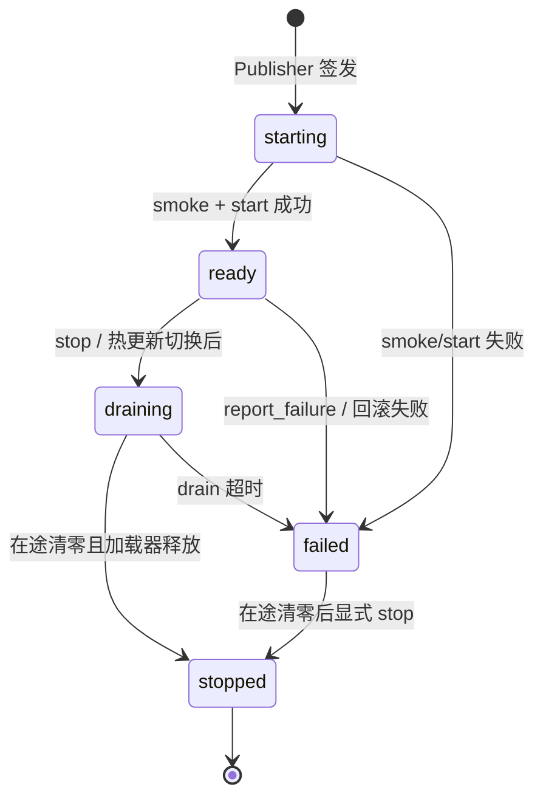
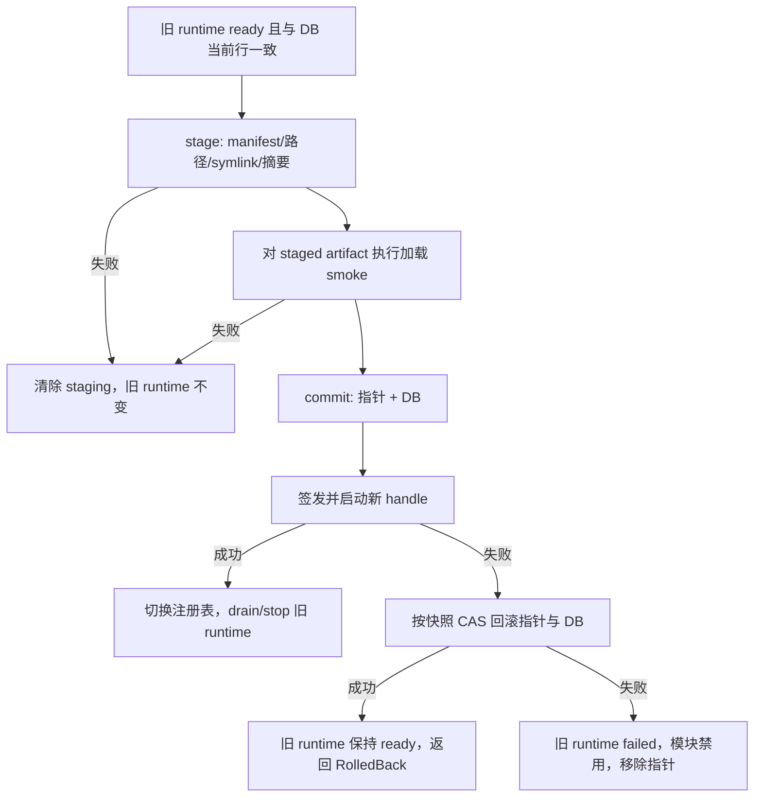
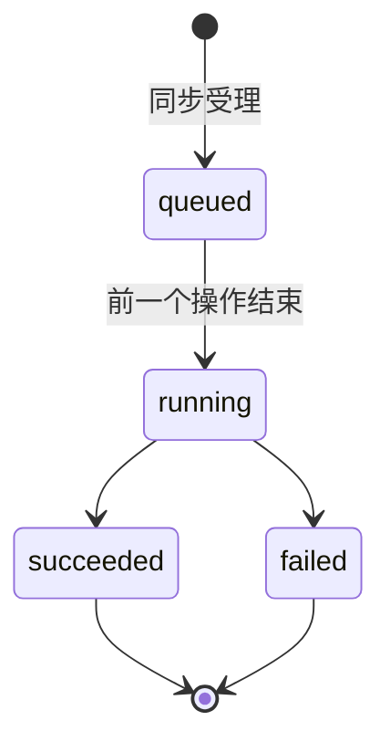
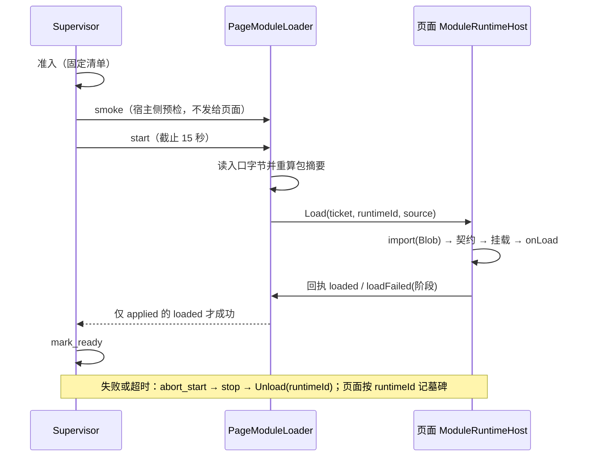

# V1-FR-004：模块系统与热更新

> **当前权威边界（2026-10-29）**：本规格的实现按 D033～D056 分阶段推进，不能直接作为 migration 或远程加载实现清单。实现遵循 D023、D024、D025～D032，和 [FR-004 前置收口设计](../../../04-技术架构/当前版本/V1-FR004前置收口设计.md)。现状：runtime supervisor、宿主操作编排与生命周期 command（[§7.5](#75-runtime-supervisor-第一阶段d033)、[§7.6](#76-宿主接入与生命周期编排d034)）、真实 WebView 模块加载（[§7.7](#77-真实模块加载纵切片d041d046)）、生产准入的第一个真实 pin、模块能力调用通道、模块管理、热更新状态交接与崩溃处理（[§7.8](#78-生产准入能力调用通道模块管理与崩溃处理d051d055)）均已实现并有 macOS 本地证据。依据 [D056](../../../06-决策记录/V1-冻结决策.md#d056-fr-004-的验收范围windowslinux真实进程重启和平台签名移到发布阶段)，AC01～AC15 的验收范围为 macOS 本机自动化证据，达到实现状态“本地验证”；Windows/Linux、真实进程重启与桌面 E2E、平台代码签名与公证、签名清单、公证后安装包比对**延后到发布阶段，未验证**；其他能力（`mcp.call`、`skills.execute`）与取消命令不在 AC 范围，**未实现**。见 [V1 实现状态](../../../02-产品与版本/当前版本/V1-实现状态.md)。

> V1 首期只允许内置或经宿主发布器验证的模块包；在模块身份、包完整性和执行边界冻结前，不接受 renderer 提交来源令牌、用户身份、版本、摘要、路径或 URL，不加载任意远程 JavaScript。依据 D034，生命周期 command 只接受 `module_id` 选择器（不是授权依据，仍须通过发布器的启用、指针与摘要核对）。Module Federation 只能作为受信任包的加载机制，不能视为安全沙箱。

## 1. 功能元信息

| 项目 | 内容 |
| --- | --- |
| 编号 | V1-FR-004 |
| 功能名称 | 模块系统与热更新 |
| 所属版本 | V1 |
| 领域 | 底层能力 |
| 规格状态 | Ready |
| 优先级 | P0（必须） |
| 风险等级 | **高风险**（复杂架构、状态管理、权限控制） |
| 上游依赖 | V1-FR-001、V1-FR-002、V1-FR-003（模块可能调用底层能力） |
| 下游影响 | V1-FR-006、V1-FR-007（作为模块加载） |
| 规格负责人 | TBD |
| 实现状态 | 见 [V1 实现状态](../../../02-产品与版本/当前版本/V1-实现状态.md)，本文不记录 |

## 2. 功能概述

### 2.1 一句话描述

基于经宿主验证的本地模块包实现应用模块的动态加载、热更新和卸载，支持粗粒度权限管理和 UI 故障隔离，让 DGOS 成为可扩展的应用平台。模块能力调用必须通过 Host Capability API；权限授权和 UI 错误边界不等于代码沙箱。

### 2.2 详细说明

模块系统是 DGOS 的架构基石，让应用功能可以独立开发、独立部署、动态加载。这是从老项目教训中学到的核心改进：**强制模块化，从架构层面避免单文件巨石**。

**核心价值**：
- ✅ 强制模块化：不允许单文件超过 1000 行
- ✅ 热更新：模块更新无需重启应用
- ✅ 独立开发：模块可以独立仓库、独立测试
- ✅ 权限管理：模块必须申请权限才能访问资源
- ✅ 崩溃隔离：模块崩溃不影响主应用

**用户价值**：
- 开发者：可以独立开发模块，快速迭代
- 最终用户：可以自由安装/卸载模块，定制功能

**从老项目学到的教训**：
- ❌ 老项目：19,038 行单文件，无法维护
- ✅ DGOS：强制模块化，每个模块独立

### 2.3 功能边界

**包含（按以下顺序实现）**：
- ✅ manifest schema、版本兼容性和 SHA-256 完整性校验
- ✅ 本地/应用资源包的暂存、验证、原子切换和启动恢复
- ✅ Host Capability API 与模块授权撤销语义
- ✅ 在受信任包范围内的 Module Federation 集成（Webpack/Vite）
- ✅ 模块动态加载（仅使用已验证的本地 artifact 入口）
- ✅ 模块热重载（无需重启）
- ✅ 模块卸载（清理内存）
- ✅ 模块生命周期管理（onLoad、onUnload、onUpdate）
- ✅ 粗粒度权限管理（`providers.call`、`skills.execute`、`mcp.call`、`storage.read`、`storage.write`、`network.local`）
- ✅ 权限检查（运行时拦截）
- ✅ 模块配置（manifest.json）
- ✅ 共享依赖管理（React、Zustand、Router）
- ✅ 错误边界隔离（Error Boundary）
- ✅ 状态保存与恢复（热更新时）
- ✅ 版本兼容性检查
- ✅ 更新回滚机制

**不包含**（明确说明原因）：
- ❌ 细粒度权限（RBAC） → V2 数据权限时做
- ❌ 任意第三方 JavaScript 或同 realm 安全沙箱 → 需要后续独立执行边界设计
- ❌ WASM/独立进程隔离 → V2 安全增强
- ❌ 模块市场（第三方上传） → V3 应用市场
- ❌ 模块开发 SDK → V8 开发者生态
- ❌ 模块性能监控 → V2 监控功能

## 3. 核心流程

### 3.1 模块加载流程

```
主应用启动
  ↓
读取已安装模块列表（数据库）
  ↓
遍历每个模块
  ↓
读取模块 manifest.json
  ↓
检查版本兼容性（主应用版本 vs 模块要求）
  ↓
（如果不兼容）跳过，记录警告
  ↓
（如果兼容）检查权限申请
  ↓
（如果权限未授予）提示用户授权
  ↓
（如果授权）发布器确认当前版本与 artifact 完整性
  ↓
使用 Module Federation 加载本地 artifact 入口
  ↓
解析模块入口（remoteEntry.js）
  ↓
导入模块组件
  ↓
调用模块生命周期 onLoad()
  ↓
注册到路由系统
  ↓
显示在侧边栏
  ↓
用户点击时渲染模块组件
```

### 3.2 模块热更新流程

```
系统检测到模块有新版本
  ↓
在模块列表显示"有更新"标记
  ↓
用户点击"更新"
  ↓
（如果模块正在使用）提示"保存当前状态"
  ↓
调用模块生命周期 onBeforeUpdate()
  ↓
模块保存状态到 localStorage
  ↓
备份旧版本文件（以便回滚）
  ↓
下载新版本到临时目录
  ↓
验证新版本完整性（checksum）
  ↓
替换旧版本文件
  ↓
清除旧版本的模块缓存
  ↓
重新加载模块（使用新版本）
  ↓
调用模块生命周期 onAfterUpdate()
  ↓
模块从 localStorage 恢复状态
  ↓
（如果加载失败）自动回滚到旧版本
  ↓
（如果回滚成功）通知用户"更新失败，已回滚"
  ↓
（如果回滚失败）禁用模块，通知用户
```

### 3.3 权限检查流程

```
模块调用底层能力（如 Provider）
  ↓
拦截器检查模块 ID
  ↓
从数据库查询模块权限
  ↓
Host Capability API 校验模块身份、当前版本和 `providers.call`
  ↓
（如果有权限）放行，继续调用
  ↓
（如果无权限）拒绝，返回错误
  ↓
记录权限拒绝日志
  ↓
（可选）通知用户"模块请求权限被拒绝"
```

### 3.4 模块崩溃处理流程

```
模块组件抛出异常
  ↓
Error Boundary 捕获异常
  ↓
记录错误日志（错误堆栈、模块 ID、时间）
  ↓
显示错误页面：
  "模块 [AI 工作台] 已崩溃"
  [查看错误详情] [重新加载模块] [卸载模块]
  ↓
用户点击"重新加载模块"
  ↓
清除模块缓存
  ↓
重新加载模块
  ↓
（如果再次崩溃）提示"模块可能有问题，建议卸载"
```

## 4. 数据模型

### 4.1 涉及的数据表

**历史草案：`installed_modules` 表**（仅用于追溯，禁止新 migration）：
```sql
CREATE TABLE installed_modules (
    id TEXT PRIMARY KEY,              -- UUID
    module_id TEXT NOT NULL,          -- 模块标识，如 ai-workbench
    name TEXT NOT NULL,               -- 模块名称
    version TEXT NOT NULL,            -- 当前版本
    entry_url TEXT NOT NULL,          -- 模块入口 URL（remoteEntry.js）
    manifest JSON NOT NULL,           -- 模块 manifest
    enabled BOOLEAN DEFAULT TRUE,     -- 是否启用
    install_path TEXT,                -- 本地安装路径（如果是本地模块）
    installed_at TIMESTAMP,
    updated_at TIMESTAMP,
    user_id TEXT,                     -- 所属用户
    FOREIGN KEY (user_id) REFERENCES users(id),
    UNIQUE(user_id, module_id)
);
```

**历史草案权限字段**（仅用于追溯；新实现使用 D024 规范值）：
```sql
CREATE TABLE module_permissions (
    id TEXT PRIMARY KEY,
    module_id TEXT NOT NULL,
    permission_type TEXT NOT NULL,    -- 权限类型：provider_access, skills_access, mcp_access, file_read, file_write, network
    resource_id TEXT,                 -- 资源 ID（可选，如具体的 Provider ID）
    granted BOOLEAN DEFAULT FALSE,    -- 是否授予
    granted_at TIMESTAMP,
    user_id TEXT,
    FOREIGN KEY (user_id) REFERENCES users(id),
    UNIQUE(module_id, permission_type, resource_id)
);
```

**module_crash_logs 表**（模块崩溃日志）：
```sql
CREATE TABLE module_crash_logs (
    id TEXT PRIMARY KEY,
    module_id TEXT NOT NULL,
    error_message TEXT,
    error_stack TEXT,                 -- 错误堆栈
    created_at TIMESTAMP,
    user_id TEXT,
    FOREIGN KEY (user_id) REFERENCES users(id)
);
```

**module_update_history 表**（模块更新历史）：
```sql
CREATE TABLE module_update_history (
    id TEXT PRIMARY KEY,
    module_id TEXT NOT NULL,
    from_version TEXT,
    to_version TEXT,
    success BOOLEAN,
    error_message TEXT,
    rollback BOOLEAN DEFAULT FALSE,   -- 是否回滚
    created_at TIMESTAMP,
    user_id TEXT,
    FOREIGN KEY (user_id) REFERENCES users(id)
);
```

### 4.2 读写关系

**读操作**：
- 获取已安装模块：`SELECT * FROM installed_modules WHERE user_id = ? AND enabled = TRUE`
- 查询模块权限：`SELECT * FROM module_permissions WHERE module_id = ? AND granted = TRUE`
- 查询崩溃日志：`SELECT * FROM module_crash_logs WHERE module_id = ? ORDER BY created_at DESC`
- 查询更新历史：`SELECT * FROM module_update_history WHERE module_id = ? ORDER BY created_at DESC`

**写操作**：
- 安装模块：`INSERT INTO installed_modules`
- 更新模块版本：`UPDATE installed_modules SET version = ?, updated_at = ? WHERE id = ?`
- 卸载模块：`DELETE FROM installed_modules WHERE id = ?`
- 授予权限：`INSERT INTO module_permissions` 或 `UPDATE ... SET granted = TRUE`
- 记录崩溃：`INSERT INTO module_crash_logs`
- 记录更新：`INSERT INTO module_update_history`

## 5. 验收标准

### 5.1 AC 逐项测试设计表

> AC01、AC06、AC11、AC14 在包发布器、恢复状态机和 Host Capability API 完成前不得标记通过。AC09/AC10 只能证明 UI 故障隔离，不能证明安全隔离。

#### AC01 模块动态加载

Given 模块已安装

When 启动应用

Then 模块成功加载并显示

#### AC02 版本兼容性检查

Given 模块要求 React 20

When 主应用是 React 19

Then 模块不加载，显示警告

#### AC03 共享依赖

Given 模块依赖 React

When 加载模块

Then 使用主应用的 React，不重复加载

#### AC04 权限申请

Given 模块需要 Provider 权限

When 安装模块

Then 显示权限列表，用户确认

#### AC05 权限检查

Given 模块未授权 Provider

When 调用 Provider

Then 拒绝调用，返回权限错误

#### AC06 热更新成功

Given 模块有新版本

When 点击更新

Then 无需重启，模块更新成功

#### AC07 状态保存恢复

Given 更新时保存状态

When 更新后恢复

Then 用户状态不丢失

#### AC08 更新失败回滚

Given 新版本加载失败

When 自动回滚

Then 恢复到旧版本，模块可用

#### AC09 崩溃隔离

Given 模块组件抛出异常

When Error Boundary 捕获

Then 主应用正常，显示错误页

#### AC10 崩溃重新加载

Given 模块崩溃

When 点击"重新加载"

Then 模块重新加载成功

#### AC11 模块卸载

Given 模块已加载

When 卸载模块

Then 清理内存、删除路由、移除侧边栏

#### AC12 生命周期钩子

Given 模块实现 onLoad

When 加载模块

Then onLoad 被调用

#### AC13 模块启用/禁用

Given 模块已安装

When 禁用模块

Then 模块不加载，不显示

#### AC14 并发加载

Given 5 个模块同时安装

When 启动应用

Then 所有模块都成功加载

#### AC15 崩溃日志记录

Given 模块崩溃

When 查询崩溃日志

Then 包含错误堆栈和时间

#### AC 逐项测试设计

证据状态按 spec-docs-pro 词表记录：未创建 / 已创建 / 静态核验 / 本地通过 / 预发通过 / 生产通过 / 失败 / 不适用。原“初始资产状态”列的内容移入“备注”，不代表升格。

| AC | 验收重点 | 测试层级 | 目标资产 | 目标命令 | 证据状态 | 备注 |
| --- | --- | --- | --- | --- | --- | --- |
| AC01 | 模块动态加载 | 真实 WebView smoke | `src-tauri/src/smoke/modules.rs`（`webview_smoke_modules`） | `npm run smoke:tauri` | 本地通过 | 页面附着后宿主自动启动全部已启用模块并渲染；页面重载代替进程重启；无真实进程重启、无 Windows/Linux |
| AC02 | 版本兼容性检查 | 后端逻辑 + 真实 WebView smoke | `crates/dgos-modules/src/compat.rs`、`build.rs`、`lib.rs`、`supervisor.rs` 测试；`tests/react-version.test.tsx`；`webview_smoke_modules` | `cargo test -p dgos-modules`；`npm test`；`npm run smoke:tauri` | 本地通过 | 要求 React `^20` 的发布在 React 19 宿主被 `1004022` 拒绝且旧版本不变；宿主版本取自锁文件的精确版本（D060），minor/patch 范围（`>=19.2`、`<19.2`、`~19.3.0`、`=19.1.0` 等）对注入的宿主版本有单元覆盖；兼容性按声明值比较 |
| AC03 | 共享依赖 | 前端集成 + 真实 WebView smoke | `tests/module-runtime-host.test.tsx`；`webview_smoke_modules` | `npm test`；`npm run smoke:tauri` | 本地通过 | 模块拿到宿主 React（同主版本、hooks 可用），裸 `import` 无法解析；只共享 React |
| AC04 | 权限申请 | 前端集成 + 真实 WebView smoke | `tests/module-management.test.tsx`；`webview_smoke_modules` | `npm test`；`npm run smoke:tauri` | 本地通过 | 真实 UI 弹出权限列表，确认前未授权未运行，确认后依次启用、授权、启动；“安装”即启用随包模块（D055） |
| AC05 | 权限检查 | 后端集成 + 真实 WebView smoke | `crates/dgos-application/src/lib.rs`（`trusted_runtime_call`）；`webview_smoke_call` | `cargo test -p dgos-application`；`npm run smoke:tauri` | 本地通过 | 未授权、撤权、停止、重启、页面重载后均 `1004004` 且 Provider 零命中；Provider 为本机 fake，不是真实厂商 |
| AC06 | 热更新成功 | 后端逻辑 + 真实 WebView smoke | `crates/dgos-modules/src/supervisor.rs` 测试；`webview_smoke_modules` | `cargo test -p dgos-modules`；`npm run smoke:tauri` | 本地通过 | 页面代次不变、无重启；5 个模块并发提交更新全部成功；更新源为宿主本地目录 |
| AC07 | 状态保存恢复 | 前端集成 + 真实 WebView smoke | `tests/module-runtime-host.test.tsx`；`webview_smoke_modules` | `npm test`；`npm run smoke:tauri` | 本地通过 | 状态内存交接、JSON 往返；规格的 localStorage 做法未采用（D055）；页面重载丢失交接状态 |
| AC08 | 更新失败回滚 | 后端逻辑 + 真实 WebView smoke | `crates/dgos-modules/src/supervisor.rs` 测试；`webview_smoke_modules` | `cargo test -p dgos-modules`；`npm run smoke:tauri` | 本地通过 | `onAfterUpdate` 抛错返回 `1004013`，旧版本继续运行且未卸载；旧文件损坏的回滚失败由 supervisor 测试覆盖，无真实磁盘故障注入 |
| AC09 | 崩溃隔离 | 前端集成 + 真实 WebView smoke | `tests/module-runtime-host.test.tsx`；`tests/module-management.test.tsx`；`webview_smoke_modules` | `npm test`；`npm run smoke:tauri` | 本地通过 | 只覆盖渲染阶段错误；同 realm 的 UI 故障隔离，不是安全隔离；事件处理器与异步错误不在范围内 |
| AC10 | 崩溃重新加载 | 真实 WebView smoke | `webview_smoke_modules`；`tests/module-management.test.tsx`；`crates/dgos-application/src/module_crashes.rs` 测试 | `npm run smoke:tauri`；`npm test`；`cargo test -p dgos-application` | 本地通过 | 通过横幅“重新加载模块”获得新 runtime；3 次崩溃后自动禁用并提示；日志写入失败时宿主仍把 runtime 记为 failed，禁用被拒时后台重试直到被受理，启动时先评估再自动加载（D059，单元覆盖，故障为注入） |
| AC11 | 模块卸载 | 真实 WebView smoke + 后端 | `webview_smoke_modules`；`crates/dgos-modules/src/management.rs` 测试 | `npm run smoke:tauri`；`cargo test -p dgos-modules` | 本地通过 | 列表、侧边栏、DOM、runtime 与文件均清除，权限与版本行删除，更新历史保留；浏览器内存未释放（D045） |
| AC12 | 生命周期钩子 | 前端集成 + 真实 WebView smoke | `tests/module-runtime-host.test.tsx`；`webview_smoke_modules` | `npm test`；`npm run smoke:tauri` | 本地通过 | `onLoad`、`onUnload`、`onBeforeUpdate`、`onAfterUpdate`；规格的 `onUpdate` 以后两者实现 |
| AC13 | 模块启用/禁用 | 后端 + 真实 WebView smoke | `webview_smoke_modules`；`crates/dgos-modules/src/management.rs` 测试 | `npm run smoke:tauri`；`cargo test -p dgos-modules` | 本地通过 | 禁用先停止 runtime，侧边栏与 DOM 消失，启动被 `1004009` 拒绝；重新启用后可启动 |
| AC14 | 并发加载 | 真实 WebView smoke | `webview_smoke_modules` | `npm run smoke:tauri` | 本地通过 | 5 个计数模块加其他 3 个模块在页面附着后全部 ready；宿主一次提交全部 start，但由 D034 队列按提交顺序执行，不是并行加载；无性能度量 |
| AC15 | 崩溃日志记录 | 后端 API + 真实 WebView smoke | `crates/dgos-db/src/repositories/module_crash_repository.rs`、`crates/dgos-application/src/module_crashes.rs` 测试；`webview_smoke_modules` | `cargo test -p dgos-db -p dgos-application`；`npm run smoke:tauri` | 本地通过 | 每次崩溃一条记录，含清洗后的堆栈帧与时间；不保存错误消息、URL、路径；每模块最多 100 条；日志写入失败不会让 runtime 保持 ready（D059，注入故障） |


### 5.2 边界条件测试

| 边界条件 | 测试场景 | 预期结果 |
| --- | --- | --- |
| 模块入口 URL 不可达 | 网络断开或 CDN 故障 | 显示"模块加载失败" |
| 模块 manifest 格式错误 | JSON 解析失败 | 显示"模块配置错误" |
| 模块依赖版本冲突 | React 19 vs React 18 | 不加载，显示警告 |
| 热更新时模块正在使用 | 用户正在输入 | 提示保存状态 |
| 更新备份失败 | 磁盘空间不足 | 拒绝更新，提示用户 |
| 回滚失败 | 旧版本文件损坏 | 禁用模块，提示重新安装 |
| 模块无限崩溃 | 3 次重新加载都崩溃 | 自动禁用，提示卸载 |

## 6. 接口设计

### 6.1 Transport 与 Host API 暴露策略

> 本节替代早期“通用模块 Tauri command”草案。已注册的 renderer-facing 模块命令见下方“当前状态”和 §7.6、§7.7；其余是后续实现的约束，不是已注册命令清单。

- **模块管理 transport**：未来的 Tauri command 或 LAN handler 只接收业务字段（例如待发布的本地包选择、目标版本、启用/禁用意图），不接收 `user_id`、`module_id` 的可信身份声明、来源 token 或授权结论。handler 先绑定宿主会话，再调用 `ModuleApplicationService`。
- **权限管理 transport**：授权/撤销请求可以携带业务上的模块标识和权限枚举，但服务端必须重新读取当前发布行和 manifest；不能把 renderer 的模块标识当作执行身份，也不能接受旧权限别名或任意 JSON 权限。
- **Host Capability API**：`HostCapabilityService` 是 Rust 内部服务，不注册为 renderer 可调用的通用 `invoke(command, payload)`，也不返回凭据、完整输入输出或授权 token。具体能力 adapter 在真实外部调用前逐次执行 `authorize → dispatch`。
- **runtime 错误与崩溃**：后续由宿主持有的 runtime handle 关联模块身份和生命周期；模块只提交脱敏错误类别或由宿主捕获异常，不自行提交可信 `module_id`、用户身份或堆栈中的敏感输入。
- **当前状态**：已注册 5 个生命周期 command（D034，仅 Settings 路由，门禁未放宽）、2 个页面桥接 command（`attach_module_host`、`report_module_host`，D046）、能力调用 `module_call_provider` 与崩溃上报 `report_module_crash`（D051/D054/D055，`main` 窗口门禁，逐命令参数白名单）、以及 7 个模块管理 command（D055，Settings 路由门禁）。桥接与调用命令不是通用模块 IPC；任何新增 command 必须先更新本规格和接口契约，并在 `contracts:check` 的白名单中登记。

### 6.2 前端模块接口

> **契约收口（D024，2026-10-28）**：本节早期字段仅作历史草案，不能直接生成 migration 或运行时权限判断。正式 V1 manifest 在 FR-004 实施前以 `modules`/`module_permissions` 数据模型为持久化依据，权限申请使用 D006 的能力点字符串。模块身份由宿主发布器从已校验的 manifest、版本和完整性摘要构造，renderer 不能声明身份。建议的冻结形态如下：
>
> ```typescript
> interface ModuleManifestV1 {
>   id: string; name: string; version: string;
>   entry: string; // 仅在 FR-004 发布器校验并切换后的本地 artifact 入口
>   artifact: { version: string; sha256: string };
>   permissions: Array<'providers.call' | 'skills.execute' | 'mcp.call' | 'storage.read' | 'storage.write' | 'network.local'>;
> }
> ```
>
> `installed_modules`、布尔权限对象（`provider_access` 等）和未绑定完整性摘要的远程 `entry` 保留为历史草图；FR-004 不得兼容写入这些旧名称。

Host Capability API 的最小语义：调用上下文由 Rust 宿主绑定 `user_id`、模块版本、artifact 完整性和 request ID；调用前逐次检查当前模块是否启用及权限是否授予；撤销立即阻止新调用，已派发的外部请求不伪报为撤销成功，终态按 Provider/MCP 的未知结果规则记录。该 API 不向模块返回凭据，也不接受模块自报的用户、来源或授权 token。

```typescript
// frontend/packages/core/src/types/module.ts

export interface ModuleManifest {
  id: string;                          // 模块唯一标识
  name: string;                        // 模块名称
  version: string;                     // 版本号
  description?: string;
  author?: string;
  entry: string;                       // 已校验本地 artifact 入口，不接受任意远程 URL
  
  // 依赖要求
  requires?: {
    dgos?: string;                     // DGOS 版本要求（如 ">=1.0.0"）
    react?: string;                    // React 版本要求
  };
  
  // 权限申请
  permissions?: Array<'providers.call' | 'skills.execute' | 'mcp.call' | 'storage.read' | 'storage.write' | 'network.local'>;
  
  // 共享依赖
  shared?: {
    react: { singleton: true, requiredVersion: string };
    zustand: { singleton: true };
  };
}

export interface ModuleLifecycle {
  // 模块加载时调用
  onLoad?(): Promise<void> | void;
  
  // 模块卸载前调用
  onUnload?(): Promise<void> | void;
  
  // 热更新前调用（保存状态）
  onBeforeUpdate?(): Promise<any> | any;
  
  // 热更新后调用（恢复状态）
  onAfterUpdate?(state: any): Promise<void> | void;
}

export interface ModuleComponent extends React.ComponentType {
  // 模块生命周期
  lifecycle?: ModuleLifecycle;
  
  // 模块路由
  routes?: Array<{
    path: string;
    element: React.ReactNode;
  }>;
}
```

### 6.3 Module Federation 配置

```javascript
// frontend/apps/desktop/vite.config.ts

import federation from '@originjs/vite-plugin-federation';

export default defineConfig({
  plugins: [
    federation({
      name: 'dgos-host',
      remotes: {
        // 动态加载远程模块
      },
      shared: {
        react: {
          singleton: true,
          requiredVersion: '^18.2.0',
        },
        'react-dom': {
          singleton: true,
          requiredVersion: '^18.2.0',
        },
        zustand: {
          singleton: true,
          requiredVersion: '^4.0.0',
        },
      },
    }),
  ],
});
```

详见 [V1 接口契约](../../../04-技术架构/当前版本/V1-接口契约.md)。

## 7. 技术设计

### 7.1 模块加载器核心实现

```typescript
// frontend/packages/core/src/module-loader.ts

export class ModuleLoader {
  private loadedModules = new Map<string, ModuleComponent>();
  private moduleStates = new Map<string, any>();
  
  // B04-01: 加载模块
  async loadModule(manifest: ModuleManifest): Promise<ModuleComponent> {
    // B04-02: 检查版本兼容性
    if (!this.checkCompatibility(manifest)) {
      throw new Error(`模块 ${manifest.name} 版本不兼容`);
    }
    
    // B04-03: 检查权限
    const permissions = await this.getModulePermissions(manifest.id);
    if (!this.arePermissionsGranted(manifest.permissions, permissions)) {
      throw new Error(`模块 ${manifest.name} 缺少必要权限`);
    }
    
    // B04-04: 动态加载远程模块
    const remoteUrl = manifest.entry;
    
    // 创建 script 标签加载 remoteEntry.js
    await this.loadRemoteEntry(remoteUrl);
    
    // B04-05: 获取模块导出
    const container = (window as any)[manifest.id];
    await container.init(__webpack_share_scopes__.default);
    
    const factory = await container.get('./Module');
    const Module = factory();
    
    // B04-06: 调用生命周期 onLoad
    if (Module.lifecycle?.onLoad) {
      await Module.lifecycle.onLoad();
    }
    
    // 缓存模块
    this.loadedModules.set(manifest.id, Module);
    
    return Module;
  }
  
  // B04-02: 检查版本兼容性
  private checkCompatibility(manifest: ModuleManifest): boolean {
    if (manifest.requires?.dgos) {
      const currentVersion = '1.0.0'; // DGOS 版本
      const requiredVersion = manifest.requires.dgos;
      
      if (!satisfies(currentVersion, requiredVersion)) {
        console.warn(`模块要求 DGOS ${requiredVersion}，当前版本 ${currentVersion}`);
        return false;
      }
    }
    
    return true;
  }
  
  // B04-07: 热更新模块
  async reloadModule(
    moduleId: string,
    newManifest: ModuleManifest
  ): Promise<ModuleComponent> {
    const oldModule = this.loadedModules.get(moduleId);
    
    if (!oldModule) {
      throw new Error('模块未加载');
    }
    
    // B04-08: 保存状态（onBeforeUpdate）
    let savedState: any;
    if (oldModule.lifecycle?.onBeforeUpdate) {
      savedState = await oldModule.lifecycle.onBeforeUpdate();
      this.moduleStates.set(moduleId, savedState);
    }
    
    try {
      // B04-09: 卸载旧模块
      if (oldModule.lifecycle?.onUnload) {
        await oldModule.lifecycle.onUnload();
      }
      
      // 清除旧模块缓存
      this.loadedModules.delete(moduleId);
      delete (window as any)[moduleId];
      
      // B04-10: 加载新模块
      const newModule = await this.loadModule(newManifest);
      
      // B04-11: 恢复状态（onAfterUpdate）
      if (newModule.lifecycle?.onAfterUpdate && savedState) {
        await newModule.lifecycle.onAfterUpdate(savedState);
      }
      
      return newModule;
    } catch (error) {
      // B04-12: 加载失败，尝试回滚
      console.error('模块加载失败，尝试回滚', error);
      
      // 这里应该从备份恢复旧版本
      // 实际实现中，需要服务端支持
      throw error;
    }
  }
  
  // B04-13: 卸载模块
  async unloadModule(moduleId: string): Promise<void> {
    const module = this.loadedModules.get(moduleId);
    
    if (!module) {
      return;
    }
    
    // B04-14: 调用生命周期 onUnload
    if (module.lifecycle?.onUnload) {
      await module.lifecycle.onUnload();
    }
    
    // 清除缓存
    this.loadedModules.delete(moduleId);
    this.moduleStates.delete(moduleId);
    delete (window as any)[moduleId];
  }
  
  // B04-04: 动态加载 remoteEntry.js
  private async loadRemoteEntry(url: string): Promise<void> {
    return new Promise((resolve, reject) => {
      const script = document.createElement('script');
      script.src = url;
      script.type = 'text/javascript';
      script.async = true;
      
      script.onload = () => resolve();
      script.onerror = () => reject(new Error(`Failed to load ${url}`));
      
      document.head.appendChild(script);
    });
  }
}
```

### 7.2 权限检查拦截器

```typescript
// frontend/packages/core/src/permission-interceptor.ts

export class PermissionInterceptor {
  private modulePermissions = new Map<string, Set<string>>();
  
  // B04-15: 初始化模块权限
  async initModulePermissions(moduleId: string): Promise<void> {
    const permissions = await invoke('get_module_permissions', { moduleId });
    const grantedPermissions = new Set(
      permissions
        .filter((p: any) => p.granted)
        .map((p: any) => p.permission_type)
    );
    
    this.modulePermissions.set(moduleId, grantedPermissions);
  }
  
  // B04-16: 检查权限（拦截 Provider 调用）
  async checkProviderAccess(moduleId: string): Promise<boolean> {
    const permissions = this.modulePermissions.get(moduleId);
    
    if (!permissions || !permissions.has('provider_access')) {
      console.error(`模块 ${moduleId} 无 Provider 访问权限`);
      
      // 记录日志
      await invoke('log_permission_denied', {
        moduleId,
        permissionType: 'provider_access',
      });
      
      return false;
    }
    
    return true;
  }
  
  // B04-17: 检查文件读权限
  async checkFileRead(moduleId: string, path: string): Promise<boolean> {
    const permissions = this.modulePermissions.get(moduleId);
    
    if (!permissions || !permissions.has('file_read')) {
      console.error(`模块 ${moduleId} 无文件读取权限`);
      return false;
    }
    
    return true;
  }
  
  // B04-18: 检查网络权限
  async checkNetwork(moduleId: string): Promise<boolean> {
    const permissions = this.modulePermissions.get(moduleId);
    
    if (!permissions || !permissions.has('network')) {
      console.error(`模块 ${moduleId} 无网络访问权限`);
      return false;
    }
    
    return true;
  }
}
```

### 7.3 错误边界隔离

```typescript
// frontend/packages/core/src/ModuleErrorBoundary.tsx

import React, { Component, ErrorInfo } from 'react';
import { invoke } from '@tauri-apps/api';

interface Props {
  moduleId: string;
  moduleName: string;
  children: React.ReactNode;
}

interface State {
  hasError: boolean;
  error?: Error;
  errorInfo?: ErrorInfo;
}

// B04-19: 模块错误边界
export class ModuleErrorBoundary extends Component<Props, State> {
  constructor(props: Props) {
    super(props);
    this.state = { hasError: false };
  }
  
  static getDerivedStateFromError(error: Error): State {
    return { hasError: true, error };
  }
  
  async componentDidCatch(error: Error, errorInfo: ErrorInfo) {
    console.error('模块崩溃:', error, errorInfo);
    
    // B04-20: 记录崩溃日志
    await invoke('report_module_crash', {
      moduleId: this.props.moduleId,
      errorMessage: error.message,
      errorStack: error.stack || '',
    });
    
    this.setState({ errorInfo });
  }
  
  // B04-21: 重新加载模块
  handleReload = () => {
    this.setState({ hasError: false, error: undefined, errorInfo: undefined });
    
    // 触发模块重新加载
    window.location.reload();
  };
  
  render() {
    if (this.state.hasError) {
      return (
        <div className="module-crash-page">
          <h2>模块 [{this.props.moduleName}] 已崩溃</h2>
          <p>错误信息：{this.state.error?.message}</p>
          <details>
            <summary>查看错误详情</summary>
            <pre>{this.state.error?.stack}</pre>
          </details>
          <button onClick={this.handleReload}>重新加载模块</button>
          <button onClick={() => {/* 卸载模块 */}}>卸载模块</button>
        </div>
      );
    }
    
    return this.props.children;
  }
}
```

### 7.4 分支到测试追踪表

| 分支 ID | 分支描述 | AC 映射 | E2E 映射 |
| --- | --- | --- | --- |
| B04-01 | 加载模块 | AC01 | V1-E2E-04 |
| B04-02 | 检查版本兼容性 | AC02 | - |
| B04-03 | 检查权限 | AC04 | - |
| B04-04 | 动态加载远程模块 | AC01, AC03 | V1-E2E-04 |
| B04-05 | 获取模块导出 | AC01 | - |
| B04-06 | 调用 onLoad | AC12 | - |
| B04-07 | 热更新模块 | AC06 | V1-E2E-04 |
| B04-08 | 保存状态 | AC07 | V1-E2E-04 |
| B04-09 | 卸载旧模块 | AC11 | - |
| B04-10 | 加载新模块 | AC06 | - |
| B04-11 | 恢复状态 | AC07 | - |
| B04-12 | 加载失败回滚 | AC08 | - |
| B04-13 | 卸载模块 | AC11 | V1-E2E-04 |
| B04-14 | 调用 onUnload | AC12 | - |
| B04-15 | 初始化权限 | AC04 | - |
| B04-16 | 检查 Provider 权限 | AC05 | - |
| B04-17 | 检查文件权限 | AC05 | - |
| B04-18 | 检查网络权限 | AC05 | - |
| B04-19 | 错误边界捕获 | AC09 | V1-E2E-04 |
| B04-20 | 记录崩溃日志 | AC15 | - |
| B04-21 | 重新加载模块 | AC10 | - |

### 7.5 Runtime supervisor 第一阶段（D033）

> 本节是 D033 第一阶段 Rust 实现的权威技术设计；§7.1～7.3 的 TypeScript 草图仍是规划，Federation 加载器与前端拦截器未实现（页面侧加载与错误边界的现状见 §7.7）。实现状态与测试证据只在 [V1 实现状态](../../../02-产品与版本/当前版本/V1-实现状态.md#fr-004-第一阶段runtime-supervisor-与本地受信任加载) 维护。

| 组件 | 位置 | 职责与边界 |
| --- | --- | --- |
| `ModulePublisher::runtime_handle` | `crates/dgos-modules/src/lib.rs`（crate 内部） | 仅当模块启用、current pointer 等于 DB 当前版本、存在 commit 写入的 `module_versions` 行且包摘要一致时签发 `starting` handle |
| `VerifiedModuleArtifact` | `crates/dgos-modules/src/loader.rs` | Publisher 构造的规范化包目录与入口；无公开构造函数，加载器只接收它 |
| `ModuleLoader` / `LocalArtifactLoader` | 同上 | 加载器端口；`LocalArtifactLoader` 做宿主侧 smoke（普通文件、非空、UTF-8、≤16 MiB、仍在包内）并在 start 前重算摘要；`executes_module_code() == false`，不执行 JS。真实执行见 §7.7 的 `PageModuleLoader`；Module Federation 若采用，也只是该端口的另一个 adapter |
| `ModuleRuntimeHandle` / `ModuleRequest` | `crates/dgos-modules/src/runtime.rs` | 生命周期状态、`runtime_id`、请求准入与终态计数；状态转换仅 crate 内可用 |
| `ModuleRuntimeSupervisor` | `crates/dgos-modules/src/supervisor.rs` | start / stop / report_failure / update；生命周期操作串行化，请求准入不经该锁 |
| `ModuleCapabilityDispatchService` | `crates/dgos-application/src/lib.rs` | 准入 → 每请求 request_id → `HostCapabilityService::authorize` → 操作 → 结算终态 |



在途请求：只有 `ready` 准入，准入与状态转换在同一锁内。已准入请求恰好结算为 `succeeded`、`failed`、`denied`（授权未通过，操作未运行）或 `interrupted`（future 被丢弃，外部结果未知）之一。宿主不重试、不在新 runtime 重放；`failed` 与 drain 超时都不取消在途操作，加载器资源在在途清零后才释放。对外拒绝统一映射 `PermissionDenied`（1004004）。



commit 与切换之间，旧 runtime 的新授权因身份与 DB 当前行不一致而 fail-closed；已授权的在途请求按原 runtime 结算。相同 `(module_id, version, integrity)` 的更新返回 `Unchanged`；已存在但非当前的版本不会被重复发布重新激活（`VersionNotCurrent`）。`update`/`start` future 不具备取消安全：若在 commit 后被调用方丢弃，DB 已指向新版本而旧 runtime 无法再通过授权，需显式 stop/start 或启动恢复收敛。

| 分支 / AC | 当前证据 | 证据层级与限制 |
| --- | --- | --- |
| B04-01 加载模块（AC01 部分） | 宿主侧 start → ready、篡改/未 commit/symlink 包拒绝 | Rust 单元/集成；无 WebView、Federation 或 UI |
| B04-07/B04-10 热更新（AC06 部分） | smoke 后切换、旧 runtime drain/stop、在途请求留在旧 runtime 且不重放 | Rust 集成；无 renderer 重载与状态恢复 |
| B04-12 加载失败回滚（AC08 部分） | 启动失败按快照回滚、旧 runtime 继续服务、事件可查 | Rust 集成；加载器为本地/脚本化 fixture |
| B04-13 卸载（AC11 部分） | stop 拒绝新请求、等待在途、释放加载器资源 | 不含路由/侧边栏清理 |
| §5.2 回滚失败 | 旧版本文件损坏时禁用模块并移除指针 | Rust 集成 |

以上均不能标记任何 AC 通过。

### 7.6 宿主接入与生命周期编排（D034）

> 本节是当前 Rust/Tauri 实现的权威技术设计。实现状态与测试证据只在 [V1 实现状态](../../../02-产品与版本/当前版本/V1-实现状态.md#fr-004-第二阶段宿主接入与生命周期编排) 维护。本节不引入 Module Federation、WebView、UI 或远程加载，FR-004 整体仍未完成。

**组件**

| 组件 | 位置 | 职责 |
| --- | --- | --- |
| `ModuleOperationManager` | `dgos-application` | transport 唯一入口；持有 `ModulePublisher` 与 `ModuleRuntimeSupervisor`；受理、串行化、查询 operation；启动恢复与 fail-closed |
| `LocalModuleSources` | `dgos-modules` | 把 `module_id` 解析为宿主拥有的 `module-sources/<module_id>` 规范目录；拒绝非法 id、symlink、非目录与根外路径 |
| `ModuleOperationView` 等 DTO、`ModuleOperationErrorKind` | `dgos-types` | renderer 可见的 operation/runtime 状态与稳定错误码；不含 handle、上下文、路径或原始错误文本 |
| `start_module`/`stop_module`/`update_module`/`get_module_operation`/`get_module_runtime_status` | `src-tauri` | 仅 `main` 窗口、可信来源且路径为 `/settings` 的页面（D037）；经 `host::module_session` 取得宿主派生的 `HostSession` |

**operation 状态**



受理（校验 module id、可用性、同模块冲突、登记并派发）是同步且原子的；之后的执行不依赖调用方 future。`stop` 在宿主不可用时仍受理。冲突请求返回 `operation_in_progress`，不排队。

**取消**：command future 被取消或等待超时只停止等待；已受理操作继续到终态。没有取消接口。loader/supervisor panic 使该操作以 `internal` 失败，不阻塞后续操作。

**启动恢复**：`recover()` 调用 `ModulePublisher::recover_registered`；成功才允许 `start`/`update`。失败或被丢弃时保持 `unavailable`，可重试，桌面应用不因此退出。恢复不自动启动 runtime。

**待释放（pending release）**：热更新切换后释放失败或 drain 超时的旧 runtime、激活失败且释放失败的候选 runtime 保留在 supervisor 的待释放列表，到达 `stopped` 才移除。`stop(module_id)` 在停止当前 runtime 之外重试全部待释放实例；`start` 先结算旧实例，失败则保持旧实例并以错误返回。`runtime_status.pending_releases` 暴露数量，`update` 的 `updated_pending_release` 表示新版本已生效而旧实例释放待重试。

**错误映射**（`ModuleOperationErrorKind`，固定文案）：`1004004` 是 `host_permission_denied`（入口门禁），`invalid_manifest` 登记作废（D035）；本节与 [V1 错误码](../../../04-技术架构/当前版本/V1-错误码.md#34-模块系统与热更新04) 为准，下方 §8 的早期草案表已被 D035 取代。

| 类别 | 码 | 触发 | 可重试 |
| --- | --- | --- | --- |
| module_not_found | 1004001 | module id 非法，或模块从未发布（没有注册行） | 否 |
| already_running | 1004002 | 已有活动 runtime | 否 |
| load_failed | 1004003 | smoke/start 被 loader 拒绝 | 否 |
| version_conflict | 1004006 | runtime 与发布版本不一致、版本已存在但非当前 | 否 |
| stop_failed | 1004007 | 释放失败或 drain 超时 | 是 |
| disabled | 1004009 | 模块已注册但处于禁用状态：回滚失败后禁用，或启动恢复校验失败后禁用 | 否 |
| update_failed | 1004013 | 更新失败，已回滚到旧版本 | 否 |
| package_invalid | 1004015 | 模块已启用，但指针、提交记录、清单、摘要、入口不一致，或更新来源缺失/被拒 | 否 |
| not_running | 1004016 | 无匹配 runtime | 否 |
| operation_in_progress | 1004017 | 同模块已有未结束操作 | 是 |
| operation_not_found | 1004018 | operation id 未知或已被淘汰 | 否 |
| host_unavailable | 1004019 | 启动恢复未成功 | 否 |
| internal | 1004020 | 数据库、非法状态转换、panic、回滚失败但未禁用 | 是 |

**重启语义（D036）**：operation 记录只在内存，应用重启后全部丢失，旧 `operation_id` 返回 `1004018`；不恢复、不重试未完成操作，runtime 均为 `not_loaded`，不自动启动。重启后保留的只有已发布的包与指针，以及 `update` 写入 `module_update_events` 的审计行。没有跨重启的 operation 查询，调用方通过 `get_module_runtime_status` 判断后重新提交。这是明确限制，不是跨重启可靠的承诺。

| 分支 / AC | 当前证据 | 证据层级与限制 |
| --- | --- | --- |
| 入口门禁 | 真实 WebView：`main` + `/settings` 通过；`/workbench` 路径、非 `main` 窗口返回 `1004004`；远程来源窗口被 Tauri ACL 拒绝 | 真实 Tauri 应用与本机平台 WebView（smoke）；远程来源只证明 ACL 层，宿主来源检查仅有单元测试 |
| operation 与查询 | 真实 WebView：`start/stop/update` 返回宿主生成的 UUID，伪造的 `operationId` 被忽略；`get_module_operation`、`get_module_runtime_status` 可查询 | 真实 Tauri smoke；loader 为脚本化替身 |
| 页面销毁后继续完成 | 真实 WebView：已受理的 `start` 在页面被导航销毁后仍完成，新页面可查询结果 | 真实 Tauri smoke（页面销毁）；command future 被丢弃由 Rust 集成测试覆盖 |
| 并发串行化 | 同模块冲突拒绝；跨模块按受理顺序启动 | Rust 集成 |
| 释放失败可重试 | 真实 WebView：更新后旧实例释放失败得到 `updated_pending_release`；`stop` 返回可重试 `1004007`；故障解除后再次 `stop` 清零 | 真实 Tauri smoke，loader 为脚本化替身；Rust 集成 |
| 启动恢复/fail-closed | 真实 WebView：恢复前 `1004019`、恢复失败保持不可用、重试成功、篡改包被禁用且 `start` 返回 `1004009` | 真实 Tauri smoke（恢复由测试从 Rust 侧调用，没有 renderer 恢复命令）；Rust 集成 |
| update 来源 | 真实 WebView：携带伪造 `path/url/version` 的 `update_module` 仍只读取 `module-sources/<id>`，无来源返回 `1004015` 且不泄漏路径 | 真实 Tauri smoke；来源解析遍历/symlink 拒绝为 Rust 单元 |
| renderer 信任边界 | 真实 WebView：伪造的 user/caller/runtime/handle/context/version/integrity/path/url 字段不影响结果；路径/URL 形 id 返回 `1004001` 且不创建 operation；`contracts:check` 静态检查命令参数 | 真实 Tauri smoke + 静态检查；不证明 WebView 隔离 |
| 分类 | 未发布 `1004001`、已禁用 `1004009`、包无效 `1004015` | Rust 集成 + 真实 Tauri smoke |

以上均不能标记任何 AC 通过。smoke 未覆盖：Windows/Linux WebView、开发服务器来源、真实进程重启与 UI。该节 smoke 的 loader 是脚本化替身，不执行模块代码；真实执行见 §7.7。

### 7.7 真实模块加载纵切片（D041～D046）

> 本节是真实执行的权威技术设计。实现状态与测试证据只在 [V1 实现状态](../../../02-产品与版本/当前版本/V1-实现状态.md#fr-004-第三阶段-b真实模块执行契约收口与最小加载纵切片) 维护。本节不引入 Module Federation 插件、远程加载、通用模块 IPC 或模块市场，**FR-004 整体未完成，AC01～AC15 均未通过**。

**组件与归属**

| 组件 | 位置 | 职责与边界 |
| --- | --- | --- |
| `ModuleAdmission` / `PinnedModuleAdmission` | `crates/dgos-modules/src/admission.rs` | 固定清单 `(module_id, version, integrity)`；生产清单为空（D041） |
| `ModuleRuntimeSupervisor` | `supervisor.rs` | 准入（预检前、`start` 前、更新 commit 前）、对 `smoke`/`start`/`stop` 的截止时间、失败清理与待释放重试；业务编排只在这里和 Application 层 |
| `PageModuleLoader` / `ModulePageTransport` | `page_loader.rs` | adapter 无关的 attachment/ticket/回执状态机；`executes_module_code() == true` |
| `ModuleOperationManager::report_runtime_lost` | `dgos-application` | 加载器上报丢失的 runtime，经 `report_failure` 转为 `failed` |
| `ChannelTransport` / `ModuleHostBridge` / 页面加载钩子 | `src-tauri/src/module_host.rs` | Tauri `Channel`、命令 DTO、`on_page_load`/窗口销毁；只有这里知道 WebView |
| `attach_module_host` / `report_module_host` | `src-tauri/src/commands/module_host.rs` | 页面附着与回执（D046，页面生命周期 transport 扩展，非通用模块 IPC）；门禁为 `host::module_host_window`：`main` 窗口 + 可信来源，与 caller/capability/Settings 路由解耦，`contracts:check` 静态约束 |
| `ModuleRuntimeHost` / `ModuleSlots` / `ModuleHostBootstrap` | `src/modules/` | 页面侧：Blob URL 导入、契约校验、挂载、钩子、墓碑；挂在 App 根，跨 SPA 路由保持 |
| `ModuleCapabilityDispatchService::call_provider` | `crates/dgos-application/src/lib.rs` | 运行时绑定的 `providers.call`（D048）：句柄经 supervisor 签发，每次调用重新授权并生成 `request_id`；Rust 内部服务，未注册为 Tauri command，也未在 `src-tauri` 装配 |



**页面协议**：下发 `{kind:'load', ticket, runtimeId, moduleId, version, source, hookTimeoutMs}` 与 `{kind:'unload', ticket, runtimeId, hookTimeoutMs}`；回执 `{kind:'loaded'}`、`{kind:'loadFailed', stage}`（`import/contract/render/hook/timeout/cancelled`）、`{kind:'unloaded', hookFailed}`，随 `attachmentId`、`ticket` 提交。回执不含消息、堆栈、模块 id、路径。模块契约为默认导出 `createModule(host)`，返回 `{ Component, onLoad?, onUnload? }`，`host` 冻结为 `{ React, apiVersion, moduleId, version, providers, ui }`（`providers.call` 见 D048，`ui` 见下一段）。

**`host.ui`（D067，Phase 6 已实现）**：`host` 的冻结字段 `ui` 提供统一设计系统的组件（`Button`、`Input`、`Select`、`Checkbox`、`Radio`、`Switch`、`Card`、`Tooltip`、`Loading`、`Divider`、`Tabs`）、`Stack`、只收纯文本的 `toast`（`success`/`error`/`warning`/`info`）和只含 `confirm`/`alert`/`error` 的 `Modal`。注入点是 `src/modules/moduleRuntimeHost.ts` 的 `readContract`，实现是 `src/modules/moduleHostUi.ts`，取舍见 V1-FR-005 §13.3。这是新增字段，不改动或删除其余字段，`apiVersion` 保持 1。包装层在把属性交给组件前丢弃 `style`，这是防误用，不是沙箱（D042）；`ModalHost` 由宿主在 `main.tsx` 挂载，不对模块暴露。`bundled-modules/provider-console` 已迁移，摘要与 pin 已按 D061 重算并更新。

| 分支 | 行为 | 证据 |
| --- | --- | --- |
| 未准入 | `NotAdmitted`（`1004021`），不预检、不发给页面、更新时指针与 DB 不变 | Rust 单元；真实 smoke |
| 页面未附着 | `HostNotAttached` → `1004003`，不回退到不执行代码的加载器，不报 ready | Rust 单元；真实 smoke |
| 页面拒绝加载 | `PageRejected(阶段)` → `1004003`，页面已自行清理，runtime `failed`，`stop` 后可用新 runtime 重试 | Rust 单元；真实 smoke（5 种失败 fixture） |
| 加载挂起 | 页面钩子 1 秒超时，或导入挂起由 supervisor 3 秒截止；随后 `stop` 向页面发 unload | Rust 单元；真实 smoke |
| 迟到、重复、陌生回执 | `abandoned`/`duplicate`/`stale`/`unknown`，不改变状态 | Rust 单元；真实 smoke |
| 页面重载或销毁 | 进行中的加载以 `PageLost` 失败；已加载实例上报丢失，runtime `failed`，宿主不自动重启 | Rust 单元；真实 smoke（重载） |
| SPA 路由切换 | 页面代次不变，实例与 DOM 节点保留；生命周期命令按当前 URL 路径过滤 | 真实 smoke；vitest（路由一致性） |
| 卸载 | `onUnload` 超时或抛错仍视为释放；移除 DOM、卸载 root；模块记录与全局副作用留到页面重载（D045） | 真实 smoke；vitest |

以上均不能标记任何 AC 通过。证据层级与替身清单见实现状态。

**可信准入闭环与运行时能力调用（D047、D048）**（后续修订：生产 pin 已非空、模块 JS 已有调用路径，见 [§7.8](#78-生产准入能力调用通道模块管理与崩溃处理d051d055)；下文“生产 pin 仍为空”“模块 JS 没有触发路径”的描述已被取代）：生产清单只能来自发布构建对随包目录的重算摘要，绑定键是完整的 `(module_id, version, integrity)`，信任根是宿主二进制；版本替换默认保留旧 pin，撤销即在下一个构建中移除 pin，运行中的进程不被追溯撤销。签名清单、轮换、反回滚与运行中撤销**未实现**。`call_provider` 把真实 runtime 句柄、host 生成的 `request_id`、每次调用前的授权与既有 Provider 调用链串起来：撤权在下一次调用前生效，不取消在途调用；准入与授权失败为 `1004004`，Provider 失败保持自身错误码。

**产物比对门禁与调用通道设计（D049、D050、ADR-0001）**（后续修订：生产 pin、`providers.call` 命令与 ADR-0001 的采用见 [§7.8](#78-生产准入能力调用通道模块管理与崩溃处理d051d055)，下文“仍为空/Proposed/没有 Tauri command”的现状描述已被取代，边界与门禁语义不变）：D049 的 `verify_release_bundle` 对随包目录 `<根>/<module_id>/<version>/` 重算摘要并与 `BUILTIN_PINS` 逐项比对（缺包、多包、版本不一致、摘要不一致、重复 pin、非法 pin、符号链接与杂项），manifest 自报摘要、用户目录和授权都不是输入；发布流水线用 `cargo run -p dgos-modules --example verify_release_bundle -- <解包后的发布目录>` 对实际交付目录运行。该门禁只验证目录，不证明安装包字节一致，也不是签名。D050 冻结模块到宿主调用通道的边界与语义（绑定 runtime、`(module_id, version, integrity)`、附着与页面代次、宿主生成的 `request_id`；撤权、旧 runtime、页面重载、并发、取消、超时与未知结果），同 realm 不是沙箱，D041 仍是执行准入边界。

### 7.8 生产准入、能力调用通道、模块管理与崩溃处理（D051～D055）

**生产准入（D052、ADR-0002，摘要见 §7.9）**：`BUILTIN_PINS` 含一项真实 pin（`provider-console@1.0.0`，源码即产物、无构建步骤），形如 `v2:<64 位十六进制>`。`scripts/bundled-modules.mjs` 以与 `digest::read_package` 相同的 v2 算法重算并核对 manifest 与 pin，Rust 测试 `the_shipped_bundle_equals_the_builtin_pins` 是独立的第二实现核对。安装包资源 `bundled-modules/` 经 `tauri.conf.json` 映射；宿主每次启动先对资源目录运行门禁，通过才由 `provision_builtin` 发布，首次发布在同一事务内写入 official 并默认禁用（D058）。`npm run release:build` 在构建后对产物内的实际资源目录运行 `verify_release_bundle`，失败即阻断（D061）。信任根仍是宿主二进制，签名清单与平台代码签名未实现。

**能力调用通道（D051、D054）**：`module_call_provider` 与 `host.providers.call`；路由键在 runtime `ready` 后经指令通道下发；每个 runtime 在途上限 8、总期限 120 秒；页面生成的 `call_id` 让宿主丢弃传输层对同一次调用的重复投递（真实 WebView 中观察到导航中止 `fetch` 后 Tauri 经 `postMessage` 重发）。

**模块管理（D055）**：随包模块默认禁用，用户确认权限后依次 `enable → grant → start`（禁用的模块不能被授权）；`list/enable/disable/uninstall/grant/revoke/list_module_crashes` 命令；随包模块只能禁用；页面附着后宿主并发提交所有已启用模块的 `start`，由 D034 的队列按提交顺序执行。

**热更新状态交接（D055）**：`PageModuleLoader::start` 在同一页面已有该模块的唯一已加载实例时，随 `load` 指令下发 `replaces`；页面顺序为旧实例 `onBeforeUpdate`、新实例 `onLoad`、新实例 `onAfterUpdate(state)`，状态只在内存中经 JSON 往返交接，上限 256 KiB。保存失败不阻止更新；恢复失败使新实例加载失败并触发 D033 回滚，旧版本及其状态保持。

**崩溃处理（D055、D059）**：Error Boundary 捕获挂载后的渲染错误并经 `report_module_crash` 上报，页面端上报失败时用同一 `call_id` 有界重试（3 次）；宿主先把对应 runtime 记为 failed（宿主事实，不依赖日志），再写入清洗后的错误名与 `函数@module:行:列` 帧到 `module_crash_logs`，日志写入失败仍返回错误；管理页据宿主状态显示崩溃横幅与“重新加载/卸载”。同版本 10 分钟内 3 次崩溃自动禁用，计数取数据库与进程内窗口的较大值，禁用被拒时后台按退避重试直到被受理；启动时在自动加载之前按同一窗口评估所有已启用模块。事件处理器与异步错误不被捕获，不在 AC09 的声明范围内。

**版本兼容（D055、D060）**：manifest 可选 `requires {api, react}`；`HOST_API_VERSION=1`；`HOST_REACT_VERSION` 由 `build.rs` 从 `package-lock.json` 的 `node_modules/react` 精确版本编译进来，锁文件缺失或版本不是精确 semver 时构建失败；`contracts:check` 要求已安装的 react/react-dom 等于锁文件版本；不满足时暂存、启动、更新均返回 `1004022`；回滚到旧版本不检查兼容性。

以上证据均为本机（macOS arm64、WKWebView）本地证据，见实现状态；不能升格为跨平台、真实进程重启或发布验收。

### 7.9 摘要 v2、校验与执行同一快照、供给原子性与发布构建门禁（D057～D061）

**摘要 v2（D057）**：`SHA-256("dgos-module-digest\0v2\0" ‖ frame(manifest_canon) ‖ u64be(文件数) ‖ 按相对路径字节序的 frame(路径) ‖ frame(内容))`，`frame(x) = u64be(len) ‖ x`。`manifest_canon` 固定顺序编码 `id`、`name`、`version`、`entry`、`artifact.version`、`permissions`（声明顺序）、`requires`；`artifact.sha256` 不进入自己的摘要，运行时不再读取。文件集合为包内全部普通文件，只排除根目录的 `manifest.json`，子目录的同名文件按普通文件计入；符号链接与非普通文件拒绝；总大小上限 128 MiB。完整性字符串为 `v2:` + 小写十六进制，不带前缀的 64 位十六进制是遗留 v1 值，宿主只依据自己持有的值判断版本，永不由 manifest 决定，v1 值不能执行。

**校验与执行同一快照**：发布器读取一个包只做一次，同一次遍历解析 manifest、计算摘要并保留入口字节；`VerifiedModuleArtifact` 携带这份入口字节，加载器与页面只使用它，不再按路径读取磁盘（`ArtifactChanged` 因此删除）。校验后磁盘上的改动不影响本次执行，只会使下一次快照失败。签发句柄、取执行上下文、能力调用前复核都要求 `modules.manifest` 与磁盘 manifest 一致（忽略 `artifact.sha256`）。`commit` 在目录改名后再读取一次，不符则撤销。

**既有模块迁移与恢复**：`migrate_legacy_integrity` 只迁移当前版本，要求旧 v1 摘要与库中值一致且磁盘 manifest 与库中保存的 manifest 一致，单个事务内改写 `modules.integrity` 与当前版本的 `module_versions.integrity`，文件不改写；任一条件不满足则禁用该模块并保留旧值。事务中断则仍为 v1，下次启动重试。非当前版本的 v1 行保持不变，不能回滚到它们。版本目录已存在而无 `module_versions` 行（中断的提交遗留）时，提交以刚验证的暂存副本重做。

**供给原子性（D058）**：`commit_with(FirstPublish{official, enabled})` 在首次插入模块行的同一事务内写入 official 与 disabled，不再有独立的“标记随包”步骤；旧版本遗留的“与 pin 完全相同但非 official”的行由供给在同一事务内修复为 official，未授予任何权限时同时置为禁用。

**发布构建门禁（D061）**：见 `scripts/release-build.mjs`；找不到交付目录、目录有违规、dmg 无法挂载或卸载失败均以非零退出码阻断。未覆盖：平台代码签名与公证、签名清单、公证后安装包字节比对、Windows/Linux 产物。

## 8. 错误码设计

> 本节早期草案表（`1004001`～`1004010` 的另一套编号）已被 [D035](../../../06-决策记录/V1-冻结决策.md#d035-模块错误码冲突1004004-与未发布未启用包无效的分类) 取代并删除，其中的编号与含义不再有效。错误码只以 [V1 错误码](../../../04-技术架构/当前版本/V1-错误码.md#34-模块系统与热更新04) 为准。

## 9. 非功能需求

### 9.1 性能需求

| 指标 | 目标 | 测量方式 |
| --- | --- | --- |
| 模块加载时间 | < 1 秒 | Performance API |
| 热更新时间 | < 2 秒 | Performance API |
| 内存占用（每模块） | < 50MB | Chrome DevTools |
| 并发加载 | 支持 10+ 模块 | E2E 测试 |

### 9.2 安全需求

| 需求 | 实现方式 |
| --- | --- |
| 权限检查 | 运行时拦截，强制检查 |
| 崩溃隔离 | Error Boundary 隔离 |
| 代码签名 | V2 实现（V1 暂不做） |

### 9.3 可维护性需求

| 需求 | 实现方式 |
| --- | --- |
| 单文件行数限制 | < 1000 行（CI 检查） |
| 模块独立测试 | 每个模块独立测试 |
| 崩溃日志 | 完整错误堆栈 |

## 10. 实现与验证

### 10.1 后端测试

**目标资产**：
- `server/crates/modules/src/manager.rs`
- `server/crates/modules/src/permissions.rs`
- `server/crates/modules/tests/compatibility.rs`
- `server/crates/modules/tests/permission_check.rs`
- `server/crates/modules/tests/rollback.rs`
- `server/crates/modules/tests/crash_logs.rs`

**测试命令**：
```bash
cd server && cargo test -p dgos-modules
```

**验证记录**（待开发后填写）：
```
日期：YYYY-MM-DD
执行人：XXX
环境：本地开发环境

结果：
- compatibility.rs：0/1 通过（待实现）
- permission_check.rs：0/3 通过（待实现）
- rollback.rs：0/1 通过（待实现）
- crash_logs.rs：0/1 通过（待实现）

详细覆盖说明：
- AC02, AC05, AC08, AC15：待实现
```

### 10.2 前端集成测试

**目标资产**：
- `frontend/packages/core/src/module-loader.ts`
- `frontend/packages/core/src/permission-interceptor.ts`
- `frontend/packages/core/src/ModuleErrorBoundary.tsx`
- `frontend/tests/shared_deps.test.tsx`
- `frontend/tests/lifecycle.test.tsx`
- `frontend/tests/error_boundary.test.tsx`

**测试命令**：
```bash
cd frontend && pnpm test
```

**验证记录**（待开发后填写）：
```
日期：YYYY-MM-DD
执行人：XXX
环境：本地开发环境

结果：
- shared_deps.test.tsx：0/1 通过（待实现）
- lifecycle.test.tsx：0/1 通过（待实现）
- error_boundary.test.tsx：0/1 通过（待实现）

详细覆盖说明：
- AC03, AC09, AC12：待实现
```

### 10.3 E2E 测试

**E2E 场景**：V1-E2E-04（完整的模块加载、热更新、崩溃恢复流程）

**测试资产**：
- `tests/e2e/module_loading.spec.ts`
- `tests/e2e/module_hot_reload.spec.ts`
- `tests/e2e/module_crash.spec.ts`
- `tests/e2e/module_permissions.spec.ts`
- `tests/e2e/module_uninstall.spec.ts`
- `tests/e2e/module_toggle.spec.ts`
- `tests/e2e/concurrent_loading.spec.ts`

**测试命令**：
```bash
pnpm test:e2e
```

**验证记录**（待开发后填写）：
```
日期：YYYY-MM-DD
执行人：XXX
环境：集成测试环境

结果：
- module_loading.spec.ts：0/1 通过（待实现）
- module_hot_reload.spec.ts：0/1 通过（待实现）
- module_crash.spec.ts：0/1 通过（待实现）
- module_permissions.spec.ts：0/1 通过（待实现）
- module_uninstall.spec.ts：0/1 通过（待实现）
- module_toggle.spec.ts：0/1 通过（待实现）
- concurrent_loading.spec.ts：0/1 通过（待实现）

详细说明：
- AC01, AC04, AC06, AC07, AC09, AC10, AC11, AC13, AC14：待实现
```

## 11. 风险与依赖

### 11.1 技术风险

| 风险 | 概率 | 影响 | 缓解措施 |
| --- | --- | --- | --- |
| Module Federation 不稳定 | 中 | 高 | 早期原型验证，准备降级方案（iframe 隔离） |
| 共享依赖冲突 | 中 | 高 | 强制版本兼容性检查 |
| 热更新状态丢失 | 中 | 中 | 完善生命周期钩子 |
| 模块崩溃频繁 | 低 | 中 | Error Boundary + 自动禁用 |
| 内存泄漏 | 中 | 中 | 定期监控，完善卸载逻辑 |

### 11.2 外部依赖

| 依赖 | 类型 | 风险 | 应对 |
| --- | --- | --- | --- |
| Module Federation | Webpack/Vite 插件 | 版本兼容 | 锁定版本，监控更新 |
| React 18 | 前端框架 | 版本升级 | Singleton 强制单一版本 |

### 11.3 功能依赖

| 依赖功能 | 状态 | 影响 |
| --- | --- | --- |
| 本地用户管理（V1-FR-008） | 规划中 | 需要先实现用户系统 |
| SQLite 数据库 | 待初始化 | 需要先创建表结构 |
| Provider/Skills/MCP（V1-FR-001～003） | 规划中 | 模块需要调用底层能力 |

## 12. 实现状态

实现状态只在 [V1 实现状态](../../../02-产品与版本/当前版本/V1-实现状态.md) 维护；本节不再保留进度表。

## 13. 变更记录

| 日期 | 变更内容 | 变更人 |
| --- | --- | --- |
| 2024-01-XX | 初始版本，基于 spec-docs-pro 创建 | Kiro |
| 2026-10-28 | 依据 D033 新增 §7.5 runtime supervisor 第一阶段设计与分支证据映射；元信息与 §12 状态改为链接实现状态；AC 原文未改 | Codex |
| 2026-10-29 | 依据 D046～D048：更正 D046 授权状态并收口为页面生命周期 transport 扩展；§6.1/§7.7 记录桥接门禁与 caller/capability/Settings 路由解耦；新增准入闭环边界与运行时 `providers.call` 纵切片说明；AC 原文未改，FR-004 整体仍未完成 | Codex |
| 2026-10-29 | 依据 D051～D055：§5.1 AC 测试设计表改为实际存在的测试资产、命令与证据状态（均为 macOS arm64 本地证据，不含 Windows/Linux、真实进程重启、发布构建运行、平台签名）；§6.1 更新命令现状；新增 §7.8 生产准入、能力调用通道、模块管理、热更新状态交接与崩溃处理；AC 原文未改。FR-004 整体仍标记未完成，剩余门禁见实现状态 | Codex |
| 2026-10-29 | 依据 D056（用户选定）：“完成全部验收”不包含 Windows/Linux、真实进程重启与桌面 E2E、平台代码签名与公证，它们登记为发布阶段任务；AC 原文与证据状态未改，仍为“本地通过” | Codex |

---

**文档状态**：✅ 已完成（待评审）  
**符合 spec-docs-pro 标准**：✅ 100%  
**风险级别**：🔴 高风险（需要重点关注）  
**下一步**：评审通过后进入开发
