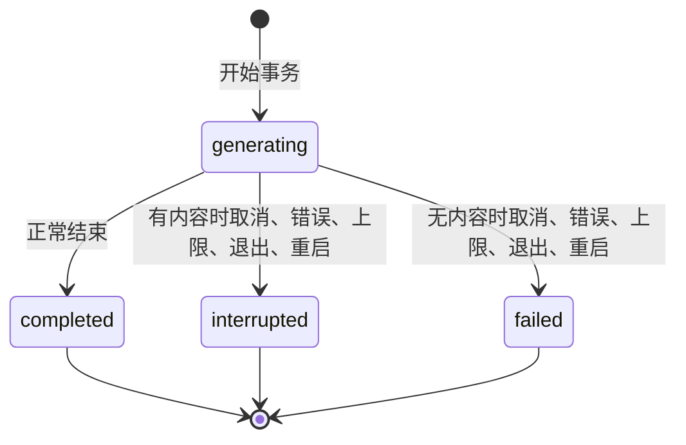

# 06 AI工作台 - 技术设计

> **设计状态：Ready（阶段 1～5）。** 本文依据 [D072](../../../06-决策记录/V1-冻结决策.md#d072-聊天内容的持久化边界用户隔离与删除语义)～[D077](../../../06-决策记录/V1-冻结决策.md#d077-聊天阶段-0-验证结论双开处理与前端选型)（2026-10-30）。阶段 0 验证已完成，结果见文末“阶段 0 验证结论”。物理结构以 migration 为准、数据模型文档为说明（[数据模型 §4.6](../../../04-技术架构/当前版本/V1-数据模型.md)）；函数名是设计名称，实现与验证状态只在 [V1 实现状态](../../../02-产品与版本/当前版本/V1-实现状态.md)维护，本文不记录进度。

来源：[需求与范围](06-AI工作台.md#2-功能概述) · [数据](06-AI工作台.md#4-数据模型) · [接口](06-AI工作台.md#6-接口设计) · [验收](06-AI工作台.md#5-验收标准) · 当前单任务切片见[工作台技能消费设计](../../../04-技术架构/当前版本/V1-工作台技能消费设计.md) · 实现状态见 [V1 实现状态](../../../02-产品与版本/当前版本/V1-实现状态.md)

## 风险与对策

本功能命中四类高风险信号：个人数据（聊天正文）、并发写同一资源（每用户的活动生成）、调用外部服务（流式 Provider）、状态机（生成与任务终态）。主规格的 `risk` 为"高风险"（用户 2026-10-30 确认）。

| 风险 | 严重程度 | 对策 | 关联决策 |
| --- | --- | --- | --- |
| 聊天正文进入日志、使用记录、任务审计或错误消息 | 高 | 正文只出现在 `chat_*` 表、IPC 响应和页面内存；日志与审计只记 ID、状态、固定错误类别；哨兵字符串测试 | D072 |
| 一个用户读取、修改、删除或搜索另一个用户的会话 | 高 | 每个查询同时按 `id` 与 `user_id` 过滤；他人与不存在返回同一错误；复合外键保证消息与会话同属一人 | D072 |
| 流式生成被中断后部分内容丢失，或重复生成导致重复计费 | 高 | 终态事务写入部分内容；`client_request_id` 幂等；条件更新保证只有一个终态生效；不自动重放 | D074 |
| 同一用户并发生成，或取消令牌被覆盖导致无法取消 | 高 | 每用户一个活动生成；注册表插入前检查已有条目；数据库部分唯一索引兜底 | D074 |
| 会话中途 Provider 端点被改，整段历史被发到新主机 | 高 | 每次发送比较目标指纹，变化时阻断并要求确认 | D075 |
| Skill 在会话中途被更新或篡改，行为漂移 | 中 | 会话固定版本与哈希，每次发送重验，失败阻断 | D075 |
| 删除后内容仍可恢复，或删除与生成竞争 | 中 | 硬删除加 `secure_delete`；该会话有活动生成时拒绝删除；界面不承诺物理擦除 | D072、D074 |
| 重新生成先删后调，失败后两份回复都丢 | 中 | 成功后替换；失败、取消、重启保留旧回复 | D076 |
| 用量未知被显示为 0，或把可能已计费的中断显示成"未发生" | 中 | 未知用量存 NULL；中断和超时提示"结果未知，上游可能已计费" | D074 |
| 搜索在单连接池上长时间扫描，阻塞生成的终态写入 | 中 | 查询长度和页大小上限；阈值触发 FTS5 评估 | D076 |
| 双开应用时，一个进程的启动恢复把另一个进程的运行中记录标为中断 | 中 | 阶段 0 实测双开可发生；D077：应用数据目录下 `dgos.lock` 独占文件锁，取不到锁则退出，恢复因此无需实例标识 | D074、D077 |

## 现状缺口与已发现缺陷

下列是对设计有影响的现有代码事实。"已读代码"表示本次直接读取了源码；"依据调查报告"表示来自代码调研记录，未逐行核对；二者都没有运行验证。

| 缺口 | 影响设计的方式 | 证据层级 |
| --- | --- | --- |
| `text_tasks.insert` 在发现重复 ID 时已经替换了表中的取消令牌，之后才返回错误（`crates/dgos-workbench/src/lib.rs` 第 261～269 行） | 聊天注册表必须"先检查再插入"，不能照搬 | 已读代码，未复现、未修复 |
| 文本任务没有"每用户一个活动任务"的规则；工具任务有 | 聊天需要自己的每用户限制 | 文本任务已读代码；工具任务依据调查报告 |
| Provider 流取消与网络中断都是一次 `stream_interrupted`（1001007），使用记录 `success=false`、tokens 为 0 | 取消原因必须由宿主在取消前记录，不能事后从错误码推断 | 已读 `manager.rs` 注释；其余依据调查报告 |
| `ProviderManager` 不累积也不返回部分内容 | 聊天服务自己累积 `delta` | 已读 `manager.rs` 第 591～593 行 |
| 流的 `Done` 在上游无用量时被写成全零，没有"用量未知"标记；流路径没有 `audit_warning` | 聊天终态把全零当作未知，存 NULL；用量写入失败只能依赖任务行 | 依据调查报告 |
| 流只有 120 秒空闲超时，没有总时长上限 | 宿主自己加总时长与回复大小上限 | 依据调查报告 |
| 流式适配器不处理 `tool_calls`，`ChatRequest` 没有工具字段 | 带工具的轮次走 D022 的非流式路径 | 依据调查报告 |
| `call_provider_stream` 使用 `Settings` 调用方且 `expected_revision = None`；先 spawn 再返回 `stream_id` | 聊天不复用该命令，直接用 `ProviderManager` 的 `stream_provider_bound_cancellable_with_provenance`，调用方为 `Workbench`、请求 ID 为任务 ID | 依据调查报告；`ProviderManager` 方法签名已读 |
| `recover_interrupted` 不按用户或实例限定；Tauri 依赖中没有 single-instance 插件 | 双开可能互相误标 | 无插件为已 grep；双开行为未验证 |
| `TaskRecord` 把数据库模型直接序列化给渲染进程，含 `user_id` | 聊天 DTO 单独定义，不含 `user_id` | 依据调查报告 |
| `workbench_tasks.status` 的 CHECK 固定四值 | 聊天消息自己的状态放在 `chat_messages`，任务状态沿用四值 | 依据调查报告 |
| 连接池默认单连接，`journal_mode = delete`，没有 `secure_delete` | 事务要短；删除需要连接选项；`VACUUM` 不可用 | 阶段 0 已实测（D077）；`establish_connection` 统一设置 `secure_delete = ON` |

## 物理模型（D073 已确认）

只描述形状与约束，不分配 migration 名称。风格对齐近期表：TEXT `user_id`、Unix 秒整数、forward-only。

```sql
-- chat_sessions
id TEXT PRIMARY KEY,
user_id TEXT NOT NULL,
title TEXT NOT NULL,
title_source TEXT NOT NULL CHECK (title_source IN ('auto','user')),
provider_id TEXT NULL,            -- 无外键：Provider 被删后会话仍可读
model_id TEXT NULL,
skill_id TEXT NULL, skill_version_id TEXT NULL, skill_content_hash TEXT NULL,
no_skill_confirmed INTEGER NOT NULL DEFAULT 0,
created_at INTEGER NOT NULL, updated_at INTEGER NOT NULL,
UNIQUE (id, user_id)
-- 索引：(user_id, updated_at DESC, id DESC)

-- chat_messages
id TEXT PRIMARY KEY,
session_id TEXT NOT NULL, user_id TEXT NOT NULL,
seq INTEGER NOT NULL,             -- 每会话单调，同秒内稳定排序
role TEXT NOT NULL CHECK (role IN ('user','assistant')),
content TEXT NOT NULL,            -- generating 时可为空串
status TEXT NOT NULL CHECK (status IN ('generating','completed','interrupted','failed')),
task_id TEXT NULL,                -- 引用 workbench_tasks.id，不建外键
replaces_id TEXT NULL,            -- 重新生成的半成品指向被替换的旧回复
finish_reason TEXT NULL, error_code TEXT NULL,
created_at INTEGER NOT NULL, updated_at INTEGER NOT NULL,
FOREIGN KEY (session_id, user_id) REFERENCES chat_sessions (id, user_id) ON DELETE CASCADE,
UNIQUE (session_id, seq)
-- 部分唯一索引：UNIQUE (user_id) WHERE role = 'assistant' AND status = 'generating'

-- workbench_tasks 追加（可空列，不重建表）
session_id TEXT NULL, kind TEXT ..., endpoint_fingerprint TEXT NULL
```

要点：

- 用户消息永远是 `completed`；`system` 角色不入库，由宿主在每次请求时构造（D018）。
- `kind` 用来区分旧单任务（`single`）与聊天生成（`chat`），使旧审计列表不被聊天任务淹没；`session_id` 在会话删除后置空，`kind` 不变。`ALTER TABLE ADD COLUMN` 带 `CHECK` 与 `NOT NULL DEFAULT` 已在阶段 0 验证可行（D077）。
- 助手消息只保存 `task_id`，Provider、模型、配置版本、目标指纹、技能引用都从任务行与引用表读取，不在消息上复制快照。
- 不建 `chat_session_config`（D073）。

### 助手消息与任务的状态



终态映射表见 [D074](../../../06-决策记录/V1-冻结决策.md#d074-聊天生成的生命周期并发重复发送取消部分内容与重启恢复)，不在此重复。终态不可改写；重新生成总是新建消息，不修改旧终态消息。

## 单元契约

名称为规划名称。所有函数的用户身份来自宿主上下文，不接受参数传入。

| 函数 | 前置条件 | 返回 / 后置条件 | 副作用 | 幂等 |
| --- | --- | --- | --- | --- |
| `send_chat_message(session_id, content, client_request_id, accept_destination?, channel) -> SendAck` | 会话属于当前用户；该用户没有活动生成；预算通过 | 返回 `task_id`、两条消息 ID、`dropped_turns`、`replayed`；生成在后台继续 | 写任务行、引用行、两条消息；登记注册表；调用 Provider | 是：`client_request_id` 即任务 ID |
| `generate(task, request, token, channel)` | 已登记注册表与取消令牌 | 恰好一个终态事件；终态事务提交后才释放注册表 | 向 `channel` 发事件；终态事务 | 否，内部函数 |
| `finalize(task, outcome)` | 消息仍为 `generating` 且任务仍为 `running` | 两者在同一事务内进入终态，或都不变 | 更新会话 `updated_at`；重新生成时替换或丢弃 | 是：条件更新，第二次返回 `already_finalized` |
| `cancel_chat_generation(task_id) -> bool` | 无 | 当前用户的活动生成返回 `true`；其他用户、未知、已结束返回 `false` | 先记录停止原因，再触发取消令牌 | 是 |
| `recover_chat_interrupted()` | 启动后、命令注册前 | 所有 `generating` 消息进入终态；重新生成半成品被丢弃 | 写消息；与现有任务恢复同一启动步骤 | 是 |
| `delete_chat_session(session_id)` | 该会话没有活动生成 | 会话与消息删除，`workbench_tasks.session_id` 置空 | 单事务 | 否：第二次返回不存在 |
| `purge_user_chat(user)` | 由 FR-008 调用 | 取消并等待该用户活动生成结束后，删除其全部会话与消息 | 单事务；任务 `session_id` 置空 | 是 |
| `regenerate_chat_message(message_id, client_request_id, channel) -> SendAck` | 目标是会话的最后一条助手消息且不在生成中 | 新建带 `replaces_id` 的占位消息；成功后替换 | 新任务行；Provider 调用 | 是：同 `client_request_id` |
| `search_chat_sessions(query, cursor, limit)` | 查询去空白后 1～128 字符 | 按 `(updated_at, id)` 倒序的会话页，含片段与匹配数 | 无写入 | 是 |
| `list_chat_sessions` / `list_chat_messages` | 无 | keyset 分页 | 无写入 | 是 |
| `fingerprint(provider) -> String` | Provider 存在 | 协议类型加端点的协议、主机、端口的哈希；不含路径与凭据 | 无 | 是 |

## 伪代码

要求：每个关键判断和副作用标注分支 ID；网络调用在事务外。B06-01～B06-17 是 D016 前的旧分支，仍登记在主规格 §7.3，不在此重复；本文从 B06-18 开始。

```text
FUNCTION send_chat_message(window, input, channel) -> Result<SendAck>:
  user = host_context(window, Workbench, TasksRun).user_id        // 宿主派生，不接受 user_id
  IF NOT is_uuid(input.client_request_id): RETURN Err(invalid_message_content)   // B06-18
  text = trim(input.content)
  IF bytes(text) == 0 OR bytes(text) > 16384: RETURN Err(invalid_message_content)   // B06-19
  prior = SELECT user message WHERE task_id = request_id AND user_id = user
  IF prior:                                                       // B06-20
    IF prior.content == text: RETURN replay_ack(prior)            // 不再次调用上游
    RETURN Err(request_id_conflict)
  session = SELECT chat_sessions WHERE id = input.session_id AND user_id = user
  IF NOT session: RETURN Err(session_not_found)                   // B06-21：他人与不存在同一错误
  (provider, model) = validate_target(session, user)              // B06-22：未选择 provider_not_selected；
                                                                  //   模型必须是 text-generation 且 Provider 已启用
  skill = revalidate_session_skill(session, user)                 // B06-23：失败 skill_unavailable
  fp = fingerprint(provider)
  IF last_task_fingerprint(session) != fp AND input.accept_destination != fp:
    RETURN Err(destination_changed(fp))                           // B06-24：界面确认后带回 fp 重发
  history = SELECT completed turns of session ORDER BY seq
  (messages, dropped) = assemble(host_system, skill, history, text)   // B06-25：整轮丢弃最旧；单条超限
                                                                  //   或空历史仍超限则 context_too_long
  IF NOT registry.try_register(user, request_id, session.id, window.label, token):
    RETURN Err(generation_in_progress)                            // B06-26：先检查再插入，不覆盖已有条目
  BEGIN TRANSACTION
    INSERT workbench_tasks(kind='chat', session_id, status='running', config_revision, endpoint_fingerprint)
    INSERT workbench_task_skills (若有技能)
    INSERT chat_messages user (seq = max+1, completed, task_id)
    INSERT chat_messages assistant (seq = max+2, generating, task_id)   // B06-27
    UPDATE chat_sessions SET updated_at, 首条消息时自动标题
  COMMIT
  ON any error (含部分唯一索引冲突): registry.release(request_id); RETURN Err(mapped)   // B06-28
  SPAWN generate(...)
  RETURN Ok(SendAck{task_id, user_message_id, assistant_message_id, dropped, replayed=false})   // B06-29

FUNCTION generate(task, request, token, channel):
  emit(channel, started)
  stream = providers.stream_bound_cancellable(task.provider, task.model, request, user,
             task.config_revision, provenance(Workbench, task.id), token)
  IF stream open fails: finalize(task, failed(code)); RETURN      // B06-30
  buffer = ""
  LOOP select:
    delta:      buffer += text; emit(channel, delta)
                IF bytes(buffer) > 64KiB: stop(generation_limit)  // B06-31
    reasoning:  emit(channel, reasoning_delta)                    // B06-32：只显示，不进 buffer、不入库、不入日志
    token.cancelled: stop(entry.stop_reason)                      // B06-33：取消、离页、窗口销毁
    elapsed > 10min: stop(generation_limit)                       // B06-34
    done:       finalize(task, completed(buffer, finish_reason, usage))   // B06-35
    error:      finalize(task, IF buffer != "" THEN interrupted ELSE failed, code)   // B06-36
  stop(reason): drop stream; finalize(task, IF buffer != "" THEN interrupted ELSE failed, reason)

FUNCTION finalize(task, outcome):
  BEGIN TRANSACTION
    n = UPDATE chat_messages SET content, status, finish_reason, error_code
        WHERE id = assistant_id AND user_id = user AND status = 'generating'   // B06-37
    IF n != 1: ROLLBACK; RETURN already_finalized                 // B06-38：已被其他终态覆盖，不重写
    tokens = IF usage is absent OR all zero THEN NULL ELSE usage.total   // B06-39：未知不写 0
    UPDATE workbench_tasks SET status, error_code, finished_at, total_tokens
        WHERE id = task.id AND user_id = user AND status = 'running'
    IF message.replaces_id:
      IF outcome is completed: DELETE old reply; clear replaces_id   // B06-51
      ELSE: DELETE this row (保留旧回复)                           // B06-52
    UPDATE chat_sessions SET updated_at
  COMMIT
  registry.release(task.id)
  emit(channel, terminal(snapshot of persisted message))          // B06-40：界面以快照为准，不用累积的 delta

FUNCTION cancel_chat_generation(window, task_id) -> bool:
  entry = registry.get(task_id)
  IF NOT entry OR entry.user != user: RETURN false                // B06-41：他人与未知同样返回 false
  IF entry.stop_reason.set_once(task_cancelled): entry.token.cancel()   // B06-42：重复取消无副作用
  RETURN true

FUNCTION recover_chat_interrupted():
  BEGIN TRANSACTION
    DELETE chat_messages WHERE status = 'generating' AND replaces_id IS NOT NULL   // B06-43
    UPDATE chat_messages SET status = IF content != '' THEN 'interrupted' ELSE 'failed',
           error_code = 'process_interrupted' WHERE status = 'generating'          // B06-44
  COMMIT                                                          // 不重发；任务行由现有恢复置为 interrupted

FUNCTION shutdown_chat(timeout):
  FOR EACH active generation: entry.stop_reason.set_once(process_interrupted); entry.token.cancel()   // B06-45
  WAIT until all finalize or timeout (与现有退出的 5 秒共用)

FUNCTION delete_chat_session(window, session_id):
  IF registry.has_active_for_session(user, session_id): RETURN Err(generation_in_progress)   // B06-46
  BEGIN TRANSACTION
    UPDATE workbench_tasks SET session_id = NULL WHERE session_id = ? AND user_id = user
    n = DELETE chat_sessions WHERE id = ? AND user_id = user      // 级联删除消息，B06-47
    IF n != 1: ROLLBACK; RETURN Err(session_not_found)
  COMMIT

FUNCTION purge_user_chat(user):
  cancel all registry entries of user; wait for finalize           // B06-48
  BEGIN TRANSACTION
    UPDATE workbench_tasks SET session_id = NULL WHERE user_id = user AND session_id IS NOT NULL
    DELETE chat_sessions WHERE user_id = user
  COMMIT

FUNCTION regenerate_chat_message(window, message_id, input, channel):
  msg = SELECT assistant message WHERE id = message_id AND user_id = user
  IF NOT msg OR msg is not the last message of its session OR msg.status == 'generating':
    RETURN Err(message_not_regenerable)                           // B06-49
  执行 B06-18、B06-21～B06-26 的同一组校验（历史不含 msg）
  BEGIN TRANSACTION
    INSERT workbench_tasks (新任务行)
    INSERT chat_messages assistant (seq = max+1, generating, replaces_id = msg.id)   // B06-50
  COMMIT
  SPAWN generate(...)

FUNCTION search_chat_sessions(window, query, cursor, limit):
  q = trim(query)
  IF len(q) NOT IN 1..128: RETURN Err(invalid_search_query)
  pattern = '%' + escape(q, '%', '_', '\') + '%'                  // B06-53
  SELECT s FROM chat_sessions s
   WHERE s.user_id = user
     AND (s.title LIKE pattern ESCAPE '\'
          OR EXISTS (SELECT 1 FROM chat_messages m
                      WHERE m.session_id = s.id AND m.user_id = user
                        AND m.status IN ('completed','interrupted') AND m.replaces_id IS NULL
                        AND m.content LIKE pattern ESCAPE '\'))
     AND (s.updated_at, s.id) < cursor
   ORDER BY s.updated_at DESC, s.id DESC LIMIT min(limit, 50) + 1  // B06-54：用户隔离与 keyset 分页
  查询串不进日志

FUNCTION create_chat_session(window, target?) -> Session:
  INSERT chat_sessions (title='新会话', title_source='auto', 目标可空)   // B06-55
FUNCTION set_auto_title(session, first_user_text):
  IF title_source == 'auto': title = first 30 chars without newlines    // B06-56：不额外调用模型
FUNCTION update_chat_session_target(session, provider, model, skill?):
  校验同 B06-22、B06-23；只影响之后的发送                          // B06-57
FUNCTION list_chat_messages(session_id, before_seq, limit):
  WHERE session_id AND user_id = user AND replaces_id IS NULL ORDER BY seq DESC LIMIT ?   // B06-58

FRONTEND chatStore.send(content):
  channel = createChannel(); 事件先于 invoke 返回到达时按 assistant_message_id 缓存    // B06-59
  on terminal event: 用快照替换占位消息，不用累积 delta                                  // B06-60
  on unmount / 窗口销毁: invoke cancel_chat_generation                                  // B06-61
  render assistant markdown: 禁 raw HTML、不加载远程图片、链接白名单加确认               // B06-62
```

### 实例锁与聊天工具轮次（D077、D022、D075）

```text
FUNCTION acquire_instance_lock(app_dir):              // 启动最早，打开数据库之前
  file = open_or_create(app_dir / "dgos.lock")
  IF file.try_lock() fails (WouldBlock): LOG fixed error; EXIT non-zero   // B06-63：不碰数据库
  keep file handle for the process lifetime              // 内核在进程被杀时释放

FUNCTION send_chat_message WITH tools (非空):
  复用 B06-18～B06-29 的校验与开始事务；再校验每个工具：服务已启用且 ready、schema_hash 与当前一致   // B06-64
  任务行 kind='chat'，task_tool 引用行与任务同一事务；该轮不流式
  SPAWN run_tool_turn: advance(RunModel) -> 无提案 -> finalize(completed)   // 提案：emit tool_proposal 并等待
FUNCTION advance_chat_tool_turn(window, task_id, action):
  session = tool_turns.get(task_id) WHERE user = 宿主用户 ELSE Err(tool_turn_invalid)   // B06-65：他人与未知同一错误
  动作与当前提案 ID 不符、已过期 -> Err(tool_turn_invalid)；批准后一次性取走上下文，重复动作被拒
  批准：重新校验 Provider 配置版本、权限、连接、schema hash，申请单次 MCP 调用，不自动重试   // 沿用 D022
  拒绝/过期/取消：finalize(failed 或 interrupted)，参数与结果不入聊天库       // B06-66
```

## 分支到测试追踪

B06-01～B06-17 在主规格 §7.3 的表中登记。下表覆盖 B06-18 起的全部分支。

| 分支 | 功能 AC | 跨功能验收 / NFR |
| --- | --- | --- |
| B06-18 | AC19 | - |
| B06-19 | AC03 | - |
| B06-20 | AC19 | - |
| B06-21 | AC16 | - |
| B06-22 | AC02、AC20 | - |
| B06-23 | AC21 | - |
| B06-24 | AC20 | - |
| B06-25 | AC05、AC23 | - |
| B06-26 | AC19 | - |
| B06-27 | AC07、AC17 | - |
| B06-28 | AC19 | - |
| B06-29 | AC04 | V1-E2E-06 |
| B06-30 | AC17 | - |
| B06-31 | AC04、AC17 | - |
| B06-32 | AC24 | - |
| B06-33 | AC06、AC17 | V1-E2E-06 |
| B06-34 | AC17 | - |
| B06-35 | AC04、AC07 | V1-E2E-06 |
| B06-36 | AC17 | - |
| B06-37 | AC07、AC17 | - |
| B06-38 | AC17、AC19 | - |
| B06-39 | AC17 | - |
| B06-40 | AC04 | - |
| B06-41 | AC06、AC16 | - |
| B06-42 | AC06 | - |
| B06-43 | AC18、AC27 | - |
| B06-44 | AC18 | - |
| B06-45 | AC18 | - |
| B06-46 | AC25 | - |
| B06-47 | AC09、AC25 | - |
| B06-48 | AC16、AC25 | - |
| B06-49 | AC13、AC27 | - |
| B06-50 | AC27 | - |
| B06-51 | AC27 | - |
| B06-52 | AC27 | - |
| B06-53 | AC15、AC28 | - |
| B06-54 | AC15、AC16、AC28 | - |
| B06-55 | AC01 | - |
| B06-56 | AC26 | - |
| B06-57 | AC02、AC21 | - |
| B06-58 | AC08、AC30 | - |
| B06-59 | AC04、AC17 | - |
| B06-60 | AC04、AC17 | V1-E2E-06 |
| B06-61 | AC06、AC17 | - |
| B06-62 | AC14、AC29 | - |
| B06-63 | AC18 | - |
| B06-64 | AC22 | - |
| B06-65 | AC16、AC22 | - |
| B06-66 | AC22 | - |

## 并发控制

| 场景 | 冲突点 | 控制方式 | 失败策略 |
| --- | --- | --- | --- |
| 同一用户在任意会话再次发送 | 每用户一个活动生成 | 注册表 `try_register`（先检查再插入）；数据库部分唯一索引兜底 | `generation_in_progress`，不调用上游 |
| 同一 `client_request_id` 重复到达 | 重复计费 | 任务 ID 即幂等键；用户消息内容比较 | 一致则返回原确认；不一致 `request_id_conflict` |
| 取消与结束同时发生 | 终态只能一个 | 取消前先写停止原因（只写一次）；终态用条件更新 | 后到者得到 `already_finalized` 或 `false`，无副作用 |
| 删除会话与该会话的生成 | 级联删除使终态更新为 0 行 | 该会话有活动生成时拒绝删除 | `generation_in_progress` |
| 修改会话目标或技能与进行中的生成 | 请求已装配完毕 | 生成使用开始事务时固定的任务行快照 | 修改只影响下一次发送 |
| 删除用户（FR-008）与活动生成 | 同上 | `purge_user_chat` 先取消并等待终态 | 超时则返回错误，不强删 |
| 搜索与生成终态写入 | 单连接池排队 | 查询长度与页大小上限；事务保持短 | 超过阈值评估 FTS5（D076） |

死锁预防：事务内不做网络调用；每个事务只涉及 `workbench_tasks`、`chat_messages`、`chat_sessions`，顺序固定为任务、消息、会话。

## 事务边界

- 开始事务：任务行、技能引用、用户消息、助手占位消息、会话 `updated_at` 与自动标题在同一事务。失败则全部回滚，注册表条目释放。
- 终态事务：助手消息、任务行、会话 `updated_at`、重新生成的替换或丢弃在同一事务。
- 删除事务：任务 `session_id` 置空与会话删除（级联消息）在同一事务。
- 隔离级别：SQLite 默认串行化写；不依赖更高隔离。
- 流式读取期间不持有事务；`delta` 不逐条写库（D074 落库 A）。

## 幂等与重试

- 幂等键：`client_request_id`（渲染端 UUID），宿主用作任务 ID。
- 存储：任务行与用户消息的 `task_id`，随会话保留。
- 重复请求：内容一致返回原确认并标记 `replayed`，界面重新拉取消息；内容不一致返回 `request_id_conflict`。
- 重试：宿主不自动重试已派发的生成；Provider 适配层在连接和响应头阶段的重试不保证外部恰好一次，文档与界面不得承诺。再次手动发送是新请求，会产生新任务。

## 外部调用与补偿

- 超时：Provider 空闲超时 120 秒（现有）；宿主总时长 10 分钟与回复 64 KiB 是自选值，待校准。
- 未知结果：中断、超时、取消后，上游是否计费未知。任务记为 `interrupted` 或 `failed`，不重放、不补偿，界面提示"结果未知，上游可能已计费"。预校验失败没有任务行，不显示该提示。
- 用量写入：流路径没有 `audit_warning`；聊天任务行是权威记录，`provider_usage_logs` 写入失败只记 warn，不影响终态。
- 取消不撤销外部副作用；带工具的轮次沿用 D022 的说明。
- 不适用补偿任务：没有需要对账的本地资金或库存。

## 安全与日志

- 敏感字段：消息正文、会话标题、搜索查询、推理文本、技能正文、工具参数与结果。不进日志、`provider_usage_logs`、Skill/MCP 使用记录、`workbench_tasks`、错误消息、测试 fixture。推理文本也不进入后续轮次上下文。
- 权限：每个命令由宿主入口校验主窗口与来源，沿用 `Workbench` 调用方的 `TasksRun`；不新增 capability；模块上下文对聊天命令一律拒绝（`BuiltinCaller::Module` 在现有 `allows` 中无任何能力）。
- DTO 不含 `user_id`，输入 `deny_unknown_fields`。
- 错误对外只返回固定类别与数字码，不回显上游原文。
- Markdown：禁用 raw HTML，不加载远程图片，链接只允许白名单协议并在打开前确认。这是防止正文外泄（图片请求携带数据）和脚本注入的要求。

## 阶段 0 验证结论

环境、方法、证据等级与局限见 [D077](../../../06-决策记录/V1-冻结决策.md#d077-聊天阶段-0-验证结论双开处理与前端选型)。只用临时库与合成哨兵，探针为一次性代码，已删除。

| 问题 | 结论 | 对设计的影响 |
| --- | --- | --- |
| `secure_delete` 是否对池内每个连接生效；删除后主库是否不含哨兵 | 通过连接选项设置后每个连接均为 1；主库哨兵命中 209 → 0 | `establish_connection` 统一设置；承诺仍只到“应用内不可恢复” |
| 连接池大小与 `journal_mode` | 池大小 1，`journal_mode = delete`，应用有两个池指向同一文件 | 事务保持短；不依赖并发读 |
| `ALTER TABLE ADD COLUMN` 带 `CHECK` / `NOT NULL DEFAULT` | 可行，旧行取默认值，CHECK 对新插入生效 | `workbench_tasks.kind` 用带 CHECK 的默认列 |
| 应用能否双开；双开恢复是否误标 | 可双开；第二进程恢复把第一进程的 `running` 任务置为 `interrupted` | D077：`dgos.lock` 文件锁（B06-63） |
| `LIKE` 在 1 万条消息上的耗时 | 最坏中位数约 9 毫秒（release），并发写等待约 7.7 毫秒 | 保持 `LIKE`，不加 FTS（D076 阈值 300 毫秒） |
| FTS5 是否可用 | 可用，含 trigram | 保留为未来路径，本阶段不启用 |
| WKWebView 剪贴板 | `navigator.clipboard.writeText` 与 `execCommand('copy')` 均成功 | 先用 `navigator.clipboard`，失败回退，再失败给出提示 |
| 长列表 | 不用内联样式时不做虚拟化：keyset 分页加节点上限（消息 200、会话 300） | AC30 以节点上限和分页测试覆盖 |
| Markdown 与高亮选型 | `marked`（仅 `Lexer`）加 `lowlight`，自写 React 映射 | 无 HTML 字符串，无需 DOMPurify（B06-62） |

## 阶段 6 收口结论（2026-10-30）

命令、环境与完整数值见[实现状态“FR-006 阶段 6 验证证据”](../../../02-产品与版本/当前版本/V1-实现状态.md)。本节只记录对设计有影响的结论。

| 项目 | 结论 | 对设计的影响 |
| --- | --- | --- |
| 预算校准（D075） | 2026-10-31 一个第三方网关、两个协议、一次运行：边际约 6.5（OpenAI 兼容）与 2.2（Anthropic 兼容）字节每 token，固定开销约 330 与 2100 tokens（推断）；16 KiB 边界、整轮丢弃（输入 tokens 在丢弃后不再增长）与已知小窗口行为与设计一致；网关模型行没有窗口；`length` 与推理文本未观察到；Anthropic 兼容端点没有执行 `max_tokens=1024`（推断），64 KiB 宿主上限实际触发 | 24 KiB、16 KiB、1024、64 KiB、10 分钟保持暂定值；不提出调整决策（只有一个第三方网关，窗口未知时放大上限会把超窗风险推给上游）。64 KiB 上限对不遵守 `max_tokens` 的上游是必要的兜底 |
| 规模（D076） | 10 万条消息、release、Apple M1 Max：最慢的无匹配全表搜索 p95 约 35 毫秒；keyset 页均低于 1 毫秒；删除 1 万条消息的会话约 42 毫秒 | 保持 `LIKE`，不启用 FTS5，不做虚拟化 |
| 搜索与终态写入的竞争 | `journal_mode = delete`，写需要等读完成。10 万条时 1 个连续搜索使终态写入 p50 等待约 25 毫秒，4 个连续搜索时 release 最大 143 毫秒、debug 最大 249 毫秒；没有出现 `SQLITE_BUSY`（5 秒忙等） | 并发控制表“搜索与生成终态写入”的风险成立但在阈值内；界面同一时刻只发一个搜索，4 个并发是上界场景 |
| 日志封顶 | 把 `sea_orm=warn` 作为追加的 `EnvFilter` 指令不够：`EnvFilter` 选最具体的匹配，`RUST_LOG=sea_orm::driver=trace` 会覆盖它 | 改为独立的 `Targets` 过滤器与用户过滤器取交集（`dgos_db::QUIET_LOG_TARGETS`，`src-tauri/src/logging.rs`） |
| 单任务历史 | `WorkbenchManager::list` 没有按 `kind` 过滤，聊天任务行会占满单任务历史的 50 行 | 加 `kind = 'single'` 过滤，与物理模型要点一致 |
| 工具轮次回复大小 | 工具轮次的最终 `content` 原先不经过 64 KiB 回复上限，只受 1 MiB 工具响应体上限约束 | 已按 [D079](../../../06-决策记录/V1-冻结决策.md#d079-聊天回复上限同样约束带工具的轮次) 处理：超过 64 KiB 在字符边界截断，终态与流式相同（`interrupted / generation_limit`） |
| 客户端构建延迟 | `ProviderManager` 原先每次调用都新建 `reqwest::Client`；macOS 上 40 次构建中有 1 次耗时约 3.1 秒（其余 0～1 毫秒），这是 `dgos-providers` 计时测试不稳定的根因。该时间在 120 秒空闲计时之外、在 10 分钟总时长之内，取消的实际停止会滞后到构建结束 | 已处理（FR-001 已知差异第 8 项）：管理器启动时构建一个客户端，所有适配器复用，构建不再发生在调用路径上 |
| 真实时钟上限 | `ProviderManager::create_adapter` 固定使用默认 `AdapterOptions`，`MAX_DURATION` 为常量，不改产品代码无法在冒烟中缩短 120 秒空闲与 10 分钟总时长 | 两项仍只有回复大小上限的自动化证据 |

## 发布与回滚

- 前置条件：D072～D076 经用户确认；阶段 0 验证完成；migration 名称与编号在确认后分配。
- 回滚方式：migration 为 forward-only（与近期惯例一致）。应用降级后新表保留但不被读取，不提供自动数据回滚。
- 监控指标：终态为 `interrupted` 的比例；`already_finalized` 出现次数；单次生成时长分布；`generation_in_progress` 次数。只记计数，不记内容。
- 分阶段交付与每阶段 AC 见主规格 §2.4。

## 变更记录

| 日期 | 变更 | 关联决策 |
| --- | --- | --- |
| 2026-10-30 | 初始草案：现状缺口、物理模型、伪代码 B06-18～B06-62、追踪表、阶段 0 验证项 | D072～D076（草案） |
| 2026-10-30 | 用户确认 D072～D076；设计状态更新。双开处理待阶段 0 验证 | D072～D076 |
| 2026-10-30 | 阶段 0 验证完成并写入 D077；双开采用文件锁；物理模型小节改名；新增分支 B06-63～B06-66（实例锁、工具轮次）；设计状态改为 Ready（阶段 1～5） | D077 |
| 2026-10-30 | 新增“阶段 6 收口结论”：规模与竞争数据、日志封顶改为独立过滤器、单任务历史按 `kind` 过滤、待决定的工具轮次回复上限、客户端构建延迟；预算校准未执行 | D075、D076、D078 |
| 2026-10-30 | 用户同意后处理两项：工具轮次回复受 64 KiB 上限约束（D079）；`ProviderManager` 复用一个 HTTP 客户端 | D079 |
