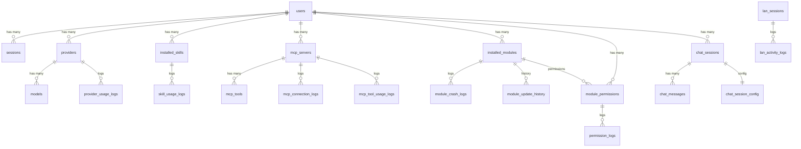

# V1 数据模型

## 1. 文档目标

本文档定义 DGOS V1 的完整数据模型，包括所有数据表、字段、约束、关系和迁移策略。

**权威性**：
- ✅ 数据模型的唯一权威来源
- ✅ 所有功能规格引用此文档
- ✅ 开发前必须 Review

**更新原则**：
- 新增表/字段：先更新此文档，再修改代码
- 字段修改：记录迁移路径
- 删除字段：标记为 deprecated，至少保留一个版本

---

## 2. 数据库选型

| 项目 | 选择 | 版本 | 理由 |
|------|------|------|------|
| **数据库** | SQLite | 3.45+ | 本地优先、零配置、单文件 |
| **ORM** | SeaORM | 0.12+ | 类型安全、异步、迁移工具 |
| **迁移工具** | SeaORM Migration | - | 与 ORM 集成 |

**并发策略**：
- 事务隔离级别：`SERIALIZABLE`（SQLite 默认）
- 唯一约束：防止重复数据
- 乐观锁：关键资源使用 `updated_at` 版本检查
- 不使用悲观锁：并发量小，不需要

---

## 3. 核心实体

### 3.1 用户管理（V1-FR-008）

#### users（用户）

| 字段 | 类型 | 约束 | 说明 |
|------|------|------|------|
| id | TEXT | PK | UUID |
| username | TEXT | UNIQUE, NOT NULL | 用户名（4-20 字符） |
| password_hash | TEXT | NOT NULL | bcrypt 哈希（cost=12） |
| created_at | TIMESTAMP | DEFAULT CURRENT_TIMESTAMP | 创建时间 |
| last_login_at | TIMESTAMP | NULL | 最后登录时间 |

**索引**：
```sql
CREATE UNIQUE INDEX idx_users_username ON users(username);
```

**完整定义**：
```sql
CREATE TABLE users (
    id TEXT PRIMARY KEY,
    username TEXT UNIQUE NOT NULL,
    password_hash TEXT NOT NULL,
    created_at TIMESTAMP DEFAULT CURRENT_TIMESTAMP,
    last_login_at TIMESTAMP,
    CHECK(length(username) >= 4 AND length(username) <= 20)
);
```

**并发安全**：
- 用户名唯一约束防止重复注册
- 密码哈希在业务层完成（bcrypt）

---

#### sessions（会话）

| 字段 | 类型 | 约束 | 说明 |
|------|------|------|------|
| id | TEXT | PK | UUID |
| user_id | TEXT | NOT NULL, FK → users.id | 所属用户 |
| session_token | TEXT | UNIQUE, NOT NULL | 会话 token（UUID） |
| created_at | TIMESTAMP | DEFAULT CURRENT_TIMESTAMP | 创建时间 |
| expires_at | TIMESTAMP | NOT NULL | 过期时间（7 天后） |

**索引**：
```sql
CREATE UNIQUE INDEX idx_sessions_token ON sessions(session_token);
CREATE INDEX idx_sessions_user ON sessions(user_id);
CREATE INDEX idx_sessions_expires ON sessions(expires_at);
```

**完整定义**：
```sql
CREATE TABLE sessions (
    id TEXT PRIMARY KEY,
    user_id TEXT NOT NULL,
    session_token TEXT UNIQUE NOT NULL,
    created_at TIMESTAMP DEFAULT CURRENT_TIMESTAMP,
    expires_at TIMESTAMP NOT NULL,
    FOREIGN KEY (user_id) REFERENCES users(id) ON DELETE CASCADE
);
```

**数据隔离**：
- 所有业务表都有 `user_id` 字段
- 中间件检查确保用户只能访问自己的数据

---

### 3.2 Provider 管理（V1-FR-001）

#### providers（Provider 配置）

| 字段 | 类型 | 约束 | 说明 |
|------|------|------|------|
| id | TEXT | PK | UUID |
| user_id | TEXT | NOT NULL, FK → users.id | 所属用户 |
| name | TEXT | NOT NULL | Provider 名称 |
| provider_type | TEXT | NOT NULL | 类型（openai-compatible） |
| base_url | TEXT | NOT NULL | API 基础地址 |
| api_key | TEXT | NOT NULL | API Key（加密存储） |
| enabled | BOOLEAN | DEFAULT true | 是否启用 |
| sort_order | INTEGER | DEFAULT 0 | 排序权重（数字越小越靠前） |
| created_at | TIMESTAMP | DEFAULT CURRENT_TIMESTAMP | 创建时间 |
| updated_at | TIMESTAMP | DEFAULT CURRENT_TIMESTAMP | 更新时间 |

**索引**：
```sql
CREATE INDEX idx_providers_user ON providers(user_id);
CREATE INDEX idx_providers_enabled ON providers(user_id, enabled);
CREATE INDEX idx_providers_sort ON providers(user_id, sort_order);
```

**完整定义**：
```sql
CREATE TABLE providers (
    id TEXT PRIMARY KEY,
    user_id TEXT NOT NULL,
    name TEXT NOT NULL,
    provider_type TEXT NOT NULL,
    base_url TEXT NOT NULL,
    api_key TEXT NOT NULL,
    enabled BOOLEAN DEFAULT true,
    sort_order INTEGER DEFAULT 0,
    created_at TIMESTAMP DEFAULT CURRENT_TIMESTAMP,
    updated_at TIMESTAMP DEFAULT CURRENT_TIMESTAMP,
    FOREIGN KEY (user_id) REFERENCES users(id) ON DELETE CASCADE,
    UNIQUE(user_id, name)
);
```

**并发安全**：
- 唯一约束：`(user_id, name)` 防止同一用户重复创建
- 乐观锁：更新前检查 `updated_at`

---

#### models（模型列表）

| 字段 | 类型 | 约束 | 说明 |
|------|------|------|------|
| id | TEXT | PK | UUID |
| provider_id | TEXT | NOT NULL, FK → providers.id | 所属 Provider |
| model_id | TEXT | NOT NULL | 模型 ID（如 gpt-4） |
| model_name | TEXT | NOT NULL | 模型显示名称 |
| capabilities | TEXT | NOT NULL | 能力标签（JSON 数组：["text", "image"]） |
| synced_at | TIMESTAMP | DEFAULT CURRENT_TIMESTAMP | 同步时间 |

**索引**：
```sql
CREATE INDEX idx_models_provider ON models(provider_id);
CREATE UNIQUE INDEX idx_models_provider_model ON models(provider_id, model_id);
```

**完整定义**：
```sql
CREATE TABLE models (
    id TEXT PRIMARY KEY,
    provider_id TEXT NOT NULL,
    model_id TEXT NOT NULL,
    model_name TEXT NOT NULL,
    capabilities TEXT NOT NULL,
    synced_at TIMESTAMP DEFAULT CURRENT_TIMESTAMP,
    FOREIGN KEY (provider_id) REFERENCES providers(id) ON DELETE CASCADE,
    UNIQUE(provider_id, model_id)
);
```

---

#### provider_usage_logs（使用记录）

| 字段 | 类型 | 约束 | 说明 |
|------|------|------|------|
| id | TEXT | PK | UUID |
| user_id | TEXT | NOT NULL, FK → users.id | 所属用户 |
| provider_id | TEXT | NOT NULL, FK → providers.id | Provider ID |
| model_id | TEXT | NOT NULL | 模型 ID |
| request_tokens | INTEGER | NULL | 请求 token 数 |
| response_tokens | INTEGER | NULL | 响应 token 数 |
| latency_ms | INTEGER | NULL | 延迟（毫秒） |
| success | BOOLEAN | NOT NULL | 是否成功 |
| error_code | TEXT | NULL | 错误码 |
| created_at | TIMESTAMP | DEFAULT CURRENT_TIMESTAMP | 调用时间 |

**索引**：
```sql
CREATE INDEX idx_provider_usage_user ON provider_usage_logs(user_id, created_at);
CREATE INDEX idx_provider_usage_provider ON provider_usage_logs(provider_id, created_at);
```

**完整定义**：
```sql
CREATE TABLE provider_usage_logs (
    id TEXT PRIMARY KEY,
    user_id TEXT NOT NULL,
    provider_id TEXT NOT NULL,
    model_id TEXT NOT NULL,
    request_tokens INTEGER,
    response_tokens INTEGER,
    latency_ms INTEGER,
    success BOOLEAN NOT NULL,
    error_code TEXT,
    created_at TIMESTAMP DEFAULT CURRENT_TIMESTAMP,
    FOREIGN KEY (user_id) REFERENCES users(id) ON DELETE CASCADE,
    FOREIGN KEY (provider_id) REFERENCES providers(id) ON DELETE CASCADE
);
```

---

### 3.3 Skills 管理（V1-FR-002）

#### skill_registry_cache（Skills 注册表缓存）

| 字段 | 类型 | 约束 | 说明 |
|------|------|------|------|
| id | TEXT | PK | UUID |
| skill_id | TEXT | UNIQUE, NOT NULL | Skill ID（全局唯一） |
| name | TEXT | NOT NULL | Skill 名称 |
| version | TEXT | NOT NULL | 版本号 |
| description | TEXT | NULL | 描述 |
| category | TEXT | NULL | 分类 |
| endpoint_type | TEXT | NOT NULL | 类型（http, cli） |
| cached_at | TIMESTAMP | DEFAULT CURRENT_TIMESTAMP | 缓存时间 |

**索引**：
```sql
CREATE UNIQUE INDEX idx_skill_registry_skill_id ON skill_registry_cache(skill_id);
```

**完整定义**：
```sql
CREATE TABLE skill_registry_cache (
    id TEXT PRIMARY KEY,
    skill_id TEXT UNIQUE NOT NULL,
    name TEXT NOT NULL,
    version TEXT NOT NULL,
    description TEXT,
    category TEXT,
    endpoint_type TEXT NOT NULL,
    cached_at TIMESTAMP DEFAULT CURRENT_TIMESTAMP
);
```

---

#### installed_skills（已安装 Skills）

| 字段 | 类型 | 约束 | 说明 |
|------|------|------|------|
| id | TEXT | PK | UUID |
| user_id | TEXT | NOT NULL, FK → users.id | 所属用户 |
| skill_id | TEXT | NOT NULL | Skill ID |
| name | TEXT | NOT NULL | Skill 名称 |
| version | TEXT | NOT NULL | 版本号 |
| endpoint_type | TEXT | NOT NULL | 类型（http, cli） |
| endpoint_config | TEXT | NOT NULL | 端点配置（JSON） |
| enabled | BOOLEAN | DEFAULT true | 是否启用 |
| installed_at | TIMESTAMP | DEFAULT CURRENT_TIMESTAMP | 安装时间 |
| updated_at | TIMESTAMP | DEFAULT CURRENT_TIMESTAMP | 更新时间 |

**索引**：
```sql
CREATE INDEX idx_installed_skills_user ON installed_skills(user_id);
CREATE UNIQUE INDEX idx_installed_skills_user_skill ON installed_skills(user_id, skill_id);
```

**完整定义**：
```sql
CREATE TABLE installed_skills (
    id TEXT PRIMARY KEY,
    user_id TEXT NOT NULL,
    skill_id TEXT NOT NULL,
    name TEXT NOT NULL,
    version TEXT NOT NULL,
    endpoint_type TEXT NOT NULL,
    endpoint_config TEXT NOT NULL,
    enabled BOOLEAN DEFAULT true,
    installed_at TIMESTAMP DEFAULT CURRENT_TIMESTAMP,
    updated_at TIMESTAMP DEFAULT CURRENT_TIMESTAMP,
    FOREIGN KEY (user_id) REFERENCES users(id) ON DELETE CASCADE,
    UNIQUE(user_id, skill_id)
);
```

**并发安全**：
- 唯一约束：`(user_id, skill_id)` 防止重复安装
- 乐观锁：更新前检查 `updated_at`

---

#### skill_usage_logs（Skills 使用记录）

| 字段 | 类型 | 约束 | 说明 |
|------|------|------|------|
| id | TEXT | PK | UUID |
| user_id | TEXT | NOT NULL, FK → users.id | 所属用户 |
| skill_id | TEXT | NOT NULL | Skill ID |
| latency_ms | INTEGER | NULL | 延迟（毫秒） |
| success | BOOLEAN | NOT NULL | 是否成功 |
| error_code | TEXT | NULL | 错误码 |
| created_at | TIMESTAMP | DEFAULT CURRENT_TIMESTAMP | 调用时间 |

**索引**：
```sql
CREATE INDEX idx_skill_usage_user ON skill_usage_logs(user_id, created_at);
CREATE INDEX idx_skill_usage_skill ON skill_usage_logs(skill_id, created_at);
```

**完整定义**：
```sql
CREATE TABLE skill_usage_logs (
    id TEXT PRIMARY KEY,
    user_id TEXT NOT NULL,
    skill_id TEXT NOT NULL,
    latency_ms INTEGER,
    success BOOLEAN NOT NULL,
    error_code TEXT,
    created_at TIMESTAMP DEFAULT CURRENT_TIMESTAMP,
    FOREIGN KEY (user_id) REFERENCES users(id) ON DELETE CASCADE
);
```

---

### 3.4 MCP 管理（V1-FR-003）

#### mcp_servers（MCP 服务器）

| 字段 | 类型 | 约束 | 说明 |
|------|------|------|------|
| id | TEXT | PK | UUID |
| user_id | TEXT | NOT NULL, FK → users.id | 所属用户 |
| name | TEXT | NOT NULL | 服务器名称 |
| connection_type | TEXT | NOT NULL | 连接类型（stdio, http） |
| connection_config | TEXT | NOT NULL | 连接配置（JSON） |
| connected | BOOLEAN | DEFAULT false | 连接状态 |
| last_connected_at | TIMESTAMP | NULL | 最后连接时间 |
| created_at | TIMESTAMP | DEFAULT CURRENT_TIMESTAMP | 创建时间 |
| updated_at | TIMESTAMP | DEFAULT CURRENT_TIMESTAMP | 更新时间 |

**索引**：
```sql
CREATE INDEX idx_mcp_servers_user ON mcp_servers(user_id);
CREATE UNIQUE INDEX idx_mcp_servers_user_name ON mcp_servers(user_id, name);
```

**完整定义**：
```sql
CREATE TABLE mcp_servers (
    id TEXT PRIMARY KEY,
    user_id TEXT NOT NULL,
    name TEXT NOT NULL,
    connection_type TEXT NOT NULL,
    connection_config TEXT NOT NULL,
    connected BOOLEAN DEFAULT false,
    last_connected_at TIMESTAMP,
    created_at TIMESTAMP DEFAULT CURRENT_TIMESTAMP,
    updated_at TIMESTAMP DEFAULT CURRENT_TIMESTAMP,
    FOREIGN KEY (user_id) REFERENCES users(id) ON DELETE CASCADE,
    UNIQUE(user_id, name)
);
```

---

#### mcp_tools（MCP 工具）

| 字段 | 类型 | 约束 | 说明 |
|------|------|------|------|
| id | TEXT | PK | UUID |
| server_id | TEXT | NOT NULL, FK → mcp_servers.id | 所属服务器 |
| tool_name | TEXT | NOT NULL | 工具名称 |
| description | TEXT | NULL | 描述 |
| input_schema | TEXT | NOT NULL | 输入 Schema（JSON） |
| synced_at | TIMESTAMP | DEFAULT CURRENT_TIMESTAMP | 同步时间 |

**索引**：
```sql
CREATE INDEX idx_mcp_tools_server ON mcp_tools(server_id);
CREATE UNIQUE INDEX idx_mcp_tools_server_tool ON mcp_tools(server_id, tool_name);
```

**完整定义**：
```sql
CREATE TABLE mcp_tools (
    id TEXT PRIMARY KEY,
    server_id TEXT NOT NULL,
    tool_name TEXT NOT NULL,
    description TEXT,
    input_schema TEXT NOT NULL,
    synced_at TIMESTAMP DEFAULT CURRENT_TIMESTAMP,
    FOREIGN KEY (server_id) REFERENCES mcp_servers(id) ON DELETE CASCADE,
    UNIQUE(server_id, tool_name)
);
```

---

#### mcp_connection_logs（连接日志）

| 字段 | 类型 | 约束 | 说明 |
|------|------|------|------|
| id | TEXT | PK | UUID |
| user_id | TEXT | NOT NULL, FK → users.id | 所属用户 |
| server_id | TEXT | NOT NULL, FK → mcp_servers.id | 服务器 ID |
| event | TEXT | NOT NULL | 事件（connected, disconnected, error） |
| message | TEXT | NULL | 消息 |
| created_at | TIMESTAMP | DEFAULT CURRENT_TIMESTAMP | 创建时间 |

**索引**：
```sql
CREATE INDEX idx_mcp_connection_logs_user ON mcp_connection_logs(user_id, created_at);
CREATE INDEX idx_mcp_connection_logs_server ON mcp_connection_logs(server_id, created_at);
```

**完整定义**：
```sql
CREATE TABLE mcp_connection_logs (
    id TEXT PRIMARY KEY,
    user_id TEXT NOT NULL,
    server_id TEXT NOT NULL,
    event TEXT NOT NULL,
    message TEXT,
    created_at TIMESTAMP DEFAULT CURRENT_TIMESTAMP,
    FOREIGN KEY (user_id) REFERENCES users(id) ON DELETE CASCADE,
    FOREIGN KEY (server_id) REFERENCES mcp_servers(id) ON DELETE CASCADE
);
```

---

#### mcp_tool_usage_logs（工具使用记录）

| 字段 | 类型 | 约束 | 说明 |
|------|------|------|------|
| id | TEXT | PK | UUID |
| user_id | TEXT | NOT NULL, FK → users.id | 所属用户 |
| server_id | TEXT | NOT NULL, FK → mcp_servers.id | 服务器 ID |
| tool_name | TEXT | NOT NULL | 工具名称 |
| latency_ms | INTEGER | NULL | 延迟（毫秒） |
| success | BOOLEAN | NOT NULL | 是否成功 |
| error_code | TEXT | NULL | 错误码 |
| created_at | TIMESTAMP | DEFAULT CURRENT_TIMESTAMP | 调用时间 |

**索引**：
```sql
CREATE INDEX idx_mcp_tool_usage_user ON mcp_tool_usage_logs(user_id, created_at);
CREATE INDEX idx_mcp_tool_usage_tool ON mcp_tool_usage_logs(server_id, tool_name, created_at);
```

**完整定义**：
```sql
CREATE TABLE mcp_tool_usage_logs (
    id TEXT PRIMARY KEY,
    user_id TEXT NOT NULL,
    server_id TEXT NOT NULL,
    tool_name TEXT NOT NULL,
    latency_ms INTEGER,
    success BOOLEAN NOT NULL,
    error_code TEXT,
    created_at TIMESTAMP DEFAULT CURRENT_TIMESTAMP,
    FOREIGN KEY (user_id) REFERENCES users(id) ON DELETE CASCADE,
    FOREIGN KEY (server_id) REFERENCES mcp_servers(id) ON DELETE CASCADE
);
```

---

### 3.5 模块系统（V1-FR-004）

#### installed_modules（已安装模块）

| 字段 | 类型 | 约束 | 说明 |
|------|------|------|------|
| id | TEXT | PK | UUID |
| user_id | TEXT | NOT NULL, FK → users.id | 所属用户 |
| module_id | TEXT | NOT NULL | 模块 ID |
| name | TEXT | NOT NULL | 模块名称 |
| version | TEXT | NOT NULL | 版本号 |
| entry_point | TEXT | NOT NULL | 入口点 URL |
| manifest | TEXT | NOT NULL | Manifest 配置（JSON） |
| enabled | BOOLEAN | DEFAULT true | 是否启用 |
| installed_at | TIMESTAMP | DEFAULT CURRENT_TIMESTAMP | 安装时间 |
| updated_at | TIMESTAMP | DEFAULT CURRENT_TIMESTAMP | 更新时间 |

**索引**：
```sql
CREATE INDEX idx_installed_modules_user ON installed_modules(user_id);
CREATE UNIQUE INDEX idx_installed_modules_user_module ON installed_modules(user_id, module_id);
```

**完整定义**：
```sql
CREATE TABLE installed_modules (
    id TEXT PRIMARY KEY,
    user_id TEXT NOT NULL,
    module_id TEXT NOT NULL,
    name TEXT NOT NULL,
    version TEXT NOT NULL,
    entry_point TEXT NOT NULL,
    manifest TEXT NOT NULL,
    enabled BOOLEAN DEFAULT true,
    installed_at TIMESTAMP DEFAULT CURRENT_TIMESTAMP,
    updated_at TIMESTAMP DEFAULT CURRENT_TIMESTAMP,
    FOREIGN KEY (user_id) REFERENCES users(id) ON DELETE CASCADE,
    UNIQUE(user_id, module_id)
);
```

---

#### module_crash_logs（崩溃日志）

| 字段 | 类型 | 约束 | 说明 |
|------|------|------|------|
| id | TEXT | PK | UUID |
| user_id | TEXT | NOT NULL, FK → users.id | 所属用户 |
| module_id | TEXT | NOT NULL | 模块 ID |
| error_message | TEXT | NOT NULL | 错误消息 |
| stack_trace | TEXT | NULL | 堆栈跟踪 |
| created_at | TIMESTAMP | DEFAULT CURRENT_TIMESTAMP | 创建时间 |

**索引**：
```sql
CREATE INDEX idx_module_crash_logs_user ON module_crash_logs(user_id, created_at);
CREATE INDEX idx_module_crash_logs_module ON module_crash_logs(module_id, created_at);
```

**完整定义**：
```sql
CREATE TABLE module_crash_logs (
    id TEXT PRIMARY KEY,
    user_id TEXT NOT NULL,
    module_id TEXT NOT NULL,
    error_message TEXT NOT NULL,
    stack_trace TEXT,
    created_at TIMESTAMP DEFAULT CURRENT_TIMESTAMP,
    FOREIGN KEY (user_id) REFERENCES users(id) ON DELETE CASCADE
);
```

---

#### module_update_history（更新历史）

| 字段 | 类型 | 约束 | 说明 |
|------|------|------|------|
| id | TEXT | PK | UUID |
| user_id | TEXT | NOT NULL, FK → users.id | 所属用户 |
| module_id | TEXT | NOT NULL | 模块 ID |
| from_version | TEXT | NOT NULL | 旧版本 |
| to_version | TEXT | NOT NULL | 新版本 |
| success | BOOLEAN | NOT NULL | 是否成功 |
| error_message | TEXT | NULL | 错误消息 |
| updated_at | TIMESTAMP | DEFAULT CURRENT_TIMESTAMP | 更新时间 |

**索引**：
```sql
CREATE INDEX idx_module_update_history_user ON module_update_history(user_id, updated_at);
CREATE INDEX idx_module_update_history_module ON module_update_history(module_id, updated_at);
```

**完整定义**：
```sql
CREATE TABLE module_update_history (
    id TEXT PRIMARY KEY,
    user_id TEXT NOT NULL,
    module_id TEXT NOT NULL,
    from_version TEXT NOT NULL,
    to_version TEXT NOT NULL,
    success BOOLEAN NOT NULL,
    error_message TEXT,
    updated_at TIMESTAMP DEFAULT CURRENT_TIMESTAMP,
    FOREIGN KEY (user_id) REFERENCES users(id) ON DELETE CASCADE
);
```

---

### 3.6 权限管理（V1-FR-009）

#### module_permissions（模块权限）

| 字段 | 类型 | 约束 | 说明 |
|------|------|------|------|
| id | TEXT | PK | UUID |
| user_id | TEXT | NOT NULL, FK → users.id | 所属用户 |
| module_id | TEXT | NOT NULL | 模块 ID |
| permission_type | TEXT | NOT NULL | 权限类型 |
| granted | BOOLEAN | DEFAULT false | 是否授予 |
| granted_at | TIMESTAMP | NULL | 授予时间 |
| updated_at | TIMESTAMP | DEFAULT CURRENT_TIMESTAMP | 更新时间 |

**权限类型**（V1 粗粒度）：
- `provider_access`：访问 Provider
- `skills_access`：访问 Skills
- `mcp_access`：访问 MCP
- `file_read`：读取文件系统
- `file_write`：写入文件系统
- `network`：访问网络

**索引**：
```sql
CREATE INDEX idx_module_permissions_user ON module_permissions(user_id);
CREATE INDEX idx_module_permissions_module ON module_permissions(module_id);
CREATE UNIQUE INDEX idx_module_permissions_unique ON module_permissions(user_id, module_id, permission_type);
```

**完整定义**：
```sql
CREATE TABLE module_permissions (
    id TEXT PRIMARY KEY,
    user_id TEXT NOT NULL,
    module_id TEXT NOT NULL,
    permission_type TEXT NOT NULL,
    granted BOOLEAN DEFAULT false,
    granted_at TIMESTAMP,
    updated_at TIMESTAMP DEFAULT CURRENT_TIMESTAMP,
    FOREIGN KEY (user_id) REFERENCES users(id) ON DELETE CASCADE,
    UNIQUE(user_id, module_id, permission_type),
    CHECK(permission_type IN ('provider_access', 'skills_access', 'mcp_access', 'file_read', 'file_write', 'network'))
);
```

---

#### permission_logs（权限日志）

| 字段 | 类型 | 约束 | 说明 |
|------|------|------|------|
| id | TEXT | PK | UUID |
| user_id | TEXT | NOT NULL, FK → users.id | 所属用户 |
| module_id | TEXT | NOT NULL | 模块 ID |
| permission_type | TEXT | NOT NULL | 权限类型 |
| action | TEXT | NOT NULL | 动作（granted, revoked, checked, denied） |
| resource | TEXT | NULL | 资源标识（如 provider_id） |
| created_at | TIMESTAMP | DEFAULT CURRENT_TIMESTAMP | 创建时间 |

**索引**：
```sql
CREATE INDEX idx_permission_logs_user ON permission_logs(user_id, created_at);
CREATE INDEX idx_permission_logs_module ON permission_logs(module_id, created_at);
```

**完整定义**：
```sql
CREATE TABLE permission_logs (
    id TEXT PRIMARY KEY,
    user_id TEXT NOT NULL,
    module_id TEXT NOT NULL,
    permission_type TEXT NOT NULL,
    action TEXT NOT NULL,
    resource TEXT,
    created_at TIMESTAMP DEFAULT CURRENT_TIMESTAMP,
    FOREIGN KEY (user_id) REFERENCES users(id) ON DELETE CASCADE,
    CHECK(action IN ('granted', 'revoked', 'checked', 'denied'))
);
```

---

### 3.7 AI 工作台（V1-FR-006）

#### chat_sessions（会话）

| 字段 | 类型 | 约束 | 说明 |
|------|------|------|------|
| id | TEXT | PK | UUID |
| user_id | TEXT | NOT NULL, FK → users.id | 所属用户 |
| title | TEXT | NOT NULL | 会话标题 |
| created_at | TIMESTAMP | DEFAULT CURRENT_TIMESTAMP | 创建时间 |
| updated_at | TIMESTAMP | DEFAULT CURRENT_TIMESTAMP | 更新时间 |

**索引**：
```sql
CREATE INDEX idx_chat_sessions_user ON chat_sessions(user_id, updated_at DESC);
```

**完整定义**：
```sql
CREATE TABLE chat_sessions (
    id TEXT PRIMARY KEY,
    user_id TEXT NOT NULL,
    title TEXT NOT NULL,
    created_at TIMESTAMP DEFAULT CURRENT_TIMESTAMP,
    updated_at TIMESTAMP DEFAULT CURRENT_TIMESTAMP,
    FOREIGN KEY (user_id) REFERENCES users(id) ON DELETE CASCADE
);
```

---

#### chat_messages（消息）

| 字段 | 类型 | 约束 | 说明 |
|------|------|------|------|
| id | TEXT | PK | UUID |
| session_id | TEXT | NOT NULL, FK → chat_sessions.id | 所属会话 |
| role | TEXT | NOT NULL | 角色（user, assistant, system） |
| content | TEXT | NOT NULL | 消息内容 |
| provider_id | TEXT | NULL, FK → providers.id | 使用的 Provider |
| model_id | TEXT | NULL | 使用的模型 |
| token_count | INTEGER | NULL | Token 数量 |
| created_at | TIMESTAMP | DEFAULT CURRENT_TIMESTAMP | 创建时间 |

**索引**：
```sql
CREATE INDEX idx_chat_messages_session ON chat_messages(session_id, created_at);
```

**完整定义**：
```sql
CREATE TABLE chat_messages (
    id TEXT PRIMARY KEY,
    session_id TEXT NOT NULL,
    role TEXT NOT NULL,
    content TEXT NOT NULL,
    provider_id TEXT,
    model_id TEXT,
    token_count INTEGER,
    created_at TIMESTAMP DEFAULT CURRENT_TIMESTAMP,
    FOREIGN KEY (session_id) REFERENCES chat_sessions(id) ON DELETE CASCADE,
    FOREIGN KEY (provider_id) REFERENCES providers(id) ON DELETE SET NULL,
    CHECK(role IN ('user', 'assistant', 'system'))
);
```

---

#### chat_session_config（会话配置）

| 字段 | 类型 | 约束 | 说明 |
|------|------|------|------|
| id | TEXT | PK | UUID |
| session_id | TEXT | UNIQUE, NOT NULL, FK → chat_sessions.id | 所属会话 |
| provider_id | TEXT | NULL, FK → providers.id | 默认 Provider |
| enabled_skills | TEXT | NULL | 启用的 Skills（JSON 数组） |
| enabled_mcp_servers | TEXT | NULL | 启用的 MCP 服务器（JSON 数组） |
| system_prompt | TEXT | NULL | 系统提示词 |
| updated_at | TIMESTAMP | DEFAULT CURRENT_TIMESTAMP | 更新时间 |

**索引**：
```sql
CREATE UNIQUE INDEX idx_chat_session_config_session ON chat_session_config(session_id);
```

**完整定义**：
```sql
CREATE TABLE chat_session_config (
    id TEXT PRIMARY KEY,
    session_id TEXT UNIQUE NOT NULL,
    provider_id TEXT,
    enabled_skills TEXT,
    enabled_mcp_servers TEXT,
    system_prompt TEXT,
    updated_at TIMESTAMP DEFAULT CURRENT_TIMESTAMP,
    FOREIGN KEY (session_id) REFERENCES chat_sessions(id) ON DELETE CASCADE,
    FOREIGN KEY (provider_id) REFERENCES providers(id) ON DELETE SET NULL
);
```

---

### 3.8 系统设置（V1-FR-007）

#### app_config（应用配置）

| 字段 | 类型 | 约束 | 说明 |
|------|------|------|------|
| key | TEXT | PK | 配置键 |
| value | TEXT | NOT NULL | 配置值（JSON） |
| updated_at | TIMESTAMP | DEFAULT CURRENT_TIMESTAMP | 更新时间 |

**完整定义**：
```sql
CREATE TABLE app_config (
    key TEXT PRIMARY KEY,
    value TEXT NOT NULL,
    updated_at TIMESTAMP DEFAULT CURRENT_TIMESTAMP
);

-- 预设配置
INSERT INTO app_config (key, value) VALUES ('theme', '"light"');
INSERT INTO app_config (key, value) VALUES ('font_size', '14');
INSERT INTO app_config (key, value) VALUES ('last_user', 'null');
```

---

### 3.9 局域网协同（V1-FR-010）

#### lan_sessions（局域网会话）

| 字段 | 类型 | 约束 | 说明 |
|------|------|------|------|
| id | TEXT | PK | UUID |
| session_token | TEXT | UNIQUE, NOT NULL | 会话 token |
| device_name | TEXT | NULL | 设备名称 |
| device_ip | TEXT | NOT NULL | 设备 IP |
| user_id | TEXT | NULL, FK → users.id | 登录的用户 |
| created_at | TIMESTAMP | DEFAULT CURRENT_TIMESTAMP | 创建时间 |
| last_active_at | TIMESTAMP | NULL | 最后活跃时间 |
| expires_at | TIMESTAMP | NULL | 过期时间 |

**索引**：
```sql
CREATE UNIQUE INDEX idx_lan_sessions_token ON lan_sessions(session_token);
CREATE INDEX idx_lan_sessions_ip ON lan_sessions(device_ip);
```

**完整定义**：
```sql
CREATE TABLE lan_sessions (
    id TEXT PRIMARY KEY,
    session_token TEXT UNIQUE NOT NULL,
    device_name TEXT,
    device_ip TEXT NOT NULL,
    user_id TEXT,
    created_at TIMESTAMP DEFAULT CURRENT_TIMESTAMP,
    last_active_at TIMESTAMP,
    expires_at TIMESTAMP,
    FOREIGN KEY (user_id) REFERENCES users(id) ON DELETE SET NULL
);
```

---

#### lan_config（局域网配置）

| 字段 | 类型 | 约束 | 说明 |
|------|------|------|------|
| key | TEXT | PK | 配置键 |
| value | TEXT | NOT NULL | 配置值 |

**完整定义**：
```sql
CREATE TABLE lan_config (
    key TEXT PRIMARY KEY,
    value TEXT NOT NULL
);

-- 预设配置
INSERT INTO lan_config (key, value) VALUES ('enabled', 'false');
INSERT INTO lan_config (key, value) VALUES ('port', '3000');
INSERT INTO lan_config (key, value) VALUES ('access_token', '');
```

---

#### lan_activity_logs（活动日志）

| 字段 | 类型 | 约束 | 说明 |
|------|------|------|------|
| id | TEXT | PK | UUID |
| session_id | TEXT | NULL, FK → lan_sessions.id | 会话 ID |
| device_ip | TEXT | NOT NULL | 设备 IP |
| action | TEXT | NOT NULL | 动作 |
| endpoint | TEXT | NULL | 访问的端点 |
| created_at | TIMESTAMP | DEFAULT CURRENT_TIMESTAMP | 创建时间 |

**索引**：
```sql
CREATE INDEX idx_lan_activity_logs_time ON lan_activity_logs(created_at);
```

**完整定义**：
```sql
CREATE TABLE lan_activity_logs (
    id TEXT PRIMARY KEY,
    session_id TEXT,
    device_ip TEXT NOT NULL,
    action TEXT NOT NULL,
    endpoint TEXT,
    created_at TIMESTAMP DEFAULT CURRENT_TIMESTAMP,
    FOREIGN KEY (session_id) REFERENCES lan_sessions(id) ON DELETE SET NULL
);
```

---

## 4. 实体关系图（ERD）



---

## 5. 数据隔离策略

### 5.1 多用户隔离

**原则**：所有业务表都有 `user_id` 字段，确保数据隔离。

**表分类**：
- ✅ **用户数据表**：有 `user_id`，需要隔离
  - providers, installed_skills, mcp_servers, installed_modules
  - module_permissions, chat_sessions, chat_messages
  - 所有 usage_logs, permission_logs
  
- ✅ **共享数据表**：无 `user_id`，全局共享
  - skill_registry_cache（Skills 注册表）
  - models（模型列表，属于 Provider）
  - mcp_tools（工具列表，属于 MCP 服务器）
  - app_config, lan_config（全局配置）

**中间件检查**：
```rust
// 每个请求都检查 user_id
pub async fn ensure_user_access(
    user_id: &str,
    resource_user_id: &str,
) -> Result<()> {
    if user_id != resource_user_id {
        return Err(Error::Unauthorized);
    }
    Ok(())
}
```

---

### 5.2 级联删除

**用户删除**：
```sql
-- 删除用户时，自动删除所有关联数据
FOREIGN KEY (user_id) REFERENCES users(id) ON DELETE CASCADE
```

**Provider 删除**：
```sql
-- 删除 Provider 时，自动删除模型列表和使用记录
FOREIGN KEY (provider_id) REFERENCES providers(id) ON DELETE CASCADE
```

**会话删除**：
```sql
-- 删除会话时，自动删除所有消息
FOREIGN KEY (session_id) REFERENCES chat_sessions(id) ON DELETE CASCADE
```

---

## 6. 迁移策略

### 6.1 迁移文件命名

```
server/migration/
  src/
    m20240101_000001_create_users.rs
    m20240101_000002_create_sessions.rs
    m20240101_000003_create_providers.rs
    m20240101_000004_create_models.rs
    m20240101_000005_create_installed_skills.rs
    m20240101_000006_create_mcp_servers.rs
    m20240101_000007_create_mcp_tools.rs
    m20240101_000008_create_installed_modules.rs
    m20240101_000009_create_module_permissions.rs
    m20240101_000010_create_chat_sessions.rs
    m20240101_000011_create_chat_messages.rs
    m20240101_000012_create_lan_sessions.rs
    m20240101_000013_create_app_config.rs
    m20240101_000014_create_logs_tables.rs
    lib.rs
```

### 6.2 迁移顺序

1. **基础表**（无依赖）
   - users
   - app_config, lan_config

2. **核心资源表**（依赖 users）
   - sessions
   - providers
   - installed_skills
   - mcp_servers
   - installed_modules
   - chat_sessions

3. **关联表**（依赖核心资源）
   - models（依赖 providers）
   - mcp_tools（依赖 mcp_servers）
   - module_permissions（依赖 installed_modules）
   - chat_messages（依赖 chat_sessions）
   - chat_session_config（依赖 chat_sessions）

4. **日志表**（依赖所有资源）
   - 所有 usage_logs
   - 所有 crash_logs
   - 所有 connection_logs
   - permission_logs
   - lan_activity_logs

### 6.3 迁移命令

```bash
# 创建新迁移
cd server
sea-orm-cli migrate generate create_users

# 运行迁移
cargo run -- migrate up

# 回滚迁移
cargo run -- migrate down

# 重置数据库（危险！）
cargo run -- migrate fresh
```

---

## 7. 索引策略

### 7.1 索引原则

- ✅ **主键**：所有表都有 `id` 主键
- ✅ **唯一约束**：防止重复数据（username, provider name, skill_id）
- ✅ **外键**：加速 JOIN 查询
- ✅ **复合索引**：高频查询（user_id + created_at）
- ❌ **过度索引**：避免影响写入性能

### 7.2 索引汇总

| 表 | 索引类型 | 字段 | 理由 |
|----|---------|------|------|
| users | UNIQUE | username | 防止重复注册 |
| sessions | UNIQUE | session_token | 快速验证 token |
| sessions | INDEX | user_id | 查询用户会话 |
| providers | UNIQUE | (user_id, name) | 防止重复创建 |
| providers | INDEX | (user_id, enabled) | 查询可用 Provider |
| installed_skills | UNIQUE | (user_id, skill_id) | 防止重复安装 |
| mcp_servers | UNIQUE | (user_id, name) | 防止重复创建 |
| installed_modules | UNIQUE | (user_id, module_id) | 防止重复安装 |
| module_permissions | UNIQUE | (user_id, module_id, permission_type) | 防止重复授权 |
| chat_messages | INDEX | (session_id, created_at) | 加载历史消息 |
| *_usage_logs | INDEX | (user_id, created_at) | 查询使用记录 |

---

## 8. 性能优化

### 8.1 查询优化

**分页查询**：
```sql
-- 使用索引 + LIMIT
SELECT * FROM chat_messages
WHERE session_id = ?
ORDER BY created_at DESC
LIMIT 50;
```

**避免 N+1 查询**：
```rust
// 错误：N+1 查询
for provider in providers {
    let models = get_models(provider.id); // N 次查询
}

// 正确：JOIN 查询
SELECT providers.*, models.*
FROM providers
LEFT JOIN models ON providers.id = models.provider_id
WHERE providers.user_id = ?;
```

### 8.2 数据库大小控制

**日志清理**：
```sql
-- 定期清理旧日志（保留 30 天）
DELETE FROM provider_usage_logs
WHERE created_at < datetime('now', '-30 days');

DELETE FROM skill_usage_logs
WHERE created_at < datetime('now', '-30 days');

DELETE FROM mcp_tool_usage_logs
WHERE created_at < datetime('now', '-30 days');

DELETE FROM permission_logs
WHERE created_at < datetime('now', '-30 days');

DELETE FROM lan_activity_logs
WHERE created_at < datetime('now', '-30 days');
```

**VACUUM**：
```sql
-- 定期压缩数据库
VACUUM;
```

---

## 9. 并发安全

### 9.1 事务隔离

**SQLite 默认**：`SERIALIZABLE`

**适用场景**：
- 用户注册（用户 + 会话）
- Provider 创建（Provider + 模型同步）
- 模块安装（模块 + 权限）

**示例**：
```rust
let txn = db.begin().await?;

// 创建用户
let user = users::ActiveModel {
    id: Set(uuid::Uuid::new_v4().to_string()),
    username: Set(username.clone()),
    password_hash: Set(hash),
    ..Default::default()
};
user.insert(&txn).await?;

// 创建会话
let session = sessions::ActiveModel {
    id: Set(uuid::Uuid::new_v4().to_string()),
    user_id: Set(user.id.clone()),
    session_token: Set(token),
    ..Default::default()
};
session.insert(&txn).await?;

txn.commit().await?;
```

### 9.2 唯一约束

**防止重复创建**：
```sql
-- 用户名唯一
UNIQUE(username)

-- 同一用户不能创建重名 Provider
UNIQUE(user_id, name)

-- 同一用户不能重复安装同一 Skill
UNIQUE(user_id, skill_id)

-- 同一模块不能重复授予同一权限
UNIQUE(user_id, module_id, permission_type)
```

### 9.3 乐观锁

**适用场景**：
- Provider 配置更新
- Skill 配置更新
- 模块配置更新

**实现**：
```rust
// 更新前检查 updated_at
let provider = providers::Entity::find_by_id(id).one(&db).await?;

if provider.updated_at != client_updated_at {
    return Err(Error::Conflict("数据已被其他客户端修改"));
}

// 更新
let mut provider: providers::ActiveModel = provider.into();
provider.name = Set(new_name);
provider.updated_at = Set(chrono::Utc::now().naive_utc());
provider.update(&db).await?;
```

---

## 10. 备份与恢复

### 10.1 备份策略

**自动备份**：
```bash
# 每天备份一次
cp ~/.dgos/dgos.db ~/.dgos/backups/dgos_$(date +%Y%m%d).db

# 保留最近 7 天
find ~/.dgos/backups -name "dgos_*.db" -mtime +7 -delete
```

**手动备份**：
```bash
# 备份到指定位置
sqlite3 ~/.dgos/dgos.db ".backup '/path/to/backup.db'"
```

### 10.2 恢复策略

**从备份恢复**：
```bash
# 停止应用
# 恢复数据库
cp ~/.dgos/backups/dgos_20240101.db ~/.dgos/dgos.db
# 启动应用
```

---

## 11. 变更记录

| 日期 | 变更内容 | 变更人 |
|------|---------|--------|
| 2024-01-XX | 初始版本，创建完整数据模型 | Kiro |

---

**文档状态**：✅ 已完成  
**下次更新**：Schema 变更时同步更新
